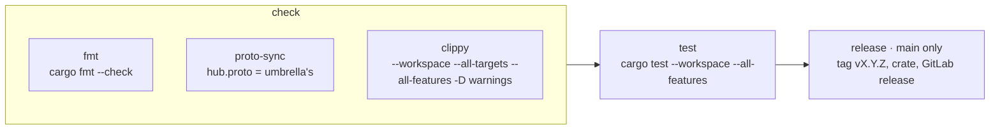

<p align="center">
  
</p>

<h1 align="center">kraken-messaging-rs</h1>

<p align="center">
  The Rust counterpart of kraken-messaging: hub client, events through the outbox to an event store, idempotent event processors, sagas, JWT identity, one builder.
</p>

<p align="center">
  <a href="https://gitlab.damoreira.ml/kraken-org/kraken-messaging-rs/-/pipelines"></a>
  <a href="https://gitlab.damoreira.ml/kraken-org/kraken-messaging-rs/-/releases"></a>
  
  
  <a href="https://gitlab.damoreira.ml/kraken-org/kraken/-/tree/main/docs"></a>
  <a href="LICENSE"></a>
</p>

---

The Rust counterpart of the Kotlin `kraken-messaging` starter. A service built on it is
indistinguishable from a Kotlin one in front of the hub and on the event store: same protocol
(`proto/hub.proto`), same event records (source `kraken.events` by default), same JSON shapes, same error codes. Its state (the outbox,
the processed events, the dead letters, the processor control, the external calls and the sagas) lives in the service's
own database through a message store add-on (ADR 0028): `.store(...)` on the builder; its events go to an event store add-on
(ADR 0027): `.event_store(...)`.

| Crate | What it is |
|---|---|
| `kraken-messaging-rs` (this directory, lib `kraken_messaging`) | the core: hub client, handlers, outbox relay, event processors, sagas, the store interfaces, the in-memory stores and the conformance kits |
| `crates/kraken-messaging-mongo` | the MongoDB message store: the same collections and documents as the Kotlin library's (see [The MongoDB message store](#the-mongodb-message-store)) |
| `crates/kraken-messaging-sqlx` | the SQL message store on PostgreSQL 13+ or MySQL 8.0.17+ (features `postgres`, `mysql`): the same tables as the Kotlin `kraken-messaging-jdbc` (see [The SQL message store](#the-sql-message-store)) |
| `crates/kraken-messaging-kafka` | the Kafka event store, and partner topics as external sources (see [The Kafka event store](#the-kafka-event-store)) |
| `crates/kraken-messaging-rabbitmq` | the RabbitMQ Streams event store (see [The RabbitMQ Streams event store](#the-rabbitmq-streams-event-store)) |

| Capability | Where |
|---|---|
| Register with the hub, handle commands and queries, reconnect with backoff | `hub::HubConnection`, `hub::Dispatcher` |
| Connect to every hub of a list or a DNS name, route and fail over between them | `hub::HubPool` |
| Send commands and queries, typed replies, timeouts, error mapping | `hub::Sender` (`app.commands()`, `app.queries()`) |
| Shared query types and scatter-gather queries | `shared_query`, `Sender::scatter_gather` (see [Scatter-gather](#scatter-gather)) |
| Streaming queries under the caller's credits | `streaming_query`, `Sender::stream` / `stream_owned` (see [Streaming queries](#streaming-queries)) |
| Subscription queries: an initial result, then updates pushed by every owner instance | `subscription_query`, `QueryUpdateEmitter`, `Sender::subscribe` (see [Subscription queries](#subscription-queries)) |
| Publish events through the message store's outbox, relayed to the event store | `events::EventBus`, `events::OutboxPublisher` |
| The event store: one interface, an add-on per broker, a conformance kit | `event_store::EventStore`, `event_store::conformance` (feature `testing`) |
| The message store: one interface per collection, an add-on per database, a conformance kit | `store::MessageStore`, `store::conformance` (feature `testing`) |
| Consume events idempotently (marker + handler in one transaction) | `events::EventConsumer` |
| Named event processors (own subscription, markers, status), dead letters with an admin API | `event_in`, `app.dead_letters()`, `app.processors()` (see [Event processors](#event-processors), [Dead letters](#dead-letters)) |
| Processor control from the hub: pause, resume, reset (replay) with reset handlers, dead letters | `event_with` + `EventOptions::disallow_replay`, `reset_handler`, `app.processor_control()` (see [Processor control](#processor-control)) |
| Identity from the forwarded JWT: JWKS verification or unverified parsing; handler guards | `identity::{IdentityResolver, JwksVerifier, Guard}` |
| Sagas and deadlines on the Kotlin starter's collections, the relay, parked events | `KrakenMessagingBuilder::saga`, `saga::SagaContext`, `app.saga_failures()` (see [Sagas](#sagas)) |
| Idempotent adapters, partner sources (read by an event-store add-on), webhooks; saga statistics | `idempotent_command`, `external_source`, `app.ingress()`, `external::webhook::verify`, `app.saga_stats()` |
| A saga test fixture (feature `testing`) | `saga::testing::SagaTestFixture` |
| In-memory event store and message store: tests, local runs and demos with no infrastructure | `event_store::memory::MemoryEventStore`, `store::memory::MemoryStore`, `testing::InMemoryStores` (feature `testing`; see [In-memory stores](#in-memory-stores)) |
| Metrics through the OpenTelemetry API (outbox, consumed events, processors, hub client, sagas); the application installs the provider | `metrics`, `KrakenMessaging::builder_with_meter`, `saga::OtelSagaMetrics` (see [Metrics](#metrics)) |
| One builder wiring all of it from `KRAKEN_*` variables | `KrakenMessaging`, `Config` |

## Table of contents

- [Usage](#usage)
- [Configuration (`Config::from_env`)](#configuration-configfromenv)
- [Semantics worth knowing](#semantics-worth-knowing)
- [Multiple hubs](#multiple-hubs)
- [Scatter-gather](#scatter-gather)
- [Streaming queries](#streaming-queries)
- [Subscription queries](#subscription-queries)
- [Sagas](#sagas)
- [Event processors](#event-processors)
- [Dead letters](#dead-letters)
- [Processor control](#processor-control)
- [In-memory stores](#in-memory-stores)
- [The MongoDB message store](#the-mongodb-message-store)
- [The SQL message store](#the-sql-message-store)
- [The Kafka event store](#the-kafka-event-store)
- [The RabbitMQ Streams event store](#the-rabbitmq-streams-event-store)
- [Moving from v0.4.0](#moving-from-v040)
- [Security](#security)
- [Metrics](#metrics)
- [Build and test](#build-and-test)
- [Example](#example)
- [CI/CD pipeline](#cicd-pipeline)
- [Contributing](#contributing)
- [License](#license)

## Usage

```rust
use kraken_messaging::{Command, Config, Event, KrakenMessaging, MessagingError, Query, SendOptions, message_type};
use kraken_messaging::identity::Guard;

#[derive(serde::Serialize, serde::Deserialize)]
struct Shout { text: String }
#[derive(serde::Serialize, serde::Deserialize)]
struct Shouted { text: String }
message_type!(Shout, "examples.Shout");            // wire names are always explicit
impl Command for Shout { type Reply = Shouted; }

#[derive(serde::Serialize, serde::Deserialize)]
struct TextShouted { text: String, at: chrono::DateTime<chrono::Utc> }
message_type!(TextShouted, "examples.TextShouted");
impl Event for TextShouted {}

#[tokio::main]
async fn main() -> Result<(), Box<dyn std::error::Error>> {
    // The two add-ons (any message store and any event store will do; see their sections).
    let store = kraken_messaging_mongo::MongoStore::new(client, db);  // the service's own database
    let event_store = kraken_messaging_kafka::KafkaEventStore::new(kraken_messaging_kafka::KafkaConfig::from_env())?;
    let builder = KrakenMessaging::builder(Config::from_env()?).await?
        .store(std::sync::Arc::new(store))                           // outbox, markers, sagas, dead letters
        .event_store(std::sync::Arc::new(event_store));              // where events go and come from
    let events = builder.events();                                   // capture what handlers need
    let app = builder
        .command::<Shout, _, _>(move |cmd, ctx| {
            let events = events.clone();
            async move {
                let text = cmd.text.to_uppercase();
                events.publish(&TextShouted { text: text.clone(), at: chrono::Utc::now() }, Some(&cmd.text)).await?;
                tracing::info!(correlation = %ctx.correlation_id, "handled Shout");
                Ok(Shouted { text })
            }
        })
        .requires::<Shout>(Guard::role("kraken-user"))              // optional, like @RequiresAuthentication
        .start()                                                      // registers in the background
        .await?;
    app.await_hub(std::time::Duration::from_secs(30)).await;
    tokio::signal::ctrl_c().await.ok();
    app.shutdown().await;
    Ok(())
}
```

Handlers are async closures `Fn(Message, MessageContext) -> Future<Result<Reply, MessagingError>>`.
Event handlers receive an `EventContext { message, tx }`: `tx` is the message store's transaction the
consumer opened (`Arc<Mutex<store::Tx>>`), so writes done in it, including
`events.publish_in(&event, key, &mut tx)`, commit together with the dedupe marker; the store add-on gives
the handler its own handle on it (see the add-on's section).

The **message store** (`.store(...)`) keeps the service's state: the outbox, the processed-event markers, the dead
letters, the processor control, the external calls and the sagas. The **event store** (`.event_store(...)`) is where
the outbox relay publishes the events and where the event processors read them. A service of commands and queries
alone needs neither. An event handler, a saga, an idempotent handler or a partner source without a message store
fails `start()` naming it (`... needs a message store: add .store(...)`); an event handler or a saga without an event
store fails it the same way (`... needs an event store: add .event_store(...)`); publishing without either fails
naming the missing one.

Sending: `app.commands().send_command(&cmd, SendOptions::default()).await?` and
`app.queries().send_query(&q, SendOptions { routing_key, timeout, ..Default::default() })`. Inside a handler
the caller's `correlationId` and bearer token are forwarded automatically (task-local
`MessageContext::current()`). So is the handled message's `traceparent` (the trace floor), on the requests sent and the
events published while handling it, when it is a valid W3C one (version `00`, lower-case hex, neither id all zeros;
anything else is dropped): a command or an event a saga dispatches carries the `traceparent` of the event that caused
it (kept in the dispatch entry's headers); one sent by a deadline handler carries none (a deadline keeps no headers).

## Configuration (`Config::from_env`)

| Variable | Default | Meaning |
|---|---|---|
| `KRAKEN_SERVICE_NAME` | required | hub `service_name`, base of every processor's subscription name (`<service>.<processor>`, `default` included), event `source` header |
| `KRAKEN_INSTANCE_ID` | a fresh UUID per `Config` | `Config.instance_id`: the hub `Register.instance_id`, and the `service.instance.id` the application gives its meter provider (see [Metrics](#metrics)); unique among the service's instances (a pod name, for example) |
| `KRAKEN_HUB_ADDRESS` | `static://kraken-hub:7000` | the hub's gRPC target (`static://` optional), a comma-separated list of them, or one `dns:///name:port` re-resolved every 30 s (see [Multiple hubs](#multiple-hubs)); one target is the single-hub setup |
| `KRAKEN_HUB_ENABLED` | true | `Config.hub_enabled`: `false` never connects to a hub (the address must still parse): events, processors, dead letters, sagas and idempotent handlers work, and every command, query and subscription sent fails at once with `HubUnavailable`, those to the service's own handlers included (a sender always goes through the hub); the saga relay still delivers a command type the instance handles to its own handler, and any other saga command goes into the relay's retries. For tests and local runs (see [In-memory stores](#in-memory-stores)) |
| `KRAKEN_HUB_STATUS_INTERVAL_MS` | 5000 | how often `InstanceStatus` goes to every hub (at least 1) |
| `KRAKEN_EVENTS_SOURCE` | `kraken.events` | the event store's source the service publishes to and its processors read (what a source is on each event store: its add-on's section) |
| `KRAKEN_JWKS_URL`, `KRAKEN_ISSUER` | unset | set both to verify forwarded tokens (RS256, `exp`, `iss`); unset = read signed tokens unverified, warned once |
| `KRAKEN_HUB_REQUEST_TIMEOUT_MS` | unset | default request timeout, sent as `timeout_ms` (`SendOptions.timeout` wins per call). Unset: the hub gets `timeout_ms = 0` and applies its per-type override or its default (5 s). `0` counts as unset (here and for `SendOptions.timeout`) |
| `KRAKEN_RECONNECT_BACKOFF_MIN_MS` / `_MAX_MS` | 500 / 5000 | exponential, each wait ±20 % jitter and never above the max (at the max: 80-100 % of it); back to the min once a connect reached the handshake; the min and the max must each be at least 1 ms and the max not below the min (a startup error otherwise) |
| `KRAKEN_MAX_CONCURRENT_HANDLERS` | 256 | handlers run at once, at least 1 (`0` is rejected at startup, also when set in code: `Config::validate`); also the permits offered to the hubs (`Register.initial_permits`), which queue further requests for this instance |
| `KRAKEN_HUB_LOAD_FACTOR` | 100 | `Register.load_factor`: relative capacity; weights this instance's share of keyed commands and its load score. A non-negative integer (a negative value is rejected at startup); `0` is sent as is and read as 100 by the hub |
| `KRAKEN_HUB_TAGS` | none | `Register.tags`, `k=v,k=v`: unkeyed requests prefer instances whose tags match more of the sender's tags |
| `KRAKEN_HUB_PRIORITIES` | none | default `Request.priority` per outgoing type, `type=n,type=n` (higher first while the target's queue at the hub is not empty); `SendOptions.priority` wins |
| `KRAKEN_HUB_RETRY_ENABLED` | false | caller-side retry of transient failures (see Retry): `true` sets `Config.hub_retry` to the policy the variables below describe, `false` leaves it `None` (no retry unless a call sets `SendOptions.retry`, which wins per call) |
| `KRAKEN_HUB_RETRY_MAX_ATTEMPTS` | 3 | attempts in total, the first included; at least 1 (`0` is rejected at startup, also while retry is disabled) |
| `KRAKEN_HUB_RETRY_INITIAL_BACKOFF_MS`, `_MULTIPLIER`, `_MAX_BACKOFF_MS` | 100, 2, 2000 | wait before the second attempt, growth factor (a finite number >= 1, else rejected at startup), cap of one wait; each wait is jittered by ±20 % and never above the cap (at the cap: 80-100 % of it), like the reconnect backoff |
| `KRAKEN_HUB_STREAM_CREDIT_TIMEOUT_MS` | 600000 | how long a streaming query handler waits for credit before it ends its stream with `TIMEOUT` "no credit within <d>" and releases its permits (see [Streaming queries](#streaming-queries)); the default is the hub's default `KRAKEN_HUB_MAX_STREAM_DURATION` (10 min); at least 1 (`0` is rejected at startup, also when set in code) |
| `KRAKEN_HUB_MAX_SUBSCRIPTIONS` | 1024 | the most subscription queries this instance serves at once (see [Subscription queries](#subscription-queries)): a subscription request beyond it is refused with `ReplyEnd{error = RESOURCE_EXHAUSTED}` `subscription limit (N) reached`, which the subscriber sees as `HandlerBusy`; subscriptions hold no handler permit, so this is their only bound here; the hub has its own per-instance limit (`KRAKEN_HUB_MAX_SUBSCRIPTIONS_PER_INSTANCE`, 1024); at least 1 (`0` is rejected at startup, also when set in code) |
| `KRAKEN_HUB_TOKEN` | none | the static access token sent in `Register.credentials.token` on every hub stream (`Config.hub_token`, a `SecretString` whose `Debug` prints `"***"`); needed when the hub runs `KRAKEN_HUB_AUTH_MODE=enforce`, ignored by a hub in `off` mode; an empty value is no token; never logged (see [Security](#security)) |
| `KRAKEN_HUB_TOKEN_FILE` | none | a file holding the token, for container secrets (`Config.hub_token_file`); read at startup (an unreadable file is a startup error) and again before every reconnect, so a rotated secret needs no restart; **wins over `KRAKEN_HUB_TOKEN` when both are set**; surrounding whitespace is trimmed, an empty file is no token at startup, and after a good read it keeps the last token |
| `KRAKEN_HUB_OAUTH2_TOKEN_URI` | none | turns JWT authentication on (`Config.hub_oauth2`): the Keycloak token endpoint, e.g. `https://keycloak/realms/kraken/protocol/openid-connect/token`; needs a client secret and excludes `KRAKEN_HUB_TOKEN` / `KRAKEN_HUB_TOKEN_FILE` (both set is a startup error); see [Authenticating with a JWT](#authenticating-with-a-jwt-keycloak-client-credentials) |
| `KRAKEN_HUB_OAUTH2_CLIENT_ID` | `KRAKEN_SERVICE_NAME` | the Keycloak client id; it must be the service name (the hub checks the token's `azp` against it) |
| `KRAKEN_HUB_OAUTH2_CLIENT_SECRET`, `KRAKEN_HUB_OAUTH2_CLIENT_SECRET_FILE` | none | the client secret (`SecretString`, never logged), or a file holding it, **which wins** and is re-read on every token fetch so a rotated secret applies without a restart; one of them is required with the token URI |
| `KRAKEN_HUB_OAUTH2_SCOPE`, `KRAKEN_HUB_OAUTH2_CA` | none | the `scope` sent with the grant (space-separated as sent); a PEM file with extra root certificates for an `https://` token endpoint, added to the platform roots (not the hub CA of `KRAKEN_HUB_TLS_CA`) |
| `KRAKEN_HUB_TLS` | `false` | `true` makes every hub channel TLS (`Config.hub_tls = Some(HubTls { .. })`), for a static list and for `dns:///`; needed when the hub sets `KRAKEN_HUB_TLS_CERT`. An `https://` address turns TLS on by itself (system roots) |
| `KRAKEN_HUB_TLS_CA` | none (system roots) | PEM file with the CA that signs the hub's certificate (`HubTls.ca_file`), re-read on every connect; needs `KRAKEN_HUB_TLS=true` |
| `KRAKEN_HUB_TLS_SERVER_NAME` | the host of the address (for `dns:///name:port`, `name`) | the name the hub's certificate must carry, also sent as SNI (`HubTls.server_name`); needs `KRAKEN_HUB_TLS=true` |
| `KRAKEN_HUB_TLS_CLIENT_CERT`, `KRAKEN_HUB_TLS_CLIENT_KEY` | none | the client certificate chain (leaf first) and its PKCS#8 PEM private key for mutual TLS (`HubTls.client_cert_file`, `HubTls.client_key_file`); both or neither; **they turn TLS on** like `KRAKEN_HUB_TLS=true` (`KRAKEN_HUB_TLS=false` next to them is an error); exclude `KRAKEN_HUB_TOKEN*` and `KRAKEN_HUB_OAUTH2_*` (one credential kind per service; a startup error naming both); the files are checked at startup. See [Authenticating with a client certificate](#authenticating-with-a-client-certificate-mtls) |
| `KRAKEN_CONSUMER_ENABLED`, `KRAKEN_CONSUMER_MAX_ATTEMPTS` | true, 5 | one consumer per [event processor](#event-processors) with handlers (`default` also for sagas alone); the attempts and the 1 s backoff are shared by every processor |
| `KRAKEN_EVENTS_DEAD_LETTER_MODE` | `collection` | where a record a processor cannot handle goes (see [Dead letters](#dead-letters)): `collection` (`dead_letters`, sequenced per key, admin API), `event-store` (the event store's `<source>.dlt`; needs the capability `native-dead-letter`) or `log` (logged and skipped); case-insensitive, anything else is a startup error |
| `KRAKEN_EVENTS_DEAD_LETTER_RETENTION_MS` | 2592000000 (30 d) | how long a letter is kept (`expire_at` = `parked_at` + this; the message store removes it then, which unblocks its key); at least 1000 (a startup error otherwise, also when set in code) |
| `KRAKEN_OUTBOX_ENABLED`, `KRAKEN_OUTBOX_POLL_INTERVAL_MS`, `KRAKEN_OUTBOX_BATCH_SIZE`, `KRAKEN_OUTBOX_MAX_ATTEMPTS` | true, 200, 100, 10 | |
| `KRAKEN_OUTBOX_LEASE_MS` | 120000 | how long a batch the relay claims stays its own; longer than a send (40 s), else a startup error. A batch stops before its lease could run out under a send; the next claim renews what the relay still holds |
| `KRAKEN_STORE_INIT_SCHEMA` | true | `start()` prepares the message store's schema (its add-on's own: indexes, tables), with the retentions of this table; `false` when it is managed elsewhere |
| `KRAKEN_FORWARD_JWT` | true | |

## Semantics worth knowing

- **Errors** map exactly as `HubErrors.kt`: `NoHandler`, `Timeout`, `HandlerDisconnected`,
  `RemoteHandler`, `Unauthenticated`, `AccessDenied`, `InvalidMessage`, `HubUnavailable`,
  `HubConnectionLost`, `HandlerBusy`. `HandlerBusy` (hub code `RESOURCE_EXHAUSTED`): the hub's
  queue or session buffer for the target instance is full; the handler never saw the request.
  `HubUnavailable`: the request was never written to a live hub stream (no
  stream, or the write failed), so a retry is safe. `HubConnectionLost`: the request was accepted by
  a stream's outbound queue and that stream broke before the answer, so the outcome is unknown (treat
  it like `Timeout`). An unknown code reads as `RemoteHandler`. A handler's
  `Err` becomes `HANDLER_ERROR` unless it is `Unauthenticated`/`AccessDenied`/`InvalidMessage`; a panic
  becomes `HANDLER_ERROR "handler panicked"`, never a dropped stream.
- **Guards** run before the payload is decoded: anonymous → `UNAUTHENTICATED`, refused → `PERMISSION_DENIED`.
- **Unit replies** travel as `{}`; an `Option::None` reply stays `null`.
- **Consumer** (one per [event processor](#event-processors)): one record at a time; marker
  inserted first (a duplicate id never reaches the handler), handlers run, commit, then the record is
  acknowledged to the event store.
  A failing or panicking handler is retried `max_attempts` times with 1 s backoff (a payload the
  event type cannot be read from, `InvalidMessage`, is not retried), then the record becomes a
  [dead letter](#dead-letters) before it is acknowledged (mode `log`: logged at error with its
  source, segment, position and reason, never the payload, and skipped). Records with an unhandled type are
  skipped; records without `type`, or with a non-object payload for a handled type, are INVALID
  letters.
- **Outbox**: `publish` inserts; the publisher relays in `createdAt, seq` order, stops the batch on a
  retriable failure, marks `failedAt` after 10 attempts, or at once when the event store refuses the event for good (too
  large, not authorized, a source it cannot have) or finds it invalid. One publish has 40 s (`OUTBOX_SEND_TIMEOUT`, as the
  Kotlin producer's 10 s + 30 s), then counts as failed. `userId` header is `""` when anonymous.
- **Stored records** keep the Kotlin library's names and values on every message store, so a Kotlin and a Rust
  instance of one service share one store. The service keeps its own database handles: the store is built from them,
  and a transaction passed to `events.publish_in` must be the store's (a handler's own writes go through the store's
  transaction, `EventContext.tx`). `start()` hands the store the builder's clock and prepares its schema
  (`KRAKEN_STORE_INIT_SCHEMA`).
- **Verified identity** checks signature, `exp`, `nbf` and `iss`; `aud` is not validated (Keycloak sets it, Spring's
  decoder ignores it too). A JWKS outage is `UNAUTHENTICATED` for the caller, never an internal error with a URL.
- **Shutdown** first registers no types with every hub and waits for the acks (at most 1 s), so each hub hands the requests it queued for this instance to the other instances at once (as the Kotlin starter does), then drains in-flight handlers (10 s bound; their replies still go through), closes every hub stream, fails this instance's outgoing requests still in flight with `HubConnectionLost`, stops the publisher and the consumer.
- **Start** does not wait for the hub. `await_hub(timeout)` tells you when the registration was
  confirmed by at least one hub (requests can then be sent; before that they fail with
  `HubUnavailable`); `await_all_hubs(timeout)` waits until every hub confirmed it (with
  `dns:///`: every address of the latest resolution; a second target of a hub already reached does
  not count). `app.hub_ids()` lists the hubs registered on now. kraken-messaging (Kotlin) differs
  here: its `HubConnections.awaitRegistered` waits for every hub, like `await_all_hubs`.
- **Handshake**: `Register` carries `client_version = kraken-messaging-rs/<version>`. The hub answers
  every `Register` with a `RegisterAck` (before it echoes the heartbeat that follows), which
  completes the handshake: the client then heartbeats at the announced interval (3 s; the hub
  evicts after 10 s; 3 s before the ack too) and sends `timeout_ms = 0` unless a timeout was
  chosen, guarding locally with the ack's per-type or maximum timeout plus 1 s. A stream without an
  ack within 10 s (`HubSettings.handshake_timeout`) is abandoned and opened again with the normal
  backoff; a heartbeat echo confirms nothing. `HubConnection::handshake()` returns the ack. The
  hub and this library ship together: a hub of another commit is not supported.
- **Flow control** (ADR 0014): `Register` offers `max_concurrent_handlers` permits, `load_factor`
  and `tags`. The hub forwards only while this instance has permits and queues the rest (by
  priority, then age; queued requests keep their own deadline). Every finished request gives its permit back on
  the stream it arrived on. The hub still holds `initial − received + returned` of this stream's
  permits (offered, minus requests that arrived, plus permits written back); once that is at or
  below the low-water mark `min(16, initial / 2)` the pending grants go back at once (with one
  permit, every completion does), otherwise they are batched: one `Permits` message at 16 pending
  grants or 50 ms after the first unsent one. Requests that arrive before the ack follow the same
  rule.
- **SendOptions**: `routing_key`, `timeout`, `authorization`, `priority` (else
  `KRAKEN_HUB_PRIORITIES` for the type, else 0) and `retry` (else `Config.hub_retry`, from
  `KRAKEN_HUB_RETRY_*`). A `RetryPolicy` is in force as written: `RetryPolicy::default()` is 3
  attempts, 100 ms doubling to 2 s; `Some(RetryPolicy::NONE)` (one attempt) switches a configured
  policy off for one call. A policy with `max_attempts: 0` fails the call with `InvalidMessage`
  before anything is sent (`Config::validate` rejects it at startup).
- **Retry** (opt-in: no policy applies unless `Config.hub_retry` or `SendOptions.retry` sets
  one): `retry::is_retryable(kind, &error)` is the one classification (shared with
  the saga relay). Commands retry `HubUnavailable`, `NoHandler` and `HandlerBusy` (the handler never
  ran); queries also `HandlerDisconnected`, `Timeout` and `HubConnectionLost`. A command whose
  outcome is unknown is never retried; nothing else is retried. Each attempt has a fresh request id.
  All attempts share one budget: the caller's timeout, else the hub's bound for the type (override,
  else default; 5 s while no hub has acknowledged this instance yet). A retry starts only if, once its backoff is over, at
  least `max(initial_backoff, 250 ms)` of the budget is left; otherwise the last error is returned
  at once, without waiting. Each attempt sends what is left of the budget as `timeout_ms`, never
  less than 1 ms (a remainder never turns into "unset", which would let the hub apply its default).
- **Liveness**: a stream with no heartbeat echo for three intervals is dropped and reconnected; the
  channel also sends HTTP/2 keepalive pings every 10 s (5 s to answer, also while idle).
- **Replies** go back on the stream the request arrived on; when that stream is gone the reply is
  dropped, never sent on a newer one. The hub has already failed the request with
  `HANDLER_DISCONNECTED`, including when this instance reconnected with the same instance id while
  the old stream was still registered.

## Multiple hubs

High availability without hub-to-hub traffic ([ADR 0016](../kraken/docs/adr/0016-multi-hub-ha-without-hub-to-hub-traffic.md)):
every instance registers on every hub, and the client picks a hub per request.

- **Targets.** `KRAKEN_HUB_ADDRESS=static://hub:7000,hub-2:7000` lists the hubs (blanks and
  repeats of the same target are ignored). `KRAKEN_HUB_ADDRESS=dns:///kraken-hub:7000` connects to
  every address the name resolves to, as `ip:port`, of one family only: the IPv4 addresses when
  there is any, else the IPv6 ones (a dual-stack name lists each hub twice, and two streams of one
  instance on one hub replace each other). It is resolved at start and every 30 s: a new address gets a
  connection, a vanished one leaves the routing at once and gets an empty `Register` (that hub
  stops routing to this instance and hands its queue to other instances; replies to requests it
  already forwarded still go through), and is closed once idle (no request of ours written to it
  unanswered, no handler of its requests running; at most 65 s later). A
  failed or empty resolution keeps the current hubs. `dns:///` must be the only target and needs a
  port; its host may not contain `/`; `dns://server/...` is not supported. An address that names no hub fails `Config::validate`.
- **Connections.** One stream per hub, each with its own handshake, heartbeat and reconnect
  backoff, all with the identical `Register`. Two targets whose acks carry the same
  `hub_id` are one hub: the connection acknowledged first keeps it and the other is closed for
  good (logged once). The hub replaces a session when the same instance registers again, so the
  kept connection reconnects once, and the hub drops the instance until it is back (well under a
  second with the default backoff). A hub whose ack carries an empty `hub_id` (a real hub always
  names itself) is known by its target as `host:port`, the `static://` or `http(s)://` prefix stripped
  (`hub::target_id`, the same rule as kraken-messaging); a resolved address is `ip:port`.
- **Routing.** An unkeyed request goes round-robin over the hubs whose stream is acknowledged
  (reconnecting hubs are skipped). A request with a `routing_key` goes to the live hub with the
  highest rendezvous score, so a key keeps its hub while the hubs are stable and only the keys of a
  hub that leaves move (every hub's ring then picks the same instance):

  ```text
  score(hub_id, key) = fmix64(fnv1a64(utf8(hub_id) ++ [0x00] ++ utf8(key)))
  fnv1a64: h = 0xcbf29ce484222325; for each byte b: h = (h ^ b) * 0x100000001b3   (wrapping)
  fmix64:  k ^= k >> 33; k *= 0xff51afd7ed558ccd; k ^= k >> 33; k *= 0xc4ceb9fe1a85ec53; k ^= k >> 33
  ```

  `hub::rendezvous_score` implements it; test vectors: `("", "")` → `0xb9034ad37056f5fb`,
  `("hub-1", "order-42")` → `0x5c855509f5ad7c8d`, `("hub-2", "order-42")` → `0xd109ca177e04ae14`.
  The finalizer is there because plain FNV-1a sent 80 % of the keys `order-0` … `order-999` to one
  of three hubs.
- **Failover.** A request that could not be written to its hub's stream (the stream dropped
  before the client noticed) goes to the next hub in the same order with the same request id: it
  was never sent. So does one still waiting in the stream's outbound buffer (up to 256 messages)
  when the stream drops: the transport never took it, so it was never written (as in
  kraken-messaging). `HubUnavailable` means no hub took it. A request the transport had already
  taken fails with `HubConnectionLost` when its stream drops (outcome unknown: it may be on the
  wire); the retry policy then decides (queries are retried, commands are not). Replies go on the stream the request arrived on.
- **`NO_HANDLER` failover.** A unary send (a command or a point query; not a scatter-gather,
  stream or subscription) that a hub answers with `NO_HANDLER` was never delivered, so the other
  live, acknowledged hubs get it in turn, each at most once and within the caller's remaining
  timeout; if all decline, the last `NO_HANDLER` comes back at once, with no extra delay. A keyed
  command moves too (its preferred hub has no handler, so affinity cannot be kept anyway), in
  rendezvous order. This is what keeps a single owner instance reachable while it is deregistered on
  one hub, e.g. during a [client certificate rotation](#authenticating-with-a-client-certificate-mtls)
  of the owner. It does not depend on the opt-in retry policy, which may still retry `NoHandler`
  afterwards by its own rules.
- **Permits.** A stream offers `ceil(max_concurrent_handlers / N)` permits, N being the hubs live
  when its `Register` is written, itself included (a hub still on its first connect attempt counts
  as live, so hubs that start together split from the start). When N shrinks from N_old to N_new
  (a hub is lost, its first attempt fails, it is closed as a duplicate or leaves DNS), every live
  stream gets one `Permits` top-up so that it holds `ceil(max / N_new)` in all: with 8 permits and
  two hubs each offers 4, and when one stops the survivor gets `Permits{count: 4, grant: 8}`; the
  grant raises the hub's permit cap on the session (otherwise its `initial_permits`) so the hub
  keeps the top-up. A stream that already
  offered that many (it was topped up before, or opened while another hub was down) gets nothing,
  so flapping hubs never inflate the permits. A joining or returning hub offers `ceil(max / N)`
  afresh. Permits are never revoked when N grows; the local concurrency limit stays
  `max_concurrent_handlers` over all hubs, so a hub may briefly hold more permits than this
  instance runs at once, and the extra requests wait locally (same rule as kraken-messaging).
- **Status.** Every `KRAKEN_HUB_STATUS_INTERVAL_MS` the instance sends `InstanceStatus` to every
  hub: `connected_hub_ids` (the acknowledged hubs), `handlers_in_flight` (handlers running over all
  hubs; a subscription runs no handler and is not counted) and the [event processors](#event-processors)' status. Each hub shows the report in its topology
  (`connectedHubIds`, `statusAgeMs`) and its dashboard flags instances missing a hub.
- **Logs** of each connection carry its `address` (and the `hub` id once acknowledged); its metrics
  are the hub client's in [Metrics](#metrics).

## Scatter-gather

Shared query types and scatter-gather queries ([ADR 0017](../kraken/docs/adr/0017-query-modes-and-shared-query-types.md)),
the counterpart of kraken-messaging's `scatterGather` and `@QueryHandler(shared = true)`.

```rust
use kraken_messaging::hub::{ScatterOptions, ScatterPart, ScatterResult};

// Handler side: several services may own Search. A per-target request has the id `<id>#<n>`
// and is served like any query.
let app = KrakenMessaging::builder(config).await?
    .shared_query::<Search, _, _>(|q, ctx| async move { Ok(Hits { .. }) })
    .start().await?;

// Sender side: every live instance of every owner answers.
let result: ScatterResult<Hits> = app.queries().scatter_gather(&Search { term }, ScatterOptions {
    timeout: Some(Duration::from_secs(2)), // the whole gather; else Config.hub_request_timeout, else the hub's
    max_results: 0,                        // end after this many successful parts (0: all targets)
    priority: None,                        // else KRAKEN_HUB_PRIORITIES for the type, else 0
}).await?;
for ScatterPart { service, instance, outcome } in result.parts { /* arrival order */ }
let (failed, timed_out) = (result.failed, result.timed_out);

// Or part by part, completing on the hub's ReplyEnd:
let mut parts = app.queries().scatter_gather_stream(&Search { term }, ScatterOptions::default());
while let Some(part) = parts.next().await { let part = part?; /* ... */ }
```

| API | Signature |
|---|---|
| Register a shared query | `KrakenMessagingBuilder::shared_query::<Q, F, Fut>(handler) -> Self` (also `HandlerRegistry::shared_query`) |
| Registered types | `HandlerRegistry::query_types()` (every query, exclusive and shared), `exclusive_query_types()`, `shared_query_types()`; `registered_types() -> RegisteredTypes { commands, queries (exclusive), shared_queries }` is what the `Register` announces |
| Gather | `Sender::scatter_gather<Q: Query>(&self, &Q, ScatterOptions) -> Result<ScatterResult<Q::Reply>, MessagingError>` |
| Stream | `Sender::scatter_gather_stream<Q: Query>(&self, &Q, ScatterOptions) -> impl Stream<Item = Result<ScatterPart<Q::Reply>, MessagingError>>` |
| Options | `ScatterOptions { timeout: Option<Duration>, max_results: u32, priority: Option<i32> }` (`Default`) |
| Result | `ScatterResult<R> { parts: Vec<ScatterPart<R>>, failed: u32, timed_out: u32 }` |
| Part | `ScatterPart<R> { service: String, instance: String, outcome: Result<R, RemoteError> }` |
| Part failure | `RemoteError { code: ErrorCode, message: String, details: Vec<u8> }`, `into_error(type)` gives the unary error |

- **Shared registration.** `shared_query` puts the type in `Register.shared_query_types` instead
  of `query_types`. Registering one type both as `query` and `shared_query` panics at startup.
  Exclusive vs shared must be consistent across **every** registrant of the type, in every
  service: the hub answers `ALREADY_EXISTS` at register time to the one that disagrees (the
  connection keeps retrying at the backoff cap, `last_rejection` says why). Switching a type
  between the two needs every registrant gone and the owner grace expired. Commands are never
  shared.
- **Point queries still work.** `send_query` on a shared type goes to one live instance of any
  owner (one round-robin pool over all owners at the hub).
- **Answers.** One part per target answer, in arrival order; a failed target is a part whose
  `outcome` is a `RemoteError` (the handler's error, or `HANDLER_DISCONNECTED`,
  `RESOURCE_EXHAUSTED` from the hub); a reply that does not decode is a failed part with code
  `UNSPECIFIED`. `failed` counts the failed parts, `timed_out` the targets without an answer at
  the deadline. Partial answers are answers: the call succeeds; check `failed + timed_out` for
  "all or error". Payloads use the unary reply codec (`()` accepts `{}`).
- **Errors before any target** are the unary ones: no live target `NoHandler`, a command type
  `InvalidMessage`.
- **Transport.** One gather goes to one hub (unkeyed round-robin). If its
  stream breaks before the end, the gather fails with `HubConnectionLost` (the parts received are
  dropped, none is retried on its own); one never written moves to the next hub like a unary
  request. The local guard (the hub's bound plus 1 s) covers the whole gather (`Timeout`).
  Parts and ends of unknown requests are ignored, and dropping the stream abandons the gather.
- **Retry.** `Config.hub_retry` applies to the whole gather for the same errors as a unary query
  (`HubUnavailable`, `NoHandler`, `HandlerBusy`, `HandlerDisconnected`, `Timeout`,
  `HubConnectionLost`): a retry is a new gather with a fresh id, collected from scratch, within the
  same budget. The stream retries only until its first part; after that an error ends it.

## Streaming queries

A query whose result is a flow of items from one instance of one owner, under the caller's
back-pressure ([ADR 0017, P4b](../kraken/docs/adr/0017-query-modes-and-shared-query-types.md)),
the counterpart of kraken-messaging's streaming query API.

```rust
use futures::StreamExt;
use kraken_messaging::{StreamOptions, StreamingQuery};

#[derive(serde::Serialize, serde::Deserialize)]
struct Export { since: chrono::DateTime<chrono::Utc> }
#[derive(serde::Serialize, serde::Deserialize)]
struct Row { id: String }
message_type!(Export, "files.Export");
impl StreamingQuery for Export { type Item = Row; }

// Handler side: return any `Stream<Item = Result<Row, MessagingError>>`; it is pulled at most
// one item ahead of the sender's credit. An `Err` item ends the stream with that error.
let app = KrakenMessaging::builder(config).await?
    .streaming_query::<Export, _, _, _>(|q, ctx| async move { Ok(rows_since(q.since)) })
    // .shared_streaming_query::<Search, _, _, _>(..)   // many services may own it
    .start().await?;

// Sender side: the open waits for the first item (or the end, or a failure); then pull.
let mut rows = app.queries().stream(&Export { since }, StreamOptions {
    timeout: None,         // idle timeout (hub-side, reset by every part); else Config.hub_request_timeout, else the hub's
    max_results: 0,        // end after this many items (the hub cancels the handler); 0: no limit
    priority: None,        // else KRAKEN_HUB_PRIORITIES for the type, else 0
    initial_credit: 64,    // the credit window; half of it is refilled every time half was consumed
}).await?;
while let Some(row) = rows.next().await { let row = row?; /* in the handler's order */ }

// `stream` borrows the sender: its stream cannot leave the scope of `app.queries()`. For an
// HTTP streaming body or a spawned task, `stream_owned` on the shared sender is `'static`.
let rows = app.sender().stream_owned(&Export { since }, StreamOptions::default()).await?;
tokio::spawn(async move { rows.try_for_each(|row| async { Ok(()) }).await });
```

| API | Signature |
|---|---|
| Trait | `trait StreamingQuery: MessageType + Serialize + DeserializeOwned + Send + Sync + 'static { type Item: Serialize + DeserializeOwned + Send + 'static; }` |
| Register a handler | `KrakenMessagingBuilder::streaming_query::<Q, F, Fut, S>(handler) -> Self` and `shared_streaming_query` (also on `HandlerRegistry`), with `F: Fn(Q, MessageContext) -> Fut`, `Fut: Future<Output = Result<S, MessagingError>>`, `S: Stream<Item = Result<Q::Item, MessagingError>> + Send + 'static` (a `BoxStream` fits) |
| Registered types | `HandlerRegistry::streaming_query_types()` (exclusive and shared); `registered_types() -> RegisteredTypes { commands, queries, shared_queries, streaming_queries }`: `streaming_queries` are the exclusive streaming types, announced in `Register.query_types` with `queries`; a shared streaming type is in `shared_queries` like any shared query (the hub does not tell a streaming type from a unary one: the mode is the sender's choice) |
| Stream | `Sender::stream<Q: StreamingQuery>(&self, &Q, StreamOptions) -> Result<BoxStream<'_, Result<Q::Item, MessagingError>>, MessagingError>` (`async`): the stream borrows the sender |
| Owned stream | `Sender::stream_owned<Q: StreamingQuery>(self: &Arc<Self>, &Q, StreamOptions) -> Result<BoxStream<'static, Result<Q::Item, MessagingError>>, MessagingError>` (`async`): the stream holds a clone of the `Arc<Sender>`, so it can be returned or moved into a task; `KrakenMessaging::sender()` (and the builder's `sender()`) is that `Arc`. Same behaviour otherwise |
| Options | `StreamOptions { timeout: Option<Duration>, max_results: u32, priority: Option<i32>, initial_credit: u32 }` (`Default`: `initial_credit` 64, `hub::DEFAULT_CREDIT`; 0 reads as 64) |
| Errors | `MessagingError::NoHandler`, `InvalidMessage`, `Timeout`, `RemoteHandler`, `HandlerDisconnected`, `HandlerBusy`, `Cancelled` (the hub's max stream duration), `HubUnavailable`, `HubConnectionLost`, `Serialization` |

- **One handler, one instance.** A stream goes to one hub (unkeyed round-robin), which picks one
  instance listing the type as for a point query (on a
  shared type, one pool over every owner). The handler gets `Request{id = <id>#1, mode =
  STREAMING, initial_credit}` and only a streaming handler serves it. A type has one handler,
  whatever its kind, and the mode must match it: a stream to a type whose handler is unary ends
  with `INVALID_REQUEST` ("`<type>` is not a streaming query handler (it answers mode UNARY)"),
  a unary query to a streaming type is answered `INVALID_REQUEST` ("`<type>` is a streaming
  query: send it with Sender::stream (mode STREAMING)"): the caller used the wrong mode, which no
  retry fixes (`InvalidMessage`, never retried), unlike `NoHandler` for a type the instance does
  not serve at all.
- **Credits.** The handler's stream is pulled at most one item ahead of the credit
  (`initial_credit` plus every `Flow`): an item is held until there is credit to send it, one
  `ReplyPart` per item (`seq` from 1); its end (or failure) is sent as `ReplyEnd` as soon as the
  stream reports it, with or without credit, so a sender that grants exactly as many credits as
  there are items gets the end. The sender refills `max(1, initial_credit / 2)` credits every
  time that many items were pulled by the caller (not on arrival), so a handler never runs more
  than a window (plus the held item) ahead of the consumer. Items use the unary reply codec
  (`()` accepts `{}`).
- **Borrow or share.** `stream` returns `BoxStream<'a>` borrowing the `&'a Sender`: the stream
  lives inside that borrow, so it cannot be returned from a handler that only borrowed the app
  (an HTTP streaming body) or moved into `tokio::spawn`. `stream_owned` takes `&Arc<Sender>` and
  returns `BoxStream<'static>` holding a clone of it: the sender outlives the stream, and the
  drop guard (`Cancel` on drop before the end) works the same.
- **Open.** `stream().await` returns once the first item is in (or the end: an empty stream), so
  everything before that is the call's error: `NoHandler` (no owner), `InvalidMessage` (a
  command type), `Timeout` (no first item within the idle timeout), the
  handler's error (`RemoteHandler`, ...), `HubUnavailable` / `HubConnectionLost`.
- **Endings.** The stream ends on the hub's `ReplyEnd`; with an error it is the last item, mapped
  like a unary error of that code: `Timeout` (the idle timeout, from the forward and reset by every
  part), `RemoteHandler` (the handler's `Err` item, or a part beyond the credit: `InvalidMessage`),
  `HandlerDisconnected` (the handler left), `Cancelled` (`KRAKEN_HUB_MAX_STREAM_DURATION`). A hub
  stream lost after the first item is `HubConnectionLost`, a part that does not decode
  `Serialization` (the handler is cancelled). The sender checks for lost parts (the hub drops a
  part it could not buffer within 5 s): `seq` must run 1, 2, 3, ... in arrival order and a clean
  `ReplyEnd.parts` must equal the parts that arrived; otherwise the last item is
  `InvalidMessage` "stream `<type>` lost N part(s)" (at a gap the handler is cancelled, reason
  `lost parts`; a part out of order is `InvalidMessage` too). After `max_results` items the hub ends the stream
  and cancels the handler. The local guard (for a hub that never answers; it cancels the stream,
  best effort) allows 2 x the hub's bound plus 1 s for the first part (the hub bounds a queue
  wait by the timeout and then restarts the idle clock at the forward) and the bound plus 1 s,
  reset by every part, after it.
- **Cancel.** Dropping the stream before its end sends `Cancel{id, "dropped by the sender"}`
  (best effort, from the drop) and forgets the request, also when the open is dropped while its
  write is still blocked. A handler whose stream is cancelled by the hub (the sender dropped it or
  left, `max_results`, the idle timeout, the hub's limits) has its stream dropped and sends
  nothing more; the hub's `Cancel` for a unary or scatter-gather target (a gather that ended
  early) aborts that handler too (a handler whose work must finish once started, say a write
  followed by a publish outside one transaction, should `tokio::spawn` that section and await the
  join handle: the spawned task is not aborted with the handler). When the hub stream a streaming request arrived on is lost,
  its handler is aborted as well (the hub forgot the stream with the session; it would wait for
  credit for ever), while a unary handler runs on with its reply dropped. A handler
  that waits for credit longer than `Config.hub_stream_credit_timeout`
  (`KRAKEN_HUB_STREAM_CREDIT_TIMEOUT_MS`, 10 min: the hub's default maximum stream duration)
  ends its stream with `ReplyEnd{error = TIMEOUT "no credit within <d>"}`: a hub that forgot the
  stream (a race, a lost `Flow` or `Cancel`) cannot leak the handler task. The handler
  permit (`max_concurrent_handlers`, and the hub's) is held for the whole stream and released on
  every ending path.
- **Retry.** `Config.hub_retry` applies until the first item, for the same errors as a unary query
  (`HubUnavailable`, `NoHandler`, `HandlerBusy`, `HandlerDisconnected`, `Timeout`,
  `HubConnectionLost`): a retry is a new stream with a fresh id; a hub stream lost while the
  request still sat in its outbound buffer moves to the next hub with the same id, as a unary
  request. Every attempt sends the chosen idle timeout as is (it is an idle timeout, not a
  deadline: unlike a unary retry, an attempt does not send what is left of the budget); the
  budget only bounds how many attempts there are. Nothing is retried after the first item.

## Subscription queries

A query whose result is an initial value followed by the updates every owner instance pushes,
until the subscriber cancels or the owners complete ([ADR 0017, P4c](../kraken/docs/adr/0017-query-modes-and-shared-query-types.md)),
the counterpart of kraken-messaging's subscription query API.

```rust
use futures::StreamExt;
use kraken_messaging::{SubscriptionOptions, SubscriptionQuery};

#[derive(serde::Serialize, serde::Deserialize)]
struct Prices { symbol: String }
#[derive(serde::Serialize, serde::Deserialize)]
struct Quote { symbol: String, price: u32 }
#[derive(serde::Serialize, serde::Deserialize)]
struct Tick { symbol: String, price: u32 }
message_type!(Prices, "market.Prices");
impl SubscriptionQuery for Prices { type Initial = Quote; type Update = Tick; }

// Handler side: the handler answers the initial result; the updates are pushed through the
// emitter by whatever changes the data. Capture the emitter before `start()`.
let builder = KrakenMessaging::builder(config).await?;
let emitter = builder.emitter();
let app = builder
    .subscription_query::<Prices, _, _>(|q, ctx| async move { Ok(latest_quote(&q.symbol).await?) })
    // .shared_subscription_query::<Prices, _, _>(..)   // many services may own it
    .start().await?;

// ... wherever the data changes (after the commit of the write that changed it):
emitter.emit::<Prices>(|q| q.symbol == "ACME", &Tick { symbol: "ACME".into(), price: 101 });
emitter.complete::<Prices>(|q| q.symbol == "ACME");                       // a clean end
emitter.complete_exceptionally::<Prices>(|_| true, &MessagingError::Storage("feed down".into()));

// Sender side: `subscribe` returns once the initial result is in.
let sub = app.sender().subscribe(&Prices { symbol: "ACME".into() }, SubscriptionOptions {
    timeout: None,        // the initial result's timeout (queue wait + handler); else Config.hub_request_timeout, else the hub's
    max_results: 0,       // end after this many updates (the initial result does not count); 0: no limit
    priority: None,       // the initial request's; else KRAKEN_HUB_PRIORITIES for the type, else 0
    initial_credit: 64,   // the credit window; half of it is refilled every time half was consumed
}).await?;
println!("{}", sub.initial.price);
let mut updates = sub.updates;                      // hot: fed by the hub from the open on
while let Some(update) = updates.next().await { let tick = update?; /* in the hub's arrival order */ }
// `sub.cancel()` (or dropping the subscription, or just its `updates`) cancels it at the hub.
```

| API | Signature |
|---|---|
| Trait | `trait SubscriptionQuery: MessageType + Serialize + DeserializeOwned + Send + Sync + 'static { type Initial: Serialize + DeserializeOwned + Send + 'static; type Update: Serialize + DeserializeOwned + Send + 'static; }` |
| Register a handler | `KrakenMessagingBuilder::subscription_query::<Q, F, Fut>(handler) -> Self` and `shared_subscription_query` (also on `HandlerRegistry`), with `F: Fn(Q, MessageContext) -> Fut`, `Fut: Future<Output = Result<Q::Initial, MessagingError>>`: the handler answers the initial result |
| Registered types | `HandlerRegistry::subscription_query_types()` (exclusive and shared); `registered_types()` has `subscription_queries`, the exclusive ones, announced in `Register.query_types` with `queries`; a shared subscription type is in `shared_queries` like any shared query |
| Emitter | `QueryUpdateEmitter` (`Clone`): `emit<Q: SubscriptionQuery>(&self, filter: impl Fn(&Q) -> bool, update: &Q::Update)`, `complete<Q>(&self, filter)`, `complete_exceptionally<Q>(&self, filter, error: &MessagingError)`. From `KrakenMessagingBuilder::emitter()` (to capture in handlers and in the code that changes the data) or `KrakenMessaging::emitter()`; also `open_subscriptions()` |
| Subscribe | `Sender::subscribe<Q: SubscriptionQuery>(self: &Arc<Self>, &Q, SubscriptionOptions) -> Result<Subscription<Q>, MessagingError>` (`async`): owned, like `stream_owned` (`app.sender()` is the `Arc`); there is no borrowed variant |
| Result | `Subscription<Q> { initial: Q::Initial, updates: BoxStream<'static, Result<Q::Update, MessagingError>> }` with `cancel(self)` |
| Options | `SubscriptionOptions { timeout: Option<Duration>, max_results: u32, priority: Option<i32>, initial_credit: u32 }` (`Default`: `initial_credit` 64, `hub::DEFAULT_CREDIT`; 0 reads as 64; retry: `Config.hub_retry`) |
| Handler limit | `Config.hub_max_subscriptions` (`KRAKEN_HUB_MAX_SUBSCRIPTIONS`, 1024; `Dispatcher::max_subscriptions` when wired by hand) |
| Errors | `MessagingError::NoHandler`, `InvalidMessage`, `Timeout`, `RemoteHandler`, `HandlerDisconnected`, `HandlerBusy`, `Cancelled` (the hub's max duration), `HubUnavailable`, `HubConnectionLost`, `Serialization` |

- **Who is asked.** A subscription goes to one hub (unkeyed round-robin), which asks every live
  instance of every owner (exclusive or shared type) that lists the type, **as they are at the
  open**: an instance
  registering later is not added and one that leaves is not replaced. Updates are delivered
  **at most once** and neither the hub nor this library resubscribes: after a rolling restart a
  subscription listens to fewer instances than serve the type (an update emitted on a new
  instance is lost), and the subscriber only learns of it when the last instance left
  (`HandlerDisconnected`). A subscriber that needs every instance subscribes again.
- **Initial result and updates.** One of these instances, chosen as for a point query, also gets
  `Request{id = <id>#0, mode = UNARY}`: the registered handler answers it like a unary query
  (it holds a handler permit and is bounded by the timeout). Every one of them gets
  `Request{id = <id>#n, mode = SUBSCRIPTION}`, which registers a subscription on it (the decoded
  query, the request id and the arrival stream; no handler runs, no permit is held here or at
  the hub). It is registered as soon as the request is read, before its identity and guard are
  checked: a hub `Cancel` or a lost stream right behind it removes it (nothing is sent), updates
  emitted meanwhile are held and delivered, in order, once it is admitted (dropped when it is
  refused). The sender gets the initial result as `ReplyPart{seq = 1}` and then the updates as
  `ReplyPart{seq = 2, 3, ...}` in the hub's arrival order (the hub renumbers: per-source order
  is kept, there is no order between sources). A unary query to a subscription type (an id
  without the `#0` suffix) is answered `INVALID_REQUEST` ("`<type>` is a subscription query:
  send it with Sender::subscribe"), a subscription request to a type whose handler is unary or
  streaming ends with `INVALID_REQUEST` ("`<type>` is not a subscription query handler (it
  answers mode ...)"): the caller used the wrong mode, which no retry fixes.
  The initial request is recognised by the `#0` suffix of its id alone, which collides with
  scatter-gather (its targets are numbered from `#0` too): a gather of a subscription type sent
  by a raw client would have its target `<id>#0` answered with the initial result. Only raw
  clients can hit it, because the typed APIs never gather a subscription type.
- **Emitting.** `emit` sends one `ReplyPart` (the update serialized with the crate's codec,
  `seq` from 1 per subscription) to every open subscription of `Q` on this instance whose query
  passes the filter, in call order; `complete` a clean `ReplyEnd` and removes it;
  `complete_exceptionally` a `ReplyEnd{HANDLER_ERROR, message}` and removes it. No matching
  subscription: a no-op. A call never waits for the hub stream (one task per subscription
  writes in order). A clean end removes the instance silently at the hub; the last instance's
  clean end completes the subscription for the subscriber. An error end from any instance ends
  the whole subscription with that error (`RemoteHandler`) and cancels the others.
  **There are no transactions to defer to here** (the Kotlin library emits after the commit of
  the surrounding Spring transaction automatically): a handler that writes in a message-store
  transaction must emit after its commit, or subscribers see an update of a write that may roll
  back.
- **Credits and the hub's buffer.** The credit is `initial_credit` plus every `Flow`; the
  initial result takes one, every update one. Updates beyond it wait at the hub, up to
  `KRAKEN_HUB_SUBSCRIPTION_BUFFER` (256) per subscription; one more ends the subscription with
  `ReplyEnd{RESOURCE_EXHAUSTED}`, which `updates` yields as its last item `HandlerBusy` (the
  hub's message, "subscriber buffer (256) exceeded", is logged at debug: the variant carries
  the type). Nothing is relayed to the owners: updates are pushed, and a consumer that falls
  further behind than the buffer resubscribes and gets a fresh initial result. The sender
  refills `max(1, initial_credit / 2)` credits every time that many parts were consumed; the
  initial result counts as consumed (it took a credit, so a window of 1 does not stall).
- **Open.** `subscribe().await` returns once the initial result is in, so everything before
  that is the call's error: `NoHandler` (no owner), `InvalidMessage` (a command type, or a
  handler of another mode), `Timeout` (no initial result within the
  timeout), the handler's error (`RemoteHandler`, ...), `HandlerBusy` (an instance at its
  subscription limit or a full queue), `HubUnavailable` / `HubConnectionLost`. An owner instance
  at its limit refuses its subscription with `ReplyEnd{RESOURCE_EXHAUSTED}` and the hub ends the
  whole subscription with it (the error is the call's, or comes right after the initial
  result). The hub itself refuses a subscription whose target already serves
  `KRAKEN_HUB_MAX_SUBSCRIPTIONS_PER_INSTANCE` (1024), before anything is sent.
- **Endings.** `updates` ends when the last owner instance completed cleanly or `max_results`
  updates were relayed (the hub then cancels the owners); an error is its last item, mapped like
  a unary error of that code: `RemoteHandler` (an owner's `complete_exceptionally`),
  `HandlerDisconnected` (the last owner left), `HandlerBusy` (the buffer), `Cancelled`
  (`KRAKEN_HUB_MAX_SUBSCRIPTION_DURATION`, off by default), `HubConnectionLost` (the hub stream
  was lost), `Serialization` (an update that does not decode; the subscription is cancelled).
  There is no idle timeout and no local guard on updates: a quiet subscription is not a broken
  one. The only local guard is on the initial result (the hub's bound plus 1 s, as for a
  unary request).
- **Lost parts.** As for a stream, `seq` must run 1, 2, 3, ... in arrival order and a clean
  `ReplyEnd.parts` must equal the parts that arrived (the hub's count includes the initial
  result); otherwise the last item is `InvalidMessage` "subscription `<type>` lost N part(s)" and
  the subscription is cancelled at the hub (reason `lost parts`).
- **Cancel.** `Subscription::cancel`, dropping the `Subscription` or dropping its `updates`
  before the end sends `Cancel{id, "dropped by the sender"}` (best effort, from the drop) and
  forgets the request: the hub cancels every owner instance, which removes the subscription.
  The owners also drop a subscription on a hub `Cancel` (the subscriber left, `max_results`, the
  buffer, the hub's limits) and every subscription that arrived on a hub stream that was lost
  (the hub forgot it with the session). A shutdown (`KrakenMessaging::shutdown`) completes the
  subscriptions served here with a clean `ReplyEnd`, best effort and bounded to 2 s.
- **Retry.** `Config.hub_retry` applies until the initial result, for the same errors as a unary
  query (`HubUnavailable`, `NoHandler`, `HandlerBusy`, `HandlerDisconnected`, `Timeout`,
  `HubConnectionLost`): a retry is a new subscription with a fresh id; the timeout bounds the
  initial request like a unary one, so each attempt sends what is left of the call's budget. A
  hub stream lost while the request still sat in its outbound buffer moves to the next hub with
  the same id. Nothing is retried once the initial result is in.
- **Limits.** `Config.hub_max_subscriptions` bounds the subscriptions one instance serves (a
  subscription holds no permit: `max_concurrent_handlers` does not apply to it); beyond it a new
  request is refused with `ReplyEnd{RESOURCE_EXHAUSTED}` `subscription limit (N) reached`. The
  hub's buffer, per-instance limit and maximum duration are its own settings.

## Sagas

Sagas, deadlines and the integration toolkit of ADR 0021 (S2): the model of the Kotlin starter (S1), on the same message
store records (`sagas`, `saga_dispatch`, `saga_dispatch_leases`, `deadlines`, `saga_failures`, `external_calls`, markers in
`processed_events`), so a Kotlin and a Rust instance on one store read each other's. The
programming model, the delivery guarantees and the command-failure taxonomy are in
[kraken/docs/02-messaging.md, "Sagas and deadlines"](../kraken/docs/02-messaging.md#sagas-and-deadlines) (its "Rust"
subsection maps every Kotlin element to this crate); the decisions in
[ADR 0021](../kraken/docs/adr/0021-sagas-in-the-library.md), S2 rulings 47 to 67. The sandbox's banner saga
(`examples/service-c/src/banner.rs`) is a complete example.

A saga is a state type and a definition closure. Handlers are **synchronous** closures that change the state and record
what they want done on the `SagaContext`; the runtime writes the state, the recorded commands and events and the deadlines
in one transaction, and the relay sends them after the commit, in order, with the idempotency key `<sagaId>:<seq>`.

```rust
use kraken_messaging::SagaDefinition;
use kraken_messaging::external::{ExternalRecord, IdempotencyKey, TranslatedEvent};
use kraken_messaging_kafka::{ExternalSource, KafkaExternalSource}; // the partner's topic, read by the Kafka add-on
use serde::de::IgnoredAny;

#[derive(Default, Serialize, Deserialize)]   // stored as its serde_json text; must round-trip from Default
struct Banner { job_id: Option<String>, polls: u32 }

fn banner_saga(d: SagaDefinition<Banner>) -> SagaDefinition<Banner> {
    d.start_on::<TextShouted>("jobId", |e| Some(job_id_of(&e.text)), |s, e, ctx| {
        s.job_id = Some(job_id_of(&e.text));
        ctx.send(&PrintBanner { job_id: job_id_of(&e.text), text: e.text.clone() }, None)?; // after commit
        ctx.schedule_after::<()>(Duration::from_secs(30), "print-timeout", None)?;
        Ok(())
    })
    .on::<BannerPrinted>("jobId", |e| Some(e.job_id.clone()), |_, _, _| Ok(()))
    .ending()                                                       // ends after this handler
    .on_deadline::<IgnoredAny>("print-timeout", |s, _, ctx| {
        ctx.publish(&BannerFailed { job_id: s.job_id.clone().unwrap_or_default(), reason: "TIMEOUT".into() }, None)
    })
    .ending()
    .on_command_failed(|s, e, ctx| {                                 // routed by saga id, no association needed
        ctx.publish(&BannerFailed { job_id: s.job_id.clone().unwrap_or_default(), reason: format!("{:?}", e.reason) }, None)?;
        ctx.end();
        Ok(())
    })
}

let kafka = KafkaConfig::from_env();
let partner = KafkaExternalSource::new("printer-banner", ExternalSource::new("printer.banner.events"), "service-c", &kafka.bootstrap_servers)?;
let app = KrakenMessaging::builder(Config::from_env()?).await?
    .store(Arc::new(store))
    .event_store(Arc::new(KafkaEventStore::new(kafka)?))
    .saga("examples.Banner", banner_saga)
    // The adapter: a command handler made idempotent over external_calls (one call per key).
    .idempotent_command::<PrintBanner, _, _>(IdempotencyKey::default(), false, move |c, ctx| {
        let printer = printer.clone();
        async move { printer.submit(&c, &ctx.headers["idempotency-key"]).await }
    })
    // A partner's Kafka topic: records become local events (never republished to kraken.events).
    .external_source("printer-banner", partner, |record: &ExternalRecord| {
        // Malformed never heals: InvalidMessage skips the record at once (a bare `?` is Serialization, retried first).
        let n: Notification = serde_json::from_slice(&record.payload)
            .map_err(|e| MessagingError::InvalidMessage(format!("not a printer notification: {e}")))?;
        Ok(Some(TranslatedEvent::new(&BannerPrinted { job_id: n.job_id }, Some(n.delivery_id))?))
    })
    .start()
    .await?;

// A webhook: verify the raw body, then hand the event to the ingress (applied once per dedupe key).
if !kraken_messaging::external::webhook::verify(&secret, None, &headers, &body) { return 401; }
app.ingress().accept("printer-banner", &n.delivery_id, &BannerPrinted { job_id: n.job_id }, &HashMap::new()).await?;
```

**The definition.** `start_on::<E>(key, value, handler)` may start an instance (at most one live instance per start
`key = value`); `start_new_on` always starts one; `on` runs on the live instances associated with `key = value`; the
`*_header` forms (`start_on_header`, `start_new_on_header`, `on_header`) read the value from a message header; `.ending()`
marks the handler just added (event or deadline) as ending the saga; `on_deadline::<P>(name, handler)` gets the payload as
`Option<P>` (take `IgnoredAny` when there is none or it is ignored: `()` reads only `null`); `on_command_failed(handler)` gets
the `SagaCommandFailed` of a command the instance sent. Handlers of one event type run **in registration order**. `start()`
refuses (`InvalidMessage` naming `<saga>.<handler>`) a saga without a start handler, two sagas of one name, an empty name,
`.ending()` with nothing before it, two handlers of one deadline, and a state whose `S::default()` does not round-trip
through its JSON text.

**The context.** `saga_id()`, `message()` (the `MessageContext`; for a deadline its id, `deadline:<name>` and the correlation
id of the message that scheduled it), `associate_with`, `remove_association_with` (removing the start association frees the
start key, also from the start handler), `end()`, `send(&command, routing_key)`, `publish(&event, key)`, `schedule_after(duration, name, payload)`,
`schedule_at(time, name, payload)` (both return the deadline id), `cancel(id)`, `cancel_all(name)`; at most 999 messages per
handling of an instance. A published event must serialize to a JSON object the outbox takes (not a unit struct, no
integer above `i64::MAX`; `store::check_outbox_payload`): anything else fails the handler with `InvalidMessage` naming the
event (the relay counts one recorded before as `kraken_saga_command_failures_total{reason="INVALID"}` and gives it up). A handler gets no `Sender` or `EventBus`, and **must not capture one**: it would send inside the
saga's transaction, for a state that may roll back, with no order, retry or idempotency key.

**Handlers block.** A saga handler runs on the consumer's task and holds a tokio worker and the segment while it runs:
keep it to recording. A panic is a handler error: two attempts, then the event is parked in `saga_failures`
(`app.saga_failures()`: `list(type)`, `retry(id)`, `retry_all(type)`, `discard(id)`). A retry of an event whose saga type
does not run in this service (not registered, or `KRAKEN_SAGAS_ENABLED=false`) is refused with `InvalidMessage` and
writes nothing: the event keeps its error and attempts until the type runs again (`retry_all` of such a type: "its
parked events (N) are left as they were"; with nothing parked it returns 0, as in Kotlin).

**Adapters.** `idempotent_command::<C>(key, external_idempotent, handler)` (and `idempotent_event::<E>`, whose body runs inside
the ordinary handlers' transaction: prefer commands for slow calls) records each call in `external_calls`.
`IdempotencyKey::default()` is the `idempotency-key` header the relay sets; `IdempotencyKey::From(|c, ctx| …)` builds one (a
poll puts its attempt in it). Return `MessagingError::RetryableExternal` for a failure a later attempt may cure (nothing
reached the partner, a 5xx, a 429) and `MessagingError::UnknownOutcome` when the call may have happened (the connection broke
after the request went out); never retry inside the handler. With `external_idempotent = true` the partner de-duplicates by
the key, so a call that crashed mid-way is made again after the lease instead of reported as `UNKNOWN_OUTCOME`. Every handler
of a command a saga sends must be idempotent by `idempotency-key`: a crash between sending and marking it sent sends it again.
A call owns its record through a random `owner` token it writes when it inserts the record or takes it over; a call whose
lease ran out never settles, overwrites or deletes the record of a later call, also when the record was reset by a
retryable failure and begun afresh in between (its success is then reported retryable or unknown, never as a success).

**Configuration** (`Config::from_env`, Kotlin's defaults; retentions at least 1 s, intervals at least 1 ms, checked also in a
service without sagas):

| Variable | Default | Meaning |
|---|---|---|
| `KRAKEN_SAGAS_ENABLED` | true | `false` with sagas registered: a warning, and no runtime, relay or scheduler |
| `KRAKEN_SAGAS_MAX_ATTEMPTS` | 5 | attempts of one (event, saga type) on conflicts before it is parked (200 ms doubling to 5 s); a handler error gets two |
| `KRAKEN_SAGAS_ENDED_RETENTION_MS` | 30 d | TTL of ended sagas |
| `KRAKEN_SAGAS_DISPATCH_RETENTION_MS` | 7 d | TTL of dispatched `saga_dispatch` entries |
| `KRAKEN_SAGAS_FAILED_RETENTION_MS` | 30 d | TTL of what failed for good: `saga_dispatch` entries given up on (`failedAt_ttl`) and parked events in `saga_failures` (`lastFailedAt_ttl`, moved on by a retry that fails again); at least 1000 ms |
| `KRAKEN_SAGAS_RELAY_POLL_INTERVAL_MS` | 500 | how often the relay looks for recorded entries |
| `KRAKEN_SAGAS_RELAY_LEASE_MS` | 30000 | one saga's dispatch lease, renewed while a send runs |
| `KRAKEN_SAGAS_RELAY_MAX_ATTEMPTS` | 10 | attempts of a command on transient failures before `EXHAUSTED` |
| `KRAKEN_SAGAS_RELAY_INITIAL_BACKOFF_MS`, `_MAX_BACKOFF_MS` | 1000, 5 min | the relay's backoff (doubling) |
| `KRAKEN_DEADLINES_POLL_INTERVAL_MS` | 1000 | how often due deadlines are looked for |
| `KRAKEN_DEADLINES_LEASE_MS` | 30000 | how long a claimed deadline stays reserved (at least once) |
| `KRAKEN_DEADLINES_RETENTION_MS` | 7 d | TTL of fired and cancelled deadlines |
| `KRAKEN_EXTERNAL_CALLS_LEASE_MS` | 5 min | how long an `IN_PROGRESS` call may take before its outcome is unknown |
| `KRAKEN_EXTERNAL_CALLS_RETENTION_MS` | 30 d | TTL of `external_calls` |

Partner sources (`external_source(name, provider, translator)`, the provider an event-store add-on's, e.g. the Kafka
add-on's `KafkaExternalSource`; an empty or reserved name or two sources of one name fail `start()`) and the webhook
secret are set in code.
`builder.clock(Clock)` replaces the clock of the runtime, the relay, the scheduler, the adapters and the ingress
(`ManualClock` in tests). The runtime, the relay, the scheduler and the gauge sampler run only with a registered saga, the
`external_calls` indexes only with an idempotent handler, a partner consumer per source; `app.ingress()` always exists.
Saga commands to a type the service handles itself go to its own handler without the hub. Shutdown stops the relay, the
scheduler and the sampler first (at most 20 s for the three together), then the rest.

**Deploys and in-flight adapter calls.** At shutdown the relay abandons a send still running after 15 s; the saga's
dispatch lease then lets another instance (or this one, restarted) send the command again with the same key. For a
command delivered to a local idempotent adapter, abandoning the send drops the adapter's future mid-call, so its
`external_calls` record stays `IN_PROGRESS`: the re-send is answered "in progress" (retryable, the relay backs off) until
the record's lease ends (`KRAKEN_EXTERNAL_CALLS_LEASE_MS`, 5 min), and then, without `external_idempotent`, the outcome is
unknown and the saga gets `SagaCommandFailed` with `UNKNOWN_OUTCOME` (with the default settings; a relay whose attempts
run out first reports `EXHAUSTED`). With `external_idempotent` the call is run again after the lease. **Keep an adapter's
I/O timeouts under 15 s**, so its calls finish (or fail cleanly) within a deploy's shutdown.

**Statistics.** `app.saga_stats()` has the Kotlin meters as counters and gauges with the same names and labels
(`kraken.sagas.started{type}`, `kraken.sagas.ended{type}`, `kraken.saga.events{type,outcome}`,
`kraken.deadlines.fired{name}`, `kraken.deadlines.due{name}`, `kraken.external.calls{handler,outcome}`,
`kraken.saga.command.failures{type,reason}`, `kraken.sagas.active{type}`, `kraken.saga.dispatch.pending`): typed reads
(`started`, `ended`, `events`, `deadlines_fired`, `deadlines_due`, `external_calls`, `command_failures`, `active`,
`dispatch_pending`) and `snapshot()`; the same values are exported on the meter (see [Metrics](#metrics)). The two
database-counted gauges are sampled every 15 s. While a saga
handles a message, a `tracing` span `saga` carries `saga_type`, `saga_id` and `correlation_id`.

### Testing a saga

Enable the feature `testing` in your dev-dependencies and drive the definition with events and time, in memory, on the
crate's own runtime (no event store, message store or hub):

```toml
[dev-dependencies]
kraken-messaging-rs = { path = "../kraken-messaging-rs", features = ["testing"] }
```

```rust
use kraken_messaging::saga::testing::SagaTestFixture;

#[test]
fn a_silent_printer_fails_the_banner_after_30_seconds() {
    SagaTestFixture::new("examples.Banner", banner_saga)    // the closure given to builder.saga
        .given_current_time(t0)
        .given_events(&[&shouted("SILENT-1")])               // what these cause is not expected below
        .when_time_elapses(Duration::from_secs(30))          // fires every due deadline at its own time
        .expect_published_events(&[&BannerFailed { job_id: "banner-silent-1".into(), reason: "TIMEOUT".into() }])
        .expect_saga_ended()
        .expect_no_scheduled_deadlines();
}
```

Steps: `given_events`, `given_current_time` (default 2026-01-01T00:00:00Z), `when_event`, `when_event_with_headers`,
`when_time_elapses`, `when_command_failed(&command, reason, message)` (the relay's `SagaCommandFailed` for a command the saga
sent). Expectations: `expect_active_sagas`, `expect_association`, `expect_dispatched_commands`, `expect_published_events`
(several types in one slice: `&[&A { .. }, &B { .. }]`, compared by wire type and JSON), `expect_scheduled_deadline`,
`expect_no_scheduled_deadlines`, `expect_saga_ended`; `store()` reads the documents. A step that fails (a handler error or
panic, a state that does not survive its JSON text) and an expectation that does not hold **panic**, naming the saga; a
failing step leaves nothing behind. The methods are synchronous: call them from a `#[test]` (or from an async test without
holding the fixture across an `.await`).

### Differences from Kotlin

The behaviour is ADR 0021's rulings 1 to 46; where Rust differs, the S2 ruling says why (rulings 47 to 67):

- Sagas are closures registered on the builder (`builder.saga(name, define)`), not scanned `@Saga` classes; the name is
  required.
- Handlers of one event type run in registration order (Kotlin: method-name order).
- Handlers get one `&mut SagaContext`, no bean parameters (closures capture); `send`, `publish` and `schedule_*` return
  `Result`; capturing a `Sender` is forbidden by documentation, not by a startup check.
- A handler error is an `Err` or a caught panic; a synchronous handler also holds a tokio worker.
- Transactions are an explicit `Tx` from a `TxProvider` port; the in-memory ports exist behind the feature `testing`.
- Idempotency keys are `IdempotencyKey::Header` / `IdempotencyKey::From(fn)` instead of SpEL; a store failure before an
  adapter's body ran is `RetryableExternal` (Kotlin: a plain failure); a dropped adapter future leaves its record
  `IN_PROGRESS` until the lease, a panicking one is `FAILED`; an unbound `ExternalCallsHandle` fails at call time (Kotlin
  checks at startup).
- A partner translator is a closure returning `Result<Option<TranslatedEvent>, _>`; `InvalidMessage` skips the record at once.
- Configuration is `KRAKEN_*` environment variables (milliseconds); partner sources and the webhook secret are set in code.
- Metrics go through the OpenTelemetry API (no Micrometer), with the same series; the logging keys are a `tracing` span's fields.
- A deadline's `payloadType` is `std::any::type_name` of its payload (Kotlin: the `@MessageType` name or the FQCN).
- `SagaTestFixture` is in the crate behind a feature (Kotlin: `kraken-messaging-test`) and panics instead of throwing.

## Event processors

Each **event processor** reads the service's events with its own subscription to the event store
(its name `<service>.<processor>`), with its own positions, markers, dead letters and failure domain
(ADR 0022; the Kotlin starter's `@ProcessingGroup`). A slow or failing handler in one processor
never holds another. The event store spreads a processor's segments (its units of order per key)
over the service's instances.

```rust,ignore
let app = KrakenMessaging::builder(config).await?
    .event::<OrderPlaced, _, _>(|e, ctx| async move { /* default */ Ok(()) })
    .event_in::<OrderPlaced, _, _>("projections", |e, ctx| async move { /* its own subscription */ Ok(()) })
    .event_in::<OrderShipped, _, _>("projections", |e, ctx| async move { Ok(()) })
    .start()
    .await?;
```

| Processor | Registered with | Subscription | Markers in `processed_events` | Sagas |
|---|---|---|---|---|
| `default` | `event`, `idempotent_event` | `<service>.default` | `processor:default:<eventId>` | yes |
| `<name>` | `event_in(name, ..)` | `<service>.<name>` | `processor:<name>:<eventId>` | no (stage 1 only) |

- **Names** match `^[a-z0-9][a-z0-9-]{0,47}$` and are not `default`; a violation fails `start()`
  naming the handler (`event handler for <type>: processor name ...`).
- **One event type in several processors**: each gets every record and handles it in its own
  transaction with its own marker; a failure in one does not touch the other.
- **A processor starts only when it has handlers** (`default` also when only sagas run there) and
  `KRAKEN_CONSUMER_ENABLED` is not `false`. Attempts and back-off are the shared consumer settings.
- **A broken subscription** (its `next` fails) is closed and taken again after a backoff (1 s
  doubling to 30 s, reset after a delivery or a stable period); the error shows on the status.
- **Other entry points** (partner sources, the webhook ingress, the relay's `SagaCommandFailed`
  notices) dispatch locally to every processor's handlers, each in its own transaction and marker
  family, and to the sagas once; they are never dead-lettered (their own retry rules stay).
- **External source names** `processor`, `saga`, `ingress` and `failed` are refused (the
  library's own families: the `processor:`, `saga:` and `ingress:` markers and the relay's
  `failed:<entry id>` dedupe ids, which a source's `<source>:...` ids must never look like).

**Moving an existing handler into a named processor runs it again over the whole source.** The
subscription `<service>.<name>` is new, and a new subscription starts at the oldest event the
event store still holds (as `default` on its first run); its markers (`processor:<name>:<eventId>`)
are a new family, so none of those events is a duplicate to it: the handler runs once more for
every event the event store keeps. A projection that rebuilds idempotently may want exactly that; a
handler with effects outside the message store (an email, a payment call) repeats every one of them.
For such code either leave the handler in `default` and put only new handlers in the named
processor, or deploy the new processor paused, [reset](#reset-and-replay) it to `latest` from the
hub and resume it (events published between the reset and the moment the old instances stop are
handled twice, once by the old `default` and once by the new processor, so reset right before the
rollout).

### Status

Every status interval (`KRAKEN_HUB_STATUS_INTERVAL_MS`, 5 s) each instance reports one
`ProcessorStatus` per started processor to every hub (in its `InstanceStatus`). The hub shows them in its topology,
`GET /api/v1/processors` and the dashboard's Processors page. `app.processors()` returns the same
list locally. The status fields are the protocol's of this release: a hub of an earlier release cannot read them.

| Field | Source |
|---|---|
| `name`, `subscription`, `source` | the processor, its subscription's name (`<service>.<processor>`) and the source it reads (`KRAKEN_EVENTS_SOURCE`) |
| `event_store`, `capabilities` | the event store's name (`kafka`, `rabbitmq-streams`, `memory` or a third-party add-on's) and what it offers (`replay`, `browse`, `lag`, `native-dead-letter`) |
| `state` | STOPPED while its consumer does not run (stopping, out of its subscription for a [reset](#reset-and-replay), with `operation_id`, or its reader ended by a panic until the processor is started again); else PAUSED while [paused](#pause-and-resume); else FAILING for 60 s after a record exhausted its attempts, a letter could not be parked (or published to the dead-letter source), or the subscription reported an error; else STARTING before the first assignment and between a revoke and the next assign (an empty assignment counts: such an instance is RUNNING); else RUNNING |
| `segments` | the segments assigned to this instance, in the event store's segment order; per segment `position` (the next position this instance will process; empty when unknown), `committed` (the subscription's committed position; empty when none), `head` (the position of the next event written; empty when unknown), `lag` (between `committed` and `head`, between `position` and `head` without a commit; -1 unknown; never negative) and `replay_until`. Positions are the event store's opaque strings. The subscription keeps them current itself (never a blocking call); the processor copies them every second and after every acknowledgement |
| `processed_total`, `failed_total` | records whose dispatch completed without a stage-1 failure, and records that exhausted their attempts, since start (SEQUENCED and INVALID letters count in neither) |
| `dead_letters` | the processor's letters in the message store, counted at start, every 30 s and right after this instance parked a letter; 0 unless mode `collection` |
| `last_error`, `last_error_at_ms` | `<error variant>: <message>` of the last failure (never the payload), cut at 512 bytes |
| `event_types`, `dead_letter_mode` | the processor's types (`default` with the saga types), sorted; the mode |
| `operation_id` | the reset holding the processor's lock (empty when none) |
| `replaying`, `segments[].replay_until` | a replay range is open and not yet passed on one of its assigned segments; per segment the range's end (empty when none or passed) |

## Dead letters

A record a processor cannot handle is kept, not lost (ADR 0022). `KRAKEN_EVENTS_DEAD_LETTER_MODE`
chooses where it goes:

| Mode | What happens | Sequenced per key | Admin API |
|---|---|---|---|
| `collection` (default) | parked in the message store's dead letters, then the record is acknowledged | yes | `app.dead_letters()` |
| `event-store` | published to the event store's dead-letter source `<source>.dlt` (same key and payload, the original headers plus `kraken-dlt-processor`, `kraken-dlt-reason`, `kraken-dlt-error` (`<type>: <message>`, at most 2000 characters), `kraken-dlt-original-topic`, `-partition`, `-offset`, which carry the source, segment and position); the record is acknowledged once the event store accepted it. Needs the capability `native-dead-letter` (a startup error otherwise); the destination must exist (see the add-on's section) | no | none (the destination is the operator's) |
| `log` | logged and skipped | no | none |

**Reasons** (per processor, stage 1 only; saga failures keep `saga_failures`):

- `HANDLER_FAILED`: the processor's handlers failed on every attempt (`attempts` = the invocations
  made; one for a payload the type cannot be read from).
- `SEQUENCED`: the record's key has an earlier letter in this processor; it is parked
  without running the handlers (`blocked_by` names the key's head letter). **The sagas still see
  it.** A record without a key is never sequenced.
- `INVALID`: no `type` header, or a value that is not a JSON object for a type the processor
  handles. It blocks nothing and can only be discarded. A type no handler of the processor knows
  is skipped, not a letter.

**Guarantees.** A letter is a single insert outside any transaction, keyed
`<processor>:<source>:<segment>:<position>`, so a redelivered record is parked once. **The record
is acknowledged only after the letter exists**: when the message store refuses it the record is not
acknowledged, the subscription hands it out again after a second (`Subscription::redeliver`), so it
comes again about every second (the processor turns FAILING; its segment's later records wait, the
other segments flow, and the instance keeps its subscription however long the outage). The
redelivery parks it without running the handlers again (the failure is remembered while the
segment stays assigned). Sequencing keeps an in-memory set of the parked keys of the
segments this instance holds (loaded on every assignment, added to on every park); a record
whose key is in the set is confirmed against the store first, and a miss (another instance
retried or discarded the letters) removes the key and handles the record normally. **A letter that
expires** (`KRAKEN_EVENTS_DEAD_LETTER_RETENTION_MS`, 30 d; the store removes it at `expire_at_ms`)
**unblocks its key**.

### The admin API

```rust,ignore
use kraken_messaging::processors::{RetryResult, DEFAULT_LIST_LIMIT};

let letters = app.dead_letters();
for letter in letters.list(Some("projections"), DEFAULT_LIST_LIMIT).await? { /* parked_at, then id */ }
let one = letters.get("projections:kraken.events:1:42").await?;           // Option<DeadLetter>
let n = letters.count(None).await?;                                        // every processor
match letters.retry("projections:kraken.events:1:42").await? {
    RetryResult::Retried | RetryResult::Duplicate => {}                    // deleted
    RetryResult::Failed(message) => {}                                     // attempts + 1, kept
    RetryResult::Blocked(head_id) => {}                                    // retry or discard the head first
    RetryResult::NotRetriable | RetryResult::NotFound => {}                // INVALID / no such letter
}
let all = letters.retry_all("projections").await?;                         // RetryAllResult { retried, failed, blocked, skipped }
let gone = letters.discard("projections:kraken.events:1:43").await?;       // true when deleted
```

- **Any instance** of the service serves it, for the processors with handlers there (whether or
  not it consumes); a processor it does not run is an error naming it (`list(None, ..)` and
  `count(None)` cover every letter). In modes `event-store` and `log` every call is an error naming
  the mode.
- **`retry` is exactly-once with respect to the handlers**: the processor's handlers for the type
  run in the marker transaction, and the letter's deletion is in the same transaction, so a
  failure leaves the letter (updated: `attempts + 1`, `error`, `last_attempt_at_ms`, reason
  `HANDLER_FAILED`, no `blocked_by`) and a crash can neither handle it twice nor handle it and keep
  it. One attempt per call, no back-off; the sagas are not re-run (they saw the record when it was
  parked). A marker that exists already is `Duplicate` (the letter is deleted). A letter whose type
  no handler of the processor handles any more is `Failed("no handler for <type> in processor
  <name>")`.
- **`retry_all`** goes per key in position order (keys in their head letters' `parked_at` order), a
  key stopping at its first failure (its later letters count as `blocked`), then the keyless
  letters in `parked_at` order; INVALID letters are `skipped`.
- **`discard`** deletes a letter; discarding a key's head unblocks its next letter.

A letter (`store::DeadLetter`, the same in both libraries): `id`, `processor`, `source`, `segment`,
`position`, `key` (none without one), `event_id`, `event_type` (none when missing), `headers`,
`payload` (the record's bytes), `reason`, `error {type_name, message}`, `blocked_by` (SEQUENCED),
`attempts`, `parked_at_ms`, `last_attempt_at_ms`, `expire_at_ms`, and `replay` (the record was
parked while its processor replayed it; its retry is then a replay too). How a store keeps it is
the add-on's (the MongoDB add-on: the Kotlin `dead_letters` document, see its section).

## Processor control

The hub is the control plane of the event processors (ADR 0023, P6b): its HTTP API and its
dashboard pause, resume and reset a processor on every instance at once and work its dead letters
(see the hub's `hub.md`, "Processor control", for the routes and the write token). Each
`ControlRequest` is handled off the hub stream's
read loop (heartbeats and requests never wait for it), one per processor at a time, answered on the
stream it came on and logged at INFO (`control_id`, processor, action, result). Two never wait
behind a running reset execute of their processor: the renewal of the reset, and the dead letters
(a list is read beside the execute; a retry, retry-all or discard is refused `LOCKED` "processor
'<name>' is executing reset operation <id>; try again when it finished", as in Kotlin). Nothing is configured: no
environment variable, no setting.

**The state lives in the message store** (`store::ProcessorControlStore`, the Kotlin
`processor_control` record), one record per processor, which every instance reads before its
consumer first reads and then every 5 s; a request is the fast path, the poll is how an instance
that missed it (no hub at the time, started later) converges:

```text
{ processor: "audit", paused: false, paused_at, paused_by,
  operation: { id: "<uuid>", kind: "reset", lease_until, prepared_at } | none,
  replay: [ { source: "kraken.events", segment: "0", from: "120", until: "450" } ],
  updated_at }
```

A missing record is a processor that is not paused, not locked and not replaying. When the record
cannot be read at start the consumer does not start (tried again every 5 s), so a paused processor
never consumes because its store was down for a moment.

### Pause and resume

A pause is written to the record (`paused_by` the control id, or `local`), then the processor
pauses its subscription **and keeps calling it**: it stays a member and keeps its segments, and
segments assigned later are paused too. The record being handled finishes; nothing more is
delivered until the resume, which starts where the pause stopped. Status `PROCESSOR_PAUSED`. A
pause outlives the hubs and restarts: a new instance starts paused. Locally:

```rust,ignore
app.processor_control().pause("audit").await?;   // every instance, within its next poll
app.processor_control().resume("audit").await?;
```

The admin API and dead-letter retries keep working while paused, and **local dispatch** (partner
sources, webhooks, the relay's notices) still runs a paused processor's handlers: a pause is about
reading the event store.

### Reset and replay

A reset needs the event store's capability `replay` (without it `reset_prepare` and `reset_execute`
are refused `UNSUPPORTED` before anything changes). It moves the processor's subscription to
`earliest`, `latest`, a time or explicit segment positions, as a **leased operation**: the hub
prepares every instance (each takes the processor's lock in the record, leaves the subscription and
reports `PROCESSOR_STOPPED` with `operation_id`), one instance executes, then every instance is
finished and consumes again (still paused if it was). Leaving the subscription waits until the
consumer closed it (its acknowledgements flushed), so a later start never adds a second reader beside
one still alive. The lock is a 30 s lease the hub renews every 10 s; a hub that dies mid-way stops
renewing, the lease passes and the instances release it and consume again by themselves. An
instance that starts (or polls) while an unexpired lock it was not prepared for is held stays out of
the subscription too. A renewal that arrives after the finish never takes the lock again: an
operation that ended on an instance (finished, aborted, its lease passed, its lock lost) is
remembered for at least max(2 x lease, 60 s), and a prepare of it, or a renewal whose lock is gone,
is `NOT_PREPARED`. A prepare or renewal asking for a lease under 1000 ms is `INVALID` (the executor
extends its lease every half lease, at most every 10 s, and a tiny one would only spin against the
store), as in Kotlin.

The execute asks the event store where the target moves each segment (`earliest` its first
position, `latest` its head, a time the first position at or after it, else the head), refuses
while the subscription has members (`SUBSCRIBERS_ACTIVE`, naming them, nothing changed), and for
every segment whose target is below the subscription's committed position makes a **replay range**
`[target, committed)` (`latest` never makes one). Then, in this order: the processor's reset
handlers, the deletion of its markers in the ranges, the ranges written to the record, the
positions moved by the event store (all or nothing). Right after the reset handlers and again before
the move the executor must still extend its lease (and be within 120 s), else it stops with `FAILED`
"lease lost: ..." before touching markers or positions. **A refusal after the reset handlers ran is
not "nothing changed"**: their effects stay, and the message says what else happened, e.g.
`...; reset handlers ran (2), 37 markers deleted, positions not moved: retry the reset`.

```rust,ignore
use kraken_messaging::processors::{EventOptions, ResetContext};

KrakenMessaging::builder(config).await?
    .event_in::<OrderPlaced, _, _>("projections", |e, ctx| async move { /* replayed */ Ok(()) })
    // Never runs again in a replay: an effect outside the service (Kotlin's @DisallowReplay).
    .event_with::<OrderPlaced, _, _>(
        EventOptions::new().processor("projections").disallow_replay(),
        |e, ctx| async move { send_confirmation(&e).await },
    )
    // Once per reset that replays something, on the executing instance, before markers and
    // positions change (Kotlin's @ResetHandler); an error or a panic refuses the reset before any
    // marker or position changes (what the handlers that ran did stays; the refusal says how many).
    .reset_handler("projections", |ctx: ResetContext| async move {
        clear_projection(&ctx.ranges).await
    })
    .start()
    .await?;
```

- **What a replay runs.** A record of an open range (`from <= position < until` on its segment) runs
  the processor's stage 1 **without the handlers registered with `disallow_replay`** (its marker is
  still written) and **never the sagas** (stage 2 saw it already). Records at or past `until` are
  normal. A replayed record whose key has a parked letter is parked `SEQUENCED` as usual; a reset
  never touches the dead letters. A record parked while it was replayed keeps that in its letter
  (`replay: true`): its retry runs stage 1 without the `disallow_replay` handlers too.
- **Markers carry a position.** Every marker a processor (or a dead letter's retry) writes in
  `processed_events` has `processor`, `source`, `segment` and `position`; a replay deletes exactly
  `{processor, source, segment, position in [from, until)}`. Markers of local dispatch, sagas,
  ingress and failure notices have none.
- **The ranges end.** Once this instance is past a range's `until` on its segment it removes the
  range from the record (on its 5 s poll); status `replaying` and `replay_until` show the ranges
  the subscription's committed position (its position while nothing is committed) has not passed
  yet, so a segment stops replaying as soon as its last replayed record is acknowledged.
- `reset_handler` for a processor without event handlers here fails `start()`.

## In-memory stores

The core ships an event store and a message store that live in the process's memory, for tests,
local runs and single-process demos: no broker, no database, no container. A service asks for them
by code, as for any store; they are never a fallback for a missing one.

```rust
use kraken_messaging::event_store::memory::MemoryEventStore;
use kraken_messaging::store::memory::MemoryStore;

let app = KrakenMessaging::builder(config).await?
    .event_store(Arc::new(MemoryEventStore::default()))
    .store(Arc::new(MemoryStore::new()))
    /* handlers */
    .start()
    .await?;
```

- **Not durable.** Everything is lost when the process ends, and both stores keep everything they
  are given until then (bounding it is the caller's concern). `start()` warns at WARN:
  `in-memory message store: not durable` and `in-memory event store: not durable`.
- **Linear cost.** Nothing is purged, and the message store scans every entry under one lock for
  each relay wake-up and claim: the longer a process runs and the more it relays, the slower each
  pass. Fine for tests, local runs and demos, not for load.
- **One process.** Every clone of a store is the same store: hand clones to the instances of a
  test to make them compete for a processor's segments, or relay one outbox.
- **The event store** (`event_store::memory`) keeps one log per source split into a fixed number of
  segments `0` to `n-1` (`MemoryEventStoreConfig::segments`, 4 by default, 1 to 1024); a key goes
  to segment `FNV-1a 64(key) mod n` (the Kotlin library's too), so a key's events keep their order;
  events without a key go round the segments from `0`. It declares `replay`, `browse` and `lag` (its browser serves the
  `kraken.events.*` queries), not `native-dead-letter`: dead letters stay in the message store
  (mode `collection`). A segment moves to another instance only once the one holding it let it go.
  Its events are stamped with `Clock::tokio()` unless configured otherwise.
- **The message store** (`store::memory`) has real transactions: what a handler writes in its
  transaction is seen by others only at the commit, and nothing of it stays after a rollback. A
  record written by one live transaction is a conflict at once for another, and a commit fails
  when a record it wrote changed meanwhile (`StoreError::Conflict`, retried as a database's write
  conflict); a transaction that ended counts as none. Claims and leases are atomic and run on the
  application's clock (until the builder hands it over, `Clock::tokio()`, which follows paused
  time in tests). Every committed outbox append wakes the relay (`OutboxStore::on_append`), so
  events go out at once. Nothing is ever deleted but dead letters at their `expire_at_ms`.
- Both pass the conformance kits of every add-on (`event_store::conformance`,
  `store::conformance`), with no container.

### Zero-infrastructure tests

With the feature `testing`, `testing::InMemoryStores` builds a service's messaging on both stores,
publishes events to it as another service would, and reads back what it published and its dead
letters:

```rust
let stores = InMemoryStores::new();
let app = stores
    .install(KrakenMessaging::builder(stores.config("orders")).await?)
    .event::<OrderPlaced, _, _>(place_order)
    .start()
    .await?;
let event_id = stores.publish(&OrderPlaced { order: "o-1".into() }, Some("o-1")).await?;
let confirmed: Vec<OrderConfirmed> = stores.wait_published(1, Duration::from_secs(10)).await?;
assert!(stores.processed(&event_id)); // the event's processed marker is committed
let letters = stores.dead_letters().await?;
```

`stores.config(..)` turns the hub off (`Config::hub_enabled = false`, `KRAKEN_HUB_ENABLED=false`
in any service): nothing connects, and every command, query and subscription fails at once with
`HubUnavailable` naming the setting, those to the service's own handlers included (a sender
always goes through the hub); the saga relay still delivers a command type the instance handles
to its own handler, and any other saga command goes into the relay's retries. Events,
processors, dead letters, sagas and idempotent handlers need no hub. `stores.install(..)` makes `Clock::tokio()` the application's clock,
so a test on paused time (`#[tokio::test(start_paused = true)]`) moves the leases, claims and saga
deadlines (a later `.clock(..)` replaces it). `MemoryEventStore::events(source)` and
`MemoryStore::contents()` show what each store holds. `examples/service-c` tests its `audit`
processor this way (`src/audit.rs`).

## The MongoDB message store

The crate `kraken-messaging-mongo` (`crates/`) keeps the message store in the service's own MongoDB
database, in the collections and with the document fields the library has always written and the
Kotlin library writes (`outbox`, `processed_events`, `dead_letters`, `processor_control`,
`external_calls`, `sagas`, `saga_dispatch`, `saga_dispatch_leases`, `deadlines`, `saga_failures`;
BSON types, no `_class`), so existing data stays readable without a migration and a Kotlin and a
Rust instance share one database. Transactions are MongoDB sessions: **the database must be a
replica set** (a single-node one will do).

```rust,ignore
use kraken_messaging_mongo::{MongoStore, MongoTxExt};

// The service builds its client and picks its database; the add-on reads no setting of its own.
let client = mongodb::Client::with_uri_str(&uri).await?;
let db = client.default_database().expect("the URI names a database");
let app = KrakenMessaging::builder(config).await?
    .store(Arc::new(MongoStore::new(client, db)))
    .event_store(events)
    .event::<OrderPlaced, _, _>(|e, ctx| async move {
        // The handler's own writes, in the transaction of the event (with its marker):
        let mut tx = ctx.tx.lock().await;
        orders.insert_one(doc! { "_id": &e.order }).session(tx.session()).await?;
        Ok(())
    })
    .start()
    .await?;
```

- **`MongoStore::new(client, db)`**: the stores over `db`; `client` (the one `db` comes from)
  starts the sessions. Nothing connects before `start()`.
- **`MongoTxExt::session`** gives a handler the `ClientSession` of the transaction it runs in
  (`ctx.tx.lock().await.session()`); it panics on a transaction of another store.
- **Indexes**: `start()` creates them unless `KRAKEN_STORE_INIT_SCHEMA=false`, the TTL indexes with
  the retentions of the `Config` (`KRAKEN_*_RETENTION_MS`); `MongoStore::ensure_indexes(&MongoIndexSettings)`
  does it by hand. Expiry is MongoDB's TTL monitor (about every 60 s).
- **Times** the store stamps itself (an outbox entry's `sentAt`, `failedAt` and lease) are the
  application's clock (the builder's), never the database's.
- **A dead letter** is the Kotlin document (contract fixtures in `tests/fixtures/dead_letters_contract`):
  `_id`, `processor`, `topic`, `partition` (Int32), `offset` (Int64) for the letter's source, segment
  and position, `key` (absent without one), `eventId`, `eventType` (absent when missing), `headers`,
  `payload` (UTF-8 text) or `payloadBinary` (BinData, when not UTF-8; neither when empty), `reason`,
  `error {type, message}`, `blockedBy` (SEQUENCED), `attempts` (Int32), `parkedAt`, `lastAttemptAt`,
  `expireAt`, and `replay: true` when parked during a replay (absent otherwise). Indexes:
  `dead_letters_processor_key_offset`, `dead_letters_processor_parked`, `dead_letters_expire` (TTL,
  `expireAfterSeconds: 0`).
- **Markers and replay ranges** keep the Kotlin field names too: a marker's position is `topic`,
  `partition` (Int32) and `offset` (Int64), a replay range in `processor_control` is
  `{ topic, partition, from, until }` (numbers when they are decimal, as Kafka's are, strings
  otherwise).

Tests: `crates/kraken-messaging-mongo/tests/conformance.rs` runs the message-store conformance kit
on a MongoDB replica set container; the core's container-backed tests run on it too.

## The SQL message store

The crate `kraken-messaging-sqlx` (`crates/`, on `sqlx`) keeps the message store in the service's own PostgreSQL (13 or
later, feature `postgres`) or MySQL (8.0.17 or later, InnoDB, a STRICT `sql_mode`, feature `mysql`) database, in the tables
the Kotlin module `kraken-messaging-jdbc` writes, with the same values and meanings: a Kotlin service and a Rust service can
share one database. The schema files (`db/kraken/<dialect>/V1__kraken.sql`) are the Kotlin module's, byte for byte.
One database (or schema) holds one logical service: its instances, Kotlin or Rust; two different services keep separate
ones (markers, processor control, dead letters and claims carry no service name).

```rust
let pool = sqlx::postgres::PgPoolOptions::new().max_connections(10).connect(&url).await?;
let app = KrakenMessaging::builder(config).await?
    .store(Arc::new(SqlxStore::postgres(pool).with_settings(SqlxSettings::from_env()?)))
    .event_store(events)
    // the service's handlers; a handler writes its rows in the transaction of the message it handles:
    // sqlx::query(..).execute(ctx.tx.lock().await.connection::<sqlx::Postgres>())
    .start()
    .await?;
```

Its settings (`KRAKEN_STORE_SQL_NOTIFY`, `KRAKEN_STORE_SQL_PURGE_INTERVAL_MS`), the schema and its version rule, the
minimum versions, transactions, the PostgreSQL wake-up, the purge and the limits are in
[crates/kraken-messaging-sqlx/README.md](crates/kraken-messaging-sqlx/README.md); `examples/orders-sql` is a small service
on it.

## The Kafka event store

The crate `kraken-messaging-kafka` (`crates/`, on `rdkafka`, librdkafka built from source) is the
event store on Apache Kafka, with the layout on the wire the Kotlin starter writes: a source is a
topic (`kraken.events` by default), a segment a partition, a position an offset (both in decimal),
a processor's subscription its consumer group `<service>.<processor>`; the event's headers are the
record's headers, its key the record's key, its payload the record's value. It declares all four
capabilities: `replay`, `lag`, `browse` and `native-dead-letter` (`<topic>.dlt`).

```rust,ignore
use kraken_messaging_kafka::{KafkaConfig, KafkaEventStore};

let kafka = KafkaConfig::from_env();               // KRAKEN_KAFKA_BOOTSTRAP, KRAKEN_KAFKA_PROPERTY_*
let app = KrakenMessaging::builder(config).await?
    .event_store(Arc::new(KafkaEventStore::new(kafka)?))
    .store(store)
    /* handlers */
    .start()
    .await?;
```

| Variable | Default | Meaning |
|---|---|---|
| `KRAKEN_KAFKA_BOOTSTRAP` | `kafka:19092` | the bootstrap servers (`bootstrap.servers`); a blank value is the default |
| `KRAKEN_KAFKA_PROPERTY_<NAME>` | none | one librdkafka property for every client the store creates: `<NAME>` in lower case, `_` for `.` and `__` for a literal `_` (`KRAKEN_KAFKA_PROPERTY_SECURITY_PROTOCOL=SASL_SSL` is `security.protocol`, `KRAKEN_KAFKA_PROPERTY_SASL_MECHANISM=SCRAM-SHA-512` is `sasl.mechanism`, `KRAKEN_KAFKA_PROPERTY_LOG__LEVEL=6` is `log_level`); values never appear in `Debug` output or logs |

- **`KafkaConfig`**: `KafkaConfig::new(bootstrap)` or `from_env()`, then `property` (every client),
  `producer_property`, `consumer_property` (they override the environment's for their clients; a
  later one of the same name replaces an earlier one) and `browse(BrowseSettings)` (the browser's
  topics and bounds). The keys the store sets itself (`bootstrap.servers`, `group.id`,
  `enable.auto.commit`, the deserializers) are refused when the store or browser opens.
- **TLS** (`security.protocol` `SSL` or `SASL_SSL`) needs the cargo feature **`ssl`** of the crate
  (`kraken-messaging-kafka = { ..., features = ["ssl"] }`), which builds librdkafka with a vendored,
  statically linked OpenSSL (no system OpenSSL at run time, so a distroless image works). Without
  it a configuration asking for TLS is refused when the store or browser opens, naming the feature.
- **Partitions follow the Java client.** The producer sets librdkafka's
  `partitioner=murmur2_random` (`DEFAULT_PARTITIONER`), the Java client's default (murmur2 of the
  key, positive, modulo the partition count; an event without a key on a random partition), so one
  key from a Kotlin and a Rust publisher lands on one partition and keeps its order across both.
  `KRAKEN_KAFKA_PROPERTY_PARTITIONER` (or `producer_property("partitioner", ..)`) chooses another.
- **Publishing** is the idempotent producer (`enable.idempotence`), one send in at most 40 s
  (`SEND_TIMEOUT`); a record too large, a topic that cannot exist or a refused authorization is
  given up by the relay at once.
- **Subscriptions** are consumers of the processor's group (`auto.offset.reset=earliest`: a new
  group starts at the oldest offset the topic holds); an acknowledgement commits the offset after
  the record, a close commits them all before leaving the group. The status's `committed` and
  `head` (the high watermark) are read every 5 s (`OFFSETS_REFRESH`) on a blocking thread, so a
  busy handler or a slow broker never stalls the consumer task or the hub stream.
- **A reset** commits the group's new offsets with a consumer of the group that never subscribes
  (rdkafka has no admin call for it), which the broker refuses while the group has members. Outside
  the hub, a group can be moved with Kafka's own tools while no member runs, e.g. to start a new
  processor at the end of the topic:
  `kafka-consumer-groups --bootstrap-server <broker> --group <service>.<name> --topic <events topic> --reset-offsets --to-latest --execute`.
- **Dead-letter mode `event-store`** produces to `<topic>.dlt`: the topic must exist, or broker
  auto-creation must be on.
- **`KafkaBrowser::open(&config)`** builds the event browser alone (no producer): what a program
  that only reads the event store needs, e.g. the `kraken-event-browser` binary. `KafkaEventStore::browser()`
  is the same browser inside a store; it never joins a consumer group of its own.
- **Partner topics** as external sources: `KafkaExternalSource::new(name, ExternalSource::new(topic),
  service_name, &kafka.bootstrap_servers)?` is a provider for `builder.external_source(name, provider,
  translator)`. Its group is `<service>.external.<name>` unless `group_id` says otherwise,
  `bootstrap_servers` default to the service's own Kafka, `properties` are extra consumer properties
  (never one of the fixed keys); its records are acknowledged after the core dispatched them, and
  their dedupe id is `<name>:<partition>:<offset>` unless the translation carries a key.

Tests: `crates/kraken-messaging-kafka/tests/conformance.rs` runs the event-store conformance kit on
`apache/kafka`; `tests/browser.rs` the browser; `tests/partitioner.rs` pins keys to the partitions
the Java client gives them.

## The RabbitMQ Streams event store

The crate `kraken-messaging-rabbitmq` (`crates/`) is the event store on **RabbitMQ 3.13 or later
with the stream plugin** (`rabbitmq_stream`), through the stream protocol (port 5552, 5551 with
TLS). It reads and writes the same streams as the Kotlin module `kraken-messaging-rabbitmq`; its
crate docs give the whole layout on the wire.

```rust,ignore
use kraken_messaging_rabbitmq::{RabbitConfig, RabbitEventStore};

// `open` asks the management API (when configured) once: it must answer, and with its metrics
// off no reset is offered. `new` connects nothing.
let events = RabbitEventStore::open(RabbitConfig::from_env()?).await?;
let app = KrakenMessaging::builder(config).await?
    .event_store(Arc::new(events))
    .store(store)
    /* handlers */
    .start()
    .await?;
```

**Create the streams first** (the library never creates them): the source as a super stream,
with as many partitions as the instances should share (six by default, as Kafka's topic), and
its dead-letter stream when the dead-letter mode is `event-store`:

```bash
rabbitmq-streams add_super_stream kraken.events --partitions 6
rabbitmq-streams add_stream kraken.events.dlt
```

A missing super stream fails the publish (retried by the outbox relay) and the processors'
subscriptions (retried after a backoff), naming the command above.

**What it covers.** Events go to the super stream's partitions by key (the stream clients' hash
routing: the same partition as the Java client's), unkeyed events by their id; a processor
`<service>.<processor>` is a single active consumer of that name on every partition, so the
broker spreads the partitions over the instances; offsets are tracked on the server under that
name; headers are AMQP application properties; dead letters go to the stream `<source>.dlt`.
`browse`, `lag` and `native-dead-letter` are always declared; **`replay` only with the
management API** (`KRAKEN_RABBITMQ_MANAGEMENT_URL`, plugin `rabbitmq_stream_management`): a reset
is refused while an instance reads the processor, and only the management API can tell. Without
it, a reset is answered `UNSUPPORTED`. The management API lists a consumer only after its next
metrics collection (about every 5 s): an instance in another process that subscribed within the
last seconds can be missing from a reset's members check (this process's own subscriptions are
always counted), so stop every instance and wait a few seconds before a reset.

| Variable | Default | Meaning |
|---|---|---|
| `KRAKEN_RABBITMQ_HOSTS` | `rabbitmq` | nodes to connect to first, `host` or `host:port`, comma-separated, tried in order (then each stream's leader as the broker advertises it) |
| `KRAKEN_RABBITMQ_PORT` | 5552 (5551 with TLS) | the port of a host given without one |
| `KRAKEN_RABBITMQ_VIRTUAL_HOST` | `/` | |
| `KRAKEN_RABBITMQ_USERNAME` | `guest` | |
| `KRAKEN_RABBITMQ_PASSWORD` / `_PASSWORD_FILE` | `guest` | the password, or a file holding it (the file wins when both are set, as for the core's `_FILE` settings); never logged |
| `KRAKEN_RABBITMQ_TLS` | false | TLS (rustls, no OpenSSL) to every node |
| `KRAKEN_RABBITMQ_TLS_CA_FILE` | none | PEM CA certificates the nodes are verified against; required with TLS (the store never connects unverified) |
| `KRAKEN_RABBITMQ_LOAD_BALANCER` | false | the hosts are a load balancer: connect through it until it lands on the node needed |
| `KRAKEN_RABBITMQ_CONFIRM_TIMEOUT_MS` | 30000 | the longest a publish waits for the broker's confirm; a connection that confirms nothing in time is replaced |
| `KRAKEN_RABBITMQ_OFFSET_STORE_MESSAGES` | 10000 | a processor stores its position every so many acknowledgements... |
| `KRAKEN_RABBITMQ_OFFSET_STORE_INTERVAL_MS` | 5000 | ...or this often, whichever first, and always when a partition moves away and at shutdown (every stored position is an entry in the stream) |
| `KRAKEN_RABBITMQ_MANAGEMENT_URL` | none | the management API (`http://rabbitmq:15672`, no credentials in the URL): declares `replay`, shows live subscriptions; metrics collection must be on (neither `management.disable_stats` nor `management_agent.disable_metrics_collector`) |
| `KRAKEN_RABBITMQ_MANAGEMENT_USERNAME` / `_PASSWORD` / `_PASSWORD_FILE` | the stream user's | the management API's own login; its password file wins over its password, too |
| `KRAKEN_RABBITMQ_MANAGEMENT_CA_FILE` | none | PEM CA certificates of an `https` management API |
| `KRAKEN_RABBITMQ_KNOWN_SUBSCRIPTIONS` | none | subscription names the event browser's lag view always lists |

The source and its dead-letter source are the core's settings (`KRAKEN_EVENTS_SOURCE`,
`<source>.dlt`), as for every event store.

**Wire rules shared with the Kotlin module** (the crate docs give the whole layout): a
processor's stored position is the **next offset to read** (never the "last processed" offset:
a reset to 0 must be expressible), a consumer with none starts at the first offset; every
consumer carries the property `kraken-member`; producers **never** use sub-entry batching or
compression on kraken streams.

**Limits, and what differs from Kafka:**

- A processor's redelivery (an event it could not finish) cannot seek a single active consumer in
  place: the subscription keeps what it handed out and has not acknowledged, and hands it out
  again.
- A stream's offsets also number its offset-tracking entries (every stored offset takes one), so
  positions have gaps, and a lag counts offsets for what a processor has not received yet: it may
  overstate a lag that is not received yet (what was received and not acknowledged is counted one
  by one).
- The stream's first offset and head are read from its first and last chunk (the Rust client has
  no `StreamStats`); a stream is empty only when both reads stay silent for 1.5 s (one answering
  and the other not is an error, never an empty or shortened stream).
- Partitions are read when a processor subscribes: a partition added later is read once the
  instances subscribe again (a restart); publishing reads them again every 30 s.
- No producer deduplication: an event the outbox publishes again after a crash is a duplicate,
  which the processed-event markers skip. Each publish waits for the broker's confirm, one
  event at a time (the relay publishes sequentially), so the relay's rate is one confirm round
  trip per event: the latency to the stream's leader and the broker's write time decide it
  (about 1 700 events/s against a local broker; consuming reaches about 6 700/s). A publisher
  connection that confirms nothing within `KRAKEN_RABBITMQ_CONFIRM_TIMEOUT_MS` (30 s) is
  replaced. An event over the 1 MiB frame, or refused for access, is given up at once.
- After a crash up to 10 000 events or 5 s per partition are delivered again (the position is
  stored periodically; the processed-event markers skip them), and the event browser's lag view
  trails by as much.
- Stalls: a consuming connection that stops reading is found within about 20 s, and its
  partitions are free for another instance within about 40 s; a broker answering slower than
  10 s fails every request (subscriptions are taken again after the backoff, the relay
  retries), nothing is lost.
- The event browser's lag view lists the subscriptions this process subscribed, the ones the
  management API shows reading, and `KRAKEN_RABBITMQ_KNOWN_SUBSCRIPTIONS` (the stream protocol
  cannot list the names with a stored offset).
- The client's TLS uses the process's rustls provider: the add-on installs `ring` when none is
  installed.

Tests: `crates/kraken-messaging-rabbitmq/tests/conformance.rs` runs the event-store conformance kit
on `rabbitmq:4.4.0-management` (stream and management plugins), with and without the management
API; `tests/offsets.rs` pins the offset-tracking rules; `tests/throughput.rs` measures publishing
and consuming 10 000 events; `tests/e2e.rs` runs a service of two instances against the hub image
(outbox, competing instances, pause and resume, a reset through the hub, a dead letter in the
dead-letter stream).

## Moving from v0.4.0

v0.4.0 had Kafka and MongoDB built in; both are now add-ons a service chooses in code (ADR 0027,
ADR 0028). The data stays readable without a migration on MongoDB and Kafka: the collection names
and document fields, the outbox layout, the dead-letter ids (`<processor>:<topic>:<partition>:<offset>`),
the marker ids (`processor:<name>:<eventId>`), the topic `kraken.events`, the consumer groups
`<service>.<processor>` and the record headers are unchanged. There are no compatibility aliases.

**Dependencies.** Add the two add-ons from the same repository and tag as the core, and the MongoDB
driver the service now builds its client with:

```toml
kraken-messaging-rs    = { git = "https://gitlab.damoreira.ml/kraken-org/kraken-messaging-rs.git", tag = "vX.Y.Z" }
kraken-messaging-mongo = { git = "https://gitlab.damoreira.ml/kraken-org/kraken-messaging-rs.git", tag = "vX.Y.Z" }
kraken-messaging-kafka = { git = "https://gitlab.damoreira.ml/kraken-org/kraken-messaging-rs.git", tag = "vX.Y.Z" }
mongodb = "3.9.1"
```

**The builder.** The service builds both stores and hands them over:

```rust,ignore
let client = mongodb::Client::with_uri_str(&mongodb_uri).await?;   // KRAKEN_MONGODB_URI is no longer read
let db = client.default_database().expect("the URI names a database");
let app = KrakenMessaging::builder(Config::from_env()?).await?
    .store(Arc::new(kraken_messaging_mongo::MongoStore::new(client, db)))
    .event_store(Arc::new(kraken_messaging_kafka::KafkaEventStore::new(kraken_messaging_kafka::KafkaConfig::from_env())?))
    /* handlers as before */
    .start()
    .await?;
```

**Removed or renamed API:**

- `Config::new(service, hub, kafka_bootstrap, mongodb_uri)` is `Config::new(service, hub)`; the
  fields `kafka_bootstrap`, `kafka_topic` and `mongodb_uri` are gone (`events_source` replaces
  `kafka_topic`; the servers are the Kafka add-on's `KafkaConfig`, the database the service's own
  client).
- `KrakenMessaging::client()` / `database()` and `KrakenMessagingBuilder::client()` / `database()`
  are gone: the service keeps the client it built the store from.
- The module `kafka` is `events` (`EventBus`, `OutboxPublisher`, `EventConsumer`, `classify`, the
  dispatch types); `kafka::headers` is `event_store::headers`; `kafka::ensure_indexes` is
  `MongoStore::ensure_indexes` (or `KRAKEN_STORE_INIT_SCHEMA`); `OutboxDocument` and
  `new_outbox_document` are `store::OutboxEntry` and `events::new_outbox_entry`.
- `EventContext.session` (a `ClientSession`) is `EventContext.tx` (`Arc<Mutex<store::Tx>>`): a
  handler's own MongoDB writes take `MongoTxExt::session` (`ctx.tx.lock().await.session()`), and
  `events.publish_in(&event, key, &mut tx)` takes the store's `Tx`.
- `builder.external_source(name, ExternalSource, translator)` is
  `builder.external_source(name, provider, translator)`; `ExternalSource` moved to
  `kraken_messaging_kafka`, and the provider is `KafkaExternalSource::new(name, source, service_name,
  &kafka.bootstrap_servers)?` (see [The Kafka event store](#the-kafka-event-store)).

**Settings** renamed, with no alias (each one still set is a WARN at `start()` naming its
replacement; its value is ignored):

| v0.4.0 | Now |
|---|---|
| `KRAKEN_KAFKA_TOPIC` | `KRAKEN_EVENTS_SOURCE` |
| `KRAKEN_KAFKA_DEAD_LETTER_MODE` (`collection`, `topic`, `log`) | `KRAKEN_EVENTS_DEAD_LETTER_MODE` (`collection`, `event-store`, `log`) |
| `KRAKEN_KAFKA_DEAD_LETTER_RETENTION_MS` | `KRAKEN_EVENTS_DEAD_LETTER_RETENTION_MS` |
| `KRAKEN_MONGODB_URI` (required) | not read: the service builds its MongoDB client itself |
| `KRAKEN_KAFKA_BOOTSTRAP` | unchanged, now read by `KafkaConfig::from_env` (same default `kafka:19092`) |

New settings: `KRAKEN_HUB_ENABLED`, `KRAKEN_OUTBOX_LEASE_MS`, `KRAKEN_STORE_INIT_SCHEMA` (core);
`KRAKEN_KAFKA_PROPERTY_<NAME>` (Kafka add-on); the RabbitMQ (`KRAKEN_RABBITMQ_*`) and SQL
(`KRAKEN_STORE_SQL_*`) add-ons' own.

**Behaviour to plan for:**

- **Metrics**: `kraken_processor_lag` is labelled `segment` (was `partition`; same values on
  Kafka); dashboards and alerts that name the label change.
- **Status**: the processor status is the protocol's new shape (`subscription`, `source`,
  `segments[]`, `event_store`, `capabilities`): the hub must be of the matching release.
- **Partitions**: the Kafka add-on now partitions keys as the Java client does (`murmur2_random`);
  v0.4.0 used librdkafka's default (`consistent_random`). After the upgrade a key may go to another
  partition than its earlier events: if strict order per key across the upgrade matters, let the
  processors drain their lag (stop publishing, wait for lag 0) before rolling out.

## Security

Access control and TLS for the hub connection (roadmap P5a, hub ADR 0018). Everything here is opt-in
and the hub decides: against a hub in `KRAKEN_HUB_AUTH_MODE=off` (the default) the token is ignored
and nothing changes.

**Token.** Set `KRAKEN_HUB_TOKEN` (or `Config.hub_token`) to the service's static token. It is sent in
`Register.credentials.token` of every stream to every hub, and nowhere else. It is never logged:
`Config`'s and `HubSettings`' `Debug` print `"***"`, and the error and log lines about it carry the
path or the code, not the value. An empty token is no token. Generate one per service with
`openssl rand -hex 32`; the hub's ACL holds only its SHA-256 (`kraken-hub acl hash -`).

**Token file.** `KRAKEN_HUB_TOKEN_FILE` (or `Config.hub_token_file`) names a file with the token, the
way container secrets arrive (`/run/secrets/...`). It is read at startup (unreadable is a startup
error, `Config::validate`) and **again before every reconnect**: rotate the secret, and the next
attempt uses it, no restart. If both settings are set **the file wins**. If the file cannot be read
later (a secret mid-swap) the last token read from it is kept and a warning logged. The same holds
for a file that is **empty after a good read** (a non-atomic rotation caught between the truncate and
the write): the last good token is kept and one warning logged until a good read follows. At
startup an empty file still means no token. Prefer an atomic swap (write a new file, rename it over
the old one) all the same.

**Rejections.** In `enforce` mode the hub closes the stream of a service it refuses: `UNAUTHENTICATED`
(no token, an unknown token) or `PERMISSION_DENIED` (the token is for another service name, or the
`Register` lists a command, query or shared query type outside the token's `handle` patterns, which
the message names). A `Register` whose **instance id is held by a session of another service** is
also `PERMISSION_DENIED` (`instance id 0190abcd belongs to another service`); the hub refuses that in
`permissive` mode too, and the holder keeps its session, so give every instance a unique id (the
default is a random UUID). Like `ALREADY_EXISTS` and `INVALID_ARGUMENT` before, these are registration
rejections, not outages:

- `HubConnection::last_rejection()` holds the hub's message (until a stream registers, which clears
  it); the application reads it with `app.hub_rejections()`: every hub refusing the instance now, by
  hub id (by the target dialled, `host:port`, for a hub that never registered it: a refusal carries
  no hub id), empty while every hub accepts it. `await_hub` / `await_all_hubs` keep returning
  `false` while the hub refuses, as for the other rejections.
- `app.latest_rejection()` is the newest refusal by any hub, kept after the hub accepts again:
  `HubRejection { hub, code, description, at }` (`hub` the hub id, else the target dialled;
  `code` the status name, e.g. `PERMISSION_DENIED`; `description` the hub's message). Only a newer
  refusal replaces it; a failure to get an access token is not a hub's refusal and does not set it.
- The reconnect waits the **backoff cap** (`reconnect_backoff_max`, 80-100 % of it), not the floor:
  no tight loop against a hub that will keep saying no.
- The log line `hub rejected the registration` is at `error` once per distinct (code, message),
  then at `debug` (it resets once a stream registers). Fix the token or the ACL; the next attempt
  succeeds on its own.

**Access denied.** A request whose type is outside the token's `send` patterns is answered by the hub
with `Error{PERMISSION_DENIED}` before anything is routed, in every mode. It surfaces as
`MessagingError::AccessDenied(message)` from `send_command`, `send_query`, `scatter_gather`,
`stream` and `subscribe`, and is **never retried** (`Config.hub_retry` does not apply). A handler
that returns `AccessDenied` replies `PERMISSION_DENIED`.

**TLS.** `KRAKEN_HUB_TLS=true` (`Config.hub_tls`) makes the channel TLS: rustls through tonic, the
`ring` provider like the hub, TLS 1.2 and 1.3, for every address form (a static list, `dns:///`; an
`https://` address turns it on by itself). Without `KRAKEN_HUB_TLS_CA` the platform's root certificates
are trusted; with it, that PEM file's CA is (re-read on every connect, so a CA rotation needs no
restart). `KRAKEN_HUB_TLS_SERVER_NAME` sets the name the certificate must carry and the SNI, for a
hub reached by an address that is not in its certificate. With `dns:///name:port` the certificate is
checked against **`name`** (the DNS host, not the `ip:port` it resolves to; as kraken-messaging does)
unless `KRAKEN_HUB_TLS_SERVER_NAME` is set, which wins; a static `host:port` is checked against its
host. If the application installs its own
process-wide rustls provider, tonic uses that one. For a client certificate (mutual TLS) see
[Authenticating with a client certificate](#authenticating-with-a-client-certificate-mtls).

A mismatch is a clear log line, not a hang: plain text to a TLS hub (which drops anything that is not
a TLS handshake) logs `hub stream closed; reconnecting ... set hub_tls / KRAKEN_HUB_TLS=true`, and TLS
to a plain-text hub or a certificate the CA does not vouch for logs `TLS to the hub failed: does it
serve TLS, and does its certificate match hub_tls ca_file and server_name?` with the cause.

```bash
KRAKEN_HUB_TOKEN_FILE=/run/secrets/orders-hub-token \
KRAKEN_HUB_TLS=true KRAKEN_HUB_TLS_CA=/etc/kraken/ca.pem KRAKEN_HUB_TLS_SERVER_NAME=kraken-hub
```

### Authenticating with a JWT (Keycloak client credentials)

Instead of a static token a service can register with a short-lived Keycloak access token (roadmap
P5b, hub [ADR 0019](../kraken/docs/adr/0019-hub-jwt-authentication.md)). In Keycloak, make the
service a **confidential client with service accounts only** (no standard flow, no direct access
grants) whose **client id is the service name**: the hub checks the token's `azp` against
`Register.service_name` and takes the rights from its `[[service]]` ACL table of that name. Then set

```bash
KRAKEN_HUB_OAUTH2_TOKEN_URI=https://keycloak/realms/kraken/protocol/openid-connect/token \
KRAKEN_HUB_OAUTH2_CLIENT_SECRET_FILE=/run/secrets/orders-client-secret   # client id defaults to the service name
```

(`Config.hub_oauth2 = Some(HubOAuth2 { token_uri, client_id, client_secret, .. })` in code; the
variables are in the table above.) One `TokenProvider` per `KrakenMessaging` fetches the token with
the `client_credentials` grant (`client_secret_basic`: id and secret form-urlencoded, then base64,
RFC 6749 2.3.1; 10 s timeout; response capped at 1 MiB; `token_type` must be `Bearer`; a missing
`expires_in` means 60 s, with one warning) and every hub connection shares it: N hubs, one token,
one fetch, concurrent connects wait for it. A token is used while more than its margin remains
(20 % of its lifetime, at least 5 s, at most half of it) and is then replaced in the background,
not on demand; on every handshaken stream the new token is sent as `ClientMessage.credentials`, so
the session outlives the token (the hub closes a JWT session `KRAKEN_HUB_JWT_EXPIRY_GRACE`, 30 s,
after `exp` otherwise); a stream still waiting for its ack sends it right after the ack. A failed
background refresh keeps the current token and retries after 1 s, 2 s ... 30 s.

A token is fresh only while both the monotonic clock and the **wall clock** say more than its margin
remains (the monotonic clocks, `Instant` and tokio's timers, stand still while a laptop sleeps, so a
service waking after `exp` would otherwise keep serving its cached token), and the refresh loop wakes
at least every 5 s to look at the wall clock again. A stream the hub ends with `UNAUTHENTICATED` (a
`Register` or refresh refused, or a later close: "token expired", "unknown signing key", "credentials
expired") retires the access token it presented (its `Register`'s, or the last refresh it sent; a newer token fetched meanwhile is kept): it is never handed out again, `hub_auth()` shows no token expiry until a new one is fetched, and a new one is fetched by the background refresh at its next wake (within 5 s) or by the next stream (reconnecting at the normal backoff), whichever comes first; `PERMISSION_DENIED`
(wrong `azp`, no ACL entry) does not, because a new token would not help and the IdP is not to be
hammered. `KrakenMessaging::shutdown()` closes the provider (`TokenProvider::close`): the refresh loop
ends and no further request reaches the IdP even if a `Sender` is still held.

If no token can be had (the endpoint answers 401 `invalid_client`, is unreachable or misbehaves) the
stream is **not opened**: `last_rejection()` reads `no access token for <service> (<instance>):
<what the endpoint said>` (clipped to 200 characters; distinguishable from a hub refusal), it is logged
at `error` once per distinct message and then at `debug`, and the attempt is retried with the normal
reconnect backoff, so a recovered endpoint is used at once. A hub that has not loaded its JWKS yet
answers `UNAVAILABLE` "jwks not loaded yet": an ordinary retry, not a logged rejection.

The client secret and the tokens never appear in logs, errors or `Debug` output (an endpoint that echoes the
`Authorization` header or the secret in its error text has them masked as `***`). For what is
running, `KrakenMessaging::hub_auth()` (also `HubPool::auth()`, `HubConnection::auth()`) gives the
`AuthKind` (`none`, `token`, `jwt`), the current token's expiry, the last token fetch error and
`token_fetches`, the fetch counts by result (`ok`, `http_error`, `oauth_error`, `io_error`,
`bad_response`; also `TokenProvider::stats()`); `hub_credentials_refreshes_sent()` counts the
refreshes written; the same counts are exported as `kraken_hub_client_token_fetches_total{result}`
and `kraken_hub_client_credentials_refreshes_sent_total` (see [Metrics](#metrics)). A static token
session whose
`KRAKEN_HUB_TOKEN_FILE` changes also sends a refresh (checked once per heartbeat) on its handshaken
streams, so a token rotation needs no reconnect.

`http://` token URIs are accepted (the sandbox uses `http://keycloak:8080`) with one warning unless the
host is loopback or a single-label name: the secret then crosses the network in the clear.

Differences from the Kotlin starter: the Rust configuration has no relaxed `KRAKEN_MESSAGING_*`
binding (only `KRAKEN_HUB_OAUTH2_*`), no `/env` redaction layer to extend (`SecretString` prints
`"***"`).

### Authenticating with a client certificate (mTLS)

A third credential (roadmap P5c, hub [ADR 0020](../kraken/docs/adr/0020-hub-mutual-tls.md), "mTLS
mode" in [06-security.md](../kraken/docs/06-security.md#mtls-mode)): the service presents a
certificate in the TLS handshake of the hub connection, and the hub reads the service's identity from
it. No secret crosses the wire and no identity provider is in the path. Set

```bash
KRAKEN_HUB_TLS_CLIENT_CERT=/etc/kraken/orders.pem \
KRAKEN_HUB_TLS_CLIENT_KEY=/etc/kraken/orders.key \
KRAKEN_HUB_TLS_CA=/etc/kraken/ca.pem            # the CA of the hub's certificate (see TLS above)
```

(`Config.hub_tls = Some(HubTls { client_cert_file, client_key_file, .. })` in code.) Setting them turns
TLS on, as `KRAKEN_HUB_TLS=true` does. The key is PKCS#8 PEM (`BEGIN PRIVATE KEY`, what `openssl req
-newkey` writes); EC (`BEGIN EC PRIVATE KEY`) and RSA PEM keys work as well, without a promise. A PKCS#8
EC key that lacks its public key (some tools write it that way) is refused at startup with the
conversion to run: `openssl pkcs8 -topk8 -nocrypt -in key.pem -out key.pkcs8.pem`, or generate a new
key with openssl.

**The SAN rule.** The leaf must carry **exactly one URI SAN `kraken://service/<name>`**, `<name>` being
the service name (`KRAKEN_SERVICE_NAME`; 1 to 128 characters of `[A-Za-z0-9._-]`), and, if it has an
extended key usage at all, `clientAuth`. DNS names and other URIs on it are ignored; none, or two
service names (even equal ones), is `PERMISSION_DENIED` at the hub. The hub's `[[service]]` table of
that name gives the rights, as for a JWT. How to issue one (`openssl`, cert-manager) is in
[06-security.md](../kraken/docs/06-security.md#mtls-mode).

**What is checked, and when.** At startup (`Config::validate`, so also `KrakenMessaging::builder`): both
files, no static token and no OAuth2 next to it, both files readable and holding a certificate and a
key, the key belonging to the leaf, the leaf naming exactly this service, the leaf not yet expired.
Each is a startup error that names the file and the problem (never the key). A certificate and a
static token or OAuth2 together would be refused by the hub (a stale credential next to a good
certificate), so the client sends **no credentials** with a certificate and refuses the combination.
Before every connect the pair is read again and checked the same way, so a renewed pair is used by the
next reconnect with no restart; files caught half way through a replacement (unreadable, empty)
keep the last good pair, with one warning, and so does every other problem with the files while that
pair has not expired (another service's pair, an expired one, one that is not valid yet): one `warn`
per problem. Without a good pair to fall back on, a pair for another service or an expired one fails
the attempt before a stream opens (a registration rejection: `last_rejection()`, one `error` line per
distinct message, retried at the backoff cap).

**Rotation.** The pool reads the files every 3 s (`HubSettings::certificate_check_interval`, as the
Kotlin client does, whatever the heartbeat period). When they hold a valid pair (not expired, and
past its `notBefore`: a pair that is not valid yet is waited for, never rolled to) that a live
connection is not presenting, it first waits a **random delay**, uniform in `[0, min(30 s, 10 % of the
shortest remaining validity among the connections that still present an older pair)]` (0 once that
certificate has ended; `certificate_roll_delay_max` sets the 30 s, 0 switches the delay off), drawn once
per renewed pair (not per hub), so that the replicas which see the
same renewal in the same tick do not all leave the routing together; it then reads the files again
(the roll goes to whatever pair is current then, with no second delay, and is skipped if no
connection is stale any more) and rolls the hubs over **one at a time**, in the
order of `hub_address`:

1. the hub is told the instance is stopping (a `Register` with no types, as the shutdown path does),
   so it routes new work to other instances; a hub that has another live hub is also taken out of
   this instance's own routing, so new requests go to the other hubs (the only hub is taken out once
   its handlers have finished);
2. it waits, at most 10 s, for the requests written to that hub and the handlers of its requests to
   finish. **The streaming queries and subscriptions this instance itself consumes are not waited
   for**: they end when their owners decide, not when work is done, so the roll cuts them (as
   it always did) and their consumer sees the loss (`HubConnectionLost`); resubscribe on that. A
   handler that outlives the 10 s is cut too;
3. it closes the stream gracefully (half-close, up to 2 s for the hub to finish its side; what the hub
   sends meanwhile, a late reply included, still reaches its caller);
4. the connection reconnects at once with the new pair, and only when it is registered again (at most
   30 s) is the next hub rolled.

**A deployment with a single hub has a short gap**: the only hub is out of the routing from the end of
step 2 until its new stream is registered (milliseconds to a few seconds). A send in that window
**waits for the new stream** within its own deadline (the call's timeout; 30 s at most when it has
none) instead of failing, whatever the retry policy; if the deadline passes first it fails with
`HubUnavailable`. Requests already written to the hub when its stream closes (the 10 s ran out) fail
like on any lost stream (`HubConnectionLost`); `hub_retry` covers them for idempotent calls. Only a
deployment with several hubs rolls over with no request failing or waiting at all. If the new pair
does not load (a rotation caught half way, a key that is not the certificate's, a certificate for
another service, an expired one) every connection keeps what it presents and the problem is logged at
`error`, once per distinct problem, once it is still there a period later. A hub that does not take
the new pair back in time stops the rollover (logged at `error`; the other hubs keep their old pair
until the files change again). Replace the key and the certificate together, and prefer an atomic
swap (write new files, rename them over the old ones).

**Expiry.** The hub closes a certificate session at the certificate's `notAfter` with `UNAUTHENTICATED`
"certificate expired" and no grace, a TLS session being fixed. A client that renews the files ahead
of `notAfter` never meets it (the rollover above). One that did not reconnects after the close (a normal
reconnect at the normal backoff, one `info` line, no rejection) with whatever the files hold: a renewed
pair registers; the expired one is not offered (`expired at ...`, logged at `error` once) and the
attempts back off. When the certificate in use has less than a tenth
of its lifetime (or 24 h, whichever is smaller) left and the files hold no other, one `warn` per
certificate says so.

**Status.** `KrakenMessaging::hub_auth()` (also `HubPool::auth()`, `HubConnection::auth()`) reports
`AuthKind::Certificate` (`"certificate"`) and `certificate: Some(CertificateStatus { service,
fingerprint, not_after, rotations })`: the first 8 hex characters of the SHA-256 of the leaf presented
(what the hub's logs and `/api/v1/topology` show), its `notAfter`, and how many times the presented certificate
changed since the first one. Logs name a certificate by that fingerprint and the service only; the
key is never read into a log, an error or a `Debug` print. The rotations are also exported as
`kraken_hub_client_certificate_rotations_total` (see [Metrics](#metrics)).

**A client without a certificate against a `required` hub** fails at the transport, not as a
rejection: with TLS 1.3 the client learns that its certificate was refused only when the stream opens,
so the log reads `hub stream closed; reconnecting ... a hub that requires client certificates does that
to a client that presents none: set hub_tls client_cert_file and client_key_file`, and attempts back
off as for any outage, at `warn` then `debug`. A hub in `optional` mode takes the same client with a
token or JWT.

Differences from the Kotlin starter: the settings are `HubTls.client_cert_file` / `client_key_file`
(`KRAKEN_HUB_TLS_CLIENT_CERT` / `_KEY`) and there is no relaxed `KRAKEN_MESSAGING_*` binding; rotation
is run by the `HubPool` (a `HubConnection` used on its own re-reads the files on reconnect only); the
rotation count is in `CertificateStatus` (and `kraken_hub_client_certificate_rotations_total`).

**Turning it on: permissive first.** (1) Run the hub with `KRAKEN_HUB_AUTH_MODE=permissive` and the
ACL; it logs and counts every violation (`kraken_hub_auth_violations_total`) and refuses nothing;
(2) give the services their token (and TLS, once the hub has a certificate); (3) when the hub's log
and metric show no violation, switch it to `enforce`. A service without a token against an `enforce` hub is refused
and shows up as the `UNAUTHENTICATED` rejection above.

Tested in `tests/hub_auth.rs` and `tests/hub_tls.rs` against the in-process fake hub (which implements
the hub's modes and codes), and in `tests/e2e_auth.rs` against `kraken-hub:dev` (`KRAKEN_HUB_IMAGE`)
running `enforce` with an ACL file and a TLS certificate generated at test time. JWT authentication is tested in
`tests/hub_jwt.rs` (a test OAuth2 token endpoint in `tests/support/idp.rs`, with ES256 keys generated
at test time, and the fake hub, which accepts a JWT without verifying it and records refreshes) and in `tests/e2e_jwt.rs` against `kraken-hub:dev` (`KRAKEN_HUB_IMAGE`) in
`enforce` with a `[[service]]` ACL entry, 2 s expiry grace and no leeway: the JWKS is served to the
hub by a small container (the official `busybox` image's `httpd`) on the bridge network and tokens live 6 s, so the session
surviving past `exp` plus the grace proves the refresh.

Client certificates are tested in `tests/hub_mtls.rs` against the in-process fake hub, which verifies
client certificates against a CA generated at test time and records what each stream presented (the
rollover order, one hub at a time and deregistering first, the 10 s wait for handlers, a trickle of
requests with no failure across two hubs, invalid pairs, the expiry warning, no key material in logs),
and in `tests/e2e_mtls.rs` against `kraken-hub:dev` in `enforce` with `KRAKEN_HUB_TLS_CLIENT_AUTH=required`
(two hubs for the rotation; a certificate that lives 8 s for the hub's `notAfter` close). The hub's own
server certificate is issued by the same CA with the client usage too, so its `--health-check`, which
presents the hub's own pair under `required`, stays healthy.

## Metrics

The library records its metrics through the OpenTelemetry metrics API (`opentelemetry` 0.33, ADR 0026); the
application installs the meter provider (the SDK and an exporter, e.g. OTLP to otel-lgtm). `KrakenMessaging::builder`
records on `opentelemetry::global::meter("kraken-messaging-rs")` **as the global provider is when it runs**, so install
the provider first; `KrakenMessaging::builder_with_meter(config, meter)` takes a meter instead (tests read one back
from the SDK's in-memory exporter). With no provider installed the global meter is the API's no-op one: nothing is
recorded, no gauge callback runs, a measurement costs a virtual call.

```rust
use opentelemetry::KeyValue;
use opentelemetry_otlp::{MetricExporter, WithExportConfig};
use opentelemetry_sdk::{Resource, metrics::SdkMeterProvider};

let config = Config::from_env()?;
let provider = SdkMeterProvider::builder()
    .with_resource(
        Resource::builder_empty()
            .with_service_name(config.service_name.clone()) // Prometheus `job`
            .with_attribute(KeyValue::new("service.instance.id", config.instance_id.clone())) // `instance`
            .build(),
    )
    .with_periodic_exporter(MetricExporter::builder().with_tonic().with_endpoint("http://otel-lgtm:4317").build()?)
    .build();
opentelemetry::global::set_meter_provider(provider.clone()); // before the builder
let app = KrakenMessaging::builder(config).await? /* ... */ .start().await?;
// ... at exit, after app.shutdown(): provider.shutdown() exports what is pending.
```

`examples/service-c` does exactly this when `KRAKEN_OTLP_ENDPOINT` is set (`src/telemetry.rs`). The resource is the
identity of every series: `service.name` the service name and `service.instance.id` the instance id the hub sees
(`Config.instance_id`), which Prometheus turns into `job` and `instance`; set no `service.namespace` (it changes `job`).
The data points carry no instance label of their own.

Instruments are named with dots, as Kotlin's Micrometer meters; the OTLP-to-Prometheus translation turns the dots into
underscores, adds the unit suffix (`s` → `_seconds`) and `_total` to counters, so the Rust and the Kotlin library export
the same series. The two histograms are explicit-bucket histograms in seconds with the hub's boundaries (1 ms … 60 s).
Label values come from bounded sets: `type` is a type this service registered (a foreign producer's type is `other`),
`processor` a processor name, the rest fixed outcome and state names; never an id, a key or free text. Gauges are
observed from values the library holds anyway (the processor status, the outbox relay's last poll, the hub pool), never
with an event-store or message-store call in a callback.

An instance that stops (a restart, a crash) exports nothing more, and Prometheus keeps a gauge series that stops at its last
value for 5 minutes (OTLP carries no staleness markers), so a dead instance would still look connected, running or busy.
The kraken dashboards therefore read the library gauges as `last_over_time(<gauge>[$instance_seen])` (`$instance_seen`
3 m by default, like the hub dashboard's `$hub_seen`): a series without a sample in that window drops out. Queries of your
own should do the same; the export interval (the OpenTelemetry SDK's default 60 s, `OTEL_METRIC_EXPORT_INTERVAL`; the
sandbox's 5 s) must stay well under the window.

| Series (Prometheus) | Type | Labels | Meaning |
|---|---|---|---|
| `kraken_outbox_pending` | gauge | — | outbox documents neither sent nor failed, as the relay's last poll saw them (the batch, or a count of all of them behind a full batch); only where the relay runs, every instance reports the same database: aggregate with `max by (job)` |
| `kraken_outbox_oldest_age_seconds` | gauge | — | age of the oldest of them now, 0 when none |
| `kraken_outbox_published_total` | counter | `outcome` (`ok`, `failed`) | publish attempts (`failed`: any attempt that did not publish, retried or given up) |
| `kraken_events_consumed_total` | counter | `processor`, `type`, `outcome` | one per record and processor at its final outcome there: `handled` (stage 1 ran, and in `default` the saga stage; or only the saga stage for a type only sagas handle), `duplicate` (the marker was there and no saga stage ran, or the record's letter was there already), `skipped` (the processor does not handle the type), `parked` (taken by the dead letters, the store's or the event store's `<source>.dlt`: `HANDLER_FAILED`, `INVALID`, `SEQUENCED`), `failed` (given up without a letter: mode `log`, or the saga stage failed for good); a redelivery or a stop mid-attempts counts nothing |
| `kraken_event_handler_duration_seconds` | histogram | `processor`, `type` | every stage-1 run of a consumed record (marker transaction with the handlers; failures and duplicate markers included; not the saga stage, back-offs, skipped, `SEQUENCED` or `INVALID` records, partner sources, webhooks, letter retries) |
| `kraken_processor_lag` | gauge | `processor`, `segment` | the lag of each segment assigned to this instance whose lag is known, as the processor status; a segment that leaves the assignment (or whose processor goes) reads 0 once, then disappears, and one whose lag is unknown has no series. Prometheus keeps a series that stops at its last value for 5 minutes, so dashboards take the `max` per segment before summing: `sum by (job, processor) (max by (job, processor, segment) (kraken_processor_lag))` |
| `kraken_processor_state` | gauge | `processor`, `state` | 1 for the processor's state now, 0 for the others (`starting`, `running`, `paused`, `failing`, `stopped`, as the hub's `kraken_hub_processor_state`) |
| `kraken_dead_letters` | gauge | `processor` | the processor's letters as last sampled (every 30 s and after a park); 0 in modes `event-store` and `log` |
| `kraken_hub_client_request_duration_seconds` | histogram | `kind` (`command`, `query`), `type`, `outcome` | every command or query call through the hub (and the saga relay's commands), from the call to its result, retries included; `outcome`: `ok`, `no_handler`, `timeout`, `handler_disconnected`, `handler_error`, `invalid_request` (also a reply that does not decode), `resource_exhausted`, `cancelled`, `denied`, `unavailable` (no live hub, or the connection broke), `error` (also a request that cannot be encoded); local dispatch, scatter-gather, streams and subscriptions are not timed, nor a call its caller dropped |
| `kraken_hub_client_handlers_in_flight` | gauge | — | requests from the hubs being handled or waiting for a handler permit, over all hubs |
| `kraken_hub_client_connected_hubs` | gauge | — | hubs with an acknowledged stream (not rolling over) |
| `kraken_hub_client_token_fetches_total` | counter | `result` (`ok`, `http_error`, `oauth_error`, `io_error`, `bad_response`) | access token fetches (with `KRAKEN_HUB_OAUTH2_*` only) |
| `kraken_hub_client_certificate_rotations_total` | counter | — | client certificate pairs adopted after the first (with a client certificate only) |
| `kraken_hub_client_credentials_refreshes_sent_total` | counter | — | `ClientMessage.credentials` written to the hubs |
| `kraken_sagas_started_total`, `kraken_sagas_ended_total` | counter | `type` | saga instances started, ended, per saga type |
| `kraken_saga_events_total` | counter | `type`, `outcome` (`handled`, `no_match`, `conflict`, `parked`) | events handled by a saga type |
| `kraken_deadlines_fired_total` | counter | `name` | deadlines whose handler ran |
| `kraken_deadlines_due` | gauge | `name` | scheduled deadlines past their due time after the scheduler's last poll |
| `kraken_external_calls_total` | counter | `handler`, `outcome` (`succeeded`, `replayed`, `failed`, `retryable`, `unknown`) | idempotent handler calls (`handler`: the message's wire type) |
| `kraken_saga_command_failures_total` | counter | `type`, `reason` (`FailureReason`, e.g. `NO_HANDLER`) | `SagaCommandFailed` notices nobody handled (no saga instance took it and no ordinary handler handles it, or its delivery was given up; one a saga's handler failed on is parked in `saga_failures` instead), and saga events the outbox refuses (reason `INVALID`) |
| `kraken_sagas_active` | gauge | `type` | live saga instances (sampled every 15 s) |
| `kraken_saga_dispatch_pending` | gauge | — | `saga_dispatch` entries neither dispatched nor failed (sampled every 15 s) |

The saga series are exported by `OtelSagaMetrics`, which the runtime, relay, deadline scheduler and idempotent handlers
report to; it also keeps `app.saga_stats()`. The instrument names are constants in `kraken_messaging::metrics` and
`kraken_messaging::saga::stats`.

## Build and test

```bash
brew install cmake protobuf          # the Kafka add-on builds librdkafka from source; protoc for the proto
cargo build --workspace
cargo test --workspace --all-features -- --test-threads=1   # as CI; the in-memory suites need the feature `testing`, the container-backed ones Docker
```

Most tests run on the in-memory stores (see [In-memory stores](#in-memory-stores)) and need no
container. The integration tests that pin the add-ons' own behaviour, and the end-to-end tests,
start Kafka (`apache/kafka`), MongoDB (replica set), RabbitMQ (`rabbitmq:4.4.0-management`), PostgreSQL
(`postgres:17.7`), MySQL (`mysql:8.4.7`) and `kraken-hub:dev` with testcontainers. The hub image is built from the
sibling repo: `docker build -t kraken-hub:dev .` in `../kraken-hub` (override with `KRAKEN_HUB_IMAGE`); every
end-to-end test runs that one image, which must speak this release's protocol (the store-neutral processor status and
the event-browser queries): build it from the matching kraken-hub commit, the hub and this library ship together. Run
the container-backed suites one at a time (`--test-threads=1`, as CI does): suites that start containers at once collide
on host ports. `tests/e2e_protocol.rs` covers the handshake, timeouts,
reconnect, flow control and status reports against it; `tests/e2e_multi_hub.rs`,
`tests/e2e_scatter.rs`, `tests/e2e_stream.rs` and `tests/e2e_subscription.rs` run two hubs;
`tests/e2e_auth.rs`, `tests/e2e_jwt.rs` and `tests/e2e_mtls.rs` run it in `enforce` with an ACL
file and certificates generated at test time (written under `target/tmp` and bind-mounted into
the container); `tests/hub_pool.rs` runs
the multi-hub rules against in-process fake hubs. Without Docker the integration tests print a notice and skip; with Docker but no hub
image they fail with the build command. On Rancher Desktop export
`DOCKER_HOST=unix://$HOME/.rd/docker.sock` first. A unit test and `scripts/check-proto-sync.sh` (CI
job `proto-sync`) check that `proto/hub.proto` is byte-identical to `../kraken/protocol/hub.proto`
whenever the umbrella checkout exists.

## Example

`examples/service-c` is a complete service on the MongoDB message store and the Kafka event store: it handles `Shout`
and `Reverse`, publishes events, consumes `GreetingDelivered`, runs the banner saga (`src/banner.rs`: an idempotent
printer adapter, a partner topic,
a webhook on axum and a polling deadline, unit-tested with `SagaTestFixture`), and runs in the sandbox compose next to the
Kotlin examples.

`examples/orders-sql` is a small service on PostgreSQL with the SQL message store: `PlaceOrder` writes the order row and
appends `OrderPlaced` in one transaction, the relay publishes it (to the in-memory event store, to keep the example to one
database), its handler confirms the order (with its processed-event marker). Its end-to-end test runs through the hub
image. `examples/README.md` lists both.


## CI/CD pipeline

Defined in [`.gitlab-ci.yml`](.gitlab-ci.yml). Pipelines run for merge requests and for the default branch only, on a
shell runner that has Rust, `protoc`, Docker and buildx installed (no job image, no services).



| Stage | Job | Runs | What it does |
|---|---|---|---|
| check | `fmt` | always | `cargo fmt --all -- --check` |
| check | `proto-sync` | always | clones the umbrella repo `kraken` and checks that `proto/hub.proto` is byte-identical to its `protocol/hub.proto` (`scripts/check-proto-sync.sh`, required) |
| check | `clippy` | always | `cargo clippy --workspace --all-targets --all-features -- -D warnings` |
| test | `test` | always | logs in to Harbor, pulls `$KRAKEN_HUB_IMAGE`, then `cargo test --workspace --all-features -- --test-threads=1` (the container-backed suites run one at a time; `TESTCONTAINERS_RYUK_DISABLED=true`) |
| release | `release` | default branch only | the next version from the conventional commits since the last `v*` tag (`feat` minor, a `!` or `BREAKING CHANGE` major, else patch; `RELEASE_VERSION` or `SEMVER_BUMP` override, `DRY_RUN=true` stops before tagging), pushes the tag, packages the core crate (`cargo package`) into the project's generic package registry and creates the GitLab release linking it |

Services depend on the crates by git tag (see [Moving from v0.4.0](#moving-from-v040)). The root `Dockerfile` is not
built by CI: it builds the core crate in a clean image (`docker build .`), to check that the crate builds outside a
developer machine; the sandbox compose builds `examples/service-c` from source.

## Contributing

Branches `feat/<topic>`, `fix/<topic>`, `chore/<topic>` off `main`, merged by merge request with a
green pipeline; conventional commit messages. Design changes go to the umbrella repo first.
Conventions: [`../kraken/docs/04-repositories.md`](../kraken/docs/04-repositories.md).

## License

[MIT](LICENSE) © 2026 Guilherme D'Amoreira.
