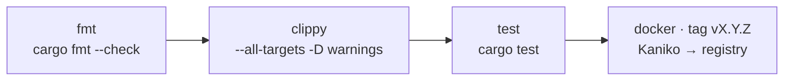

<h1 align="center">kraken-messaging-rs</h1>

<p align="center">
  The Rust counterpart of kraken-messaging: hub client, Kafka outbox and idempotent consumer, JWT identity, one builder.
</p>

<p align="center">
  <a href="https://gitlab.damoreira.ml/kraken-org/kraken-messaging-rs/-/pipelines"></a>
  <a href="https://gitlab.damoreira.ml/kraken-org/kraken-messaging-rs/-/releases"></a>
  
  
  
  <a href="https://gitlab.damoreira.ml/kraken-org/kraken/-/tree/main/docs"></a>
  <a href="LICENSE"></a>
</p>

---

The Rust counterpart of the Kotlin `kraken-messaging` starter. A service built on it is
indistinguishable from a Kotlin one in front of the hub and Kafka: same protocol
(`proto/hub.proto`), same `kraken.events` record format, same JSON shapes, same error codes, same
`outbox` and `processed_events` collections in MongoDB.

| Capability | Where |
|---|---|
| Register with the hub, handle commands and queries, reconnect with backoff | `hub::HubConnection`, `hub::Dispatcher` |
| Connect to every hub of a list or a DNS name, route and fail over between them | `hub::HubPool` |
| Send commands and queries, typed replies, timeouts, error mapping | `hub::Sender` (`app.commands()`, `app.queries()`) |
| Shared query types and scatter-gather queries | `shared_query`, `Sender::scatter_gather` (see [Scatter-gather](#scatter-gather)) |
| Streaming queries under the caller's credits | `streaming_query`, `Sender::stream` / `stream_owned` (see [Streaming queries](#streaming-queries)) |
| Subscription queries: an initial result, then updates pushed by every owner instance | `subscription_query`, `QueryUpdateEmitter`, `Sender::subscribe` (see [Subscription queries](#subscription-queries)) |
| Publish events through the Mongo outbox, relay to Kafka | `kafka::EventBus`, `kafka::OutboxPublisher` |
| Consume events idempotently (marker + handler in one transaction) | `kafka::EventConsumer` |
| Identity from the forwarded JWT: JWKS verification or unverified parsing; handler guards | `identity::{IdentityResolver, JwksVerifier, Guard}` |
| One builder wiring all of it from `KRAKEN_*` variables | `KrakenMessaging`, `Config` |

## Table of contents

- [Usage](#usage)
- [Configuration (`Config::from_env`)](#configuration-configfromenv)
- [Semantics worth knowing](#semantics-worth-knowing)
- [Multiple hubs](#multiple-hubs)
- [Scatter-gather](#scatter-gather)
- [Streaming queries](#streaming-queries)
- [Subscription queries](#subscription-queries)
- [Upgrading](#upgrading)
- [Build and test](#build-and-test)
- [Example](#example)
- [CI/CD pipeline](#cicd-pipeline)
- [Contributing](#contributing)
- [License](#license)

## Usage

```rust
use kraken_messaging::{Command, Config, Event, KrakenMessaging, MessagingError, Query, SendOptions, message_type};
use kraken_messaging::identity::Guard;

#[derive(serde::Serialize, serde::Deserialize)]
struct Shout { text: String }
#[derive(serde::Serialize, serde::Deserialize)]
struct Shouted { text: String }
message_type!(Shout, "examples.Shout");            // wire names are always explicit
impl Command for Shout { type Reply = Shouted; }

#[derive(serde::Serialize, serde::Deserialize)]
struct TextShouted { text: String, at: chrono::DateTime<chrono::Utc> }
message_type!(TextShouted, "examples.TextShouted");
impl Event for TextShouted {}

#[tokio::main]
async fn main() -> Result<(), MessagingError> {
    let builder = KrakenMessaging::builder(Config::from_env()?).await?;
    let events = builder.events();                                   // capture what handlers need
    let app = builder
        .command::<Shout, _, _>(move |cmd, ctx| {
            let events = events.clone();
            async move {
                let text = cmd.text.to_uppercase();
                events.publish(&TextShouted { text: text.clone(), at: chrono::Utc::now() }, Some(&cmd.text)).await?;
                tracing::info!(correlation = %ctx.correlation_id, "handled Shout");
                Ok(Shouted { text })
            }
        })
        .requires::<Shout>(Guard::role("kraken-user"))              // optional, like @RequiresAuthentication
        .start()                                                      // registers in the background
        .await?;
    app.await_hub(std::time::Duration::from_secs(30)).await;
    tokio::signal::ctrl_c().await.ok();
    app.shutdown().await;
    Ok(())
}
```

Handlers are async closures `Fn(Message, MessageContext) -> Future<Result<Reply, MessagingError>>`.
Event handlers receive an `EventContext { message, session }`: `session` is the Mongo session of the
consumer's transaction (`Arc<Mutex<ClientSession>>`), so writes done through it, including
`events.publish_in(&event, key, &mut session)`, commit together with the dedupe marker.

Sending: `app.commands().send_command(&cmd, SendOptions::default()).await?` and
`app.queries().send_query(&q, SendOptions { routing_key, timeout, ..Default::default() })`. Inside a handler
the caller's `correlationId` and bearer token are forwarded automatically (task-local
`MessageContext::current()`).

## Configuration (`Config::from_env`)

| Variable | Default | Meaning |
|---|---|---|
| `KRAKEN_SERVICE_NAME` | required | hub `service_name`, Kafka consumer group, event `source` |
| `KRAKEN_MONGODB_URI` | required | must name a database, e.g. `mongodb://mongodb:27017/service-c?replicaSet=rs0` |
| `KRAKEN_HUB_ADDRESS` | `static://kraken-hub:7000` | the hub's gRPC target (`static://` optional), a comma-separated list of them, or one `dns:///name:port` re-resolved every 30 s (see [Multiple hubs](#multiple-hubs)); one target is the single-hub setup |
| `KRAKEN_HUB_STATUS_INTERVAL_MS` | 5000 | how often `InstanceStatus` goes to every hub that shares `instance-status` (at least 1) |
| `KRAKEN_KAFKA_BOOTSTRAP` | `kafka:19092` | |
| `KRAKEN_KAFKA_TOPIC` | `kraken.events` | |
| `KRAKEN_JWKS_URL`, `KRAKEN_ISSUER` | unset | set both to verify forwarded tokens (RS256, `exp`, `iss`); unset = read signed tokens unverified, warned once |
| `KRAKEN_HUB_REQUEST_TIMEOUT_MS` | unset | default request timeout, sent as `timeout_ms` (`SendOptions.timeout` wins per call). Unset: a v2 hub gets `timeout_ms = 0` and applies its per-type override or its default (5 s); a legacy hub gets 5000 as before. `0` counts as unset (here and for `SendOptions.timeout`) |
| `KRAKEN_HEARTBEAT_INTERVAL_MS` | 10000 | fallback only: a v2 hub announces its interval (3 s by default) in `RegisterAck`; this value applies to legacy hubs |
| `KRAKEN_RECONNECT_BACKOFF_MIN_MS` / `_MAX_MS` | 500 / 5000 | exponential, each wait ±20 % jitter and never above the max (at the max: 80-100 % of it); back to the min once a connect reached the handshake |
| `KRAKEN_MAX_CONCURRENT_HANDLERS` | 256 | handlers run at once, at least 1 (`0` is rejected at startup, also when set in code: `Config::validate`); also the permits offered to a hub with flow control (`Register.initial_permits`), which queues further requests for this instance |
| `KRAKEN_HUB_LOAD_FACTOR` | 100 | `Register.load_factor`: relative capacity; weights this instance's share of keyed commands and its load score. A non-negative integer (a negative value is rejected at startup); `0` is sent as is and read as 100 by the hub |
| `KRAKEN_HUB_TAGS` | none | `Register.tags`, `k=v,k=v`: unkeyed requests prefer instances whose tags match more of the sender's tags |
| `KRAKEN_HUB_PRIORITIES` | none | default `Request.priority` per outgoing type, `type=n,type=n` (higher first while the target's queue at the hub is not empty); `SendOptions.priority` wins |
| `KRAKEN_HUB_RETRY_ENABLED` | false | caller-side retry of transient failures (see Retry): `true` sets `Config.hub_retry` to the policy the variables below describe, `false` leaves it `None` (no retry unless a call sets `SendOptions.retry`, which wins per call) |
| `KRAKEN_HUB_RETRY_MAX_ATTEMPTS` | 3 | attempts in total, the first included; at least 1 (`0` is rejected at startup, also while retry is disabled) |
| `KRAKEN_HUB_RETRY_INITIAL_BACKOFF_MS`, `_MULTIPLIER`, `_MAX_BACKOFF_MS` | 100, 2, 2000 | wait before the second attempt, growth factor (a finite number >= 1, else rejected at startup), cap of one wait; each wait is jittered by ±20 % and never above the cap (at the cap: 80-100 % of it), like the reconnect backoff |
| `KRAKEN_HUB_STREAM_CREDIT_TIMEOUT_MS` | 600000 | how long a streaming query handler waits for credit before it ends its stream with `TIMEOUT` "no credit within <d>" and releases its permits (see [Streaming queries](#streaming-queries)); the default is the hub's default `KRAKEN_HUB_MAX_STREAM_DURATION` (10 min); at least 1 (`0` is rejected at startup, also when set in code) |
| `KRAKEN_HUB_MAX_SUBSCRIPTIONS` | 1024 | the most subscription queries this instance serves at once (see [Subscription queries](#subscription-queries)): a subscription request beyond it is refused with `ReplyEnd{error = RESOURCE_EXHAUSTED}` `subscription limit (N) reached`, which the subscriber sees as `HandlerBusy`; subscriptions hold no handler permit, so this is their only bound here; the hub has its own per-instance limit (`KRAKEN_HUB_MAX_SUBSCRIPTIONS_PER_INSTANCE`, 1024); at least 1 (`0` is rejected at startup, also when set in code) |
| `KRAKEN_CONSUMER_ENABLED`, `KRAKEN_CONSUMER_MAX_ATTEMPTS` | true, 5 | consumer starts only when event handlers are registered |
| `KRAKEN_OUTBOX_ENABLED`, `KRAKEN_OUTBOX_POLL_INTERVAL_MS`, `KRAKEN_OUTBOX_BATCH_SIZE`, `KRAKEN_OUTBOX_MAX_ATTEMPTS` | true, 200, 100, 10 | |
| `KRAKEN_FORWARD_JWT` | true | |

## Semantics worth knowing

- **Errors** map exactly as `HubErrors.kt`: `NoHandler`, `Timeout`, `HandlerDisconnected`,
  `RemoteHandler`, `Unauthenticated`, `AccessDenied`, `InvalidMessage`, `HubUnavailable`,
  `HubConnectionLost`, `HandlerBusy`. `HandlerBusy` (hub code `RESOURCE_EXHAUSTED`): the hub's
  queue or session buffer for the target instance is full; the handler never saw the request. A hub only sends it to
  clients that declared flow control; others get `RemoteHandler` "handler busy" as before. `HubUnavailable`: the request was never written to a live hub stream (no
  stream, or the write failed), so a retry is safe. `HubConnectionLost`: the request was accepted by
  a stream's outbound queue and that stream broke before the answer, so the outcome is unknown (treat
  it like `Timeout`). An unknown code (including `UNSUPPORTED`, declared but not produced yet) reads
  as `RemoteHandler`. A handler's
  `Err` becomes `HANDLER_ERROR` unless it is `Unauthenticated`/`AccessDenied`/`InvalidMessage`; a panic
  becomes `HANDLER_ERROR "handler panicked"`, never a dropped stream.
- **Guards** run before the payload is decoded: anonymous → `UNAUTHENTICATED`, refused → `PERMISSION_DENIED`.
- **Unit replies** travel as `{}`; an `Option::None` reply stays `null`.
- **Consumer**: one record at a time; marker inserted first (a duplicate id never reaches the handler),
  handlers run, commit, then the offset. A failing or panicking handler is retried `max_attempts`
  times with 1 s backoff, then logged (type, id, topic-partition@offset, never the payload) and skipped.
  Records without `type`, with an unhandled type, or with a non-object payload are skipped.
- **Outbox**: `publish` inserts; the publisher relays in `createdAt, seq` order, stops the batch on a
  retriable failure, marks `failedAt` after 10 attempts, or at once for non-retriable failures (oversized record, invalid or
  unauthorized topic). Delivery budget per attempt is 30 s, as in the Kotlin producer. `userId` header is `""` when anonymous.
- **Mongo documents** use the Kotlin field names and BSON types; no `_class` field is written.
- **Mongo access**: `builder.client()` / `app.client()` and `database()` expose the crate's client; sessions passed to
  `events.publish_in` must come from it (the driver rejects sessions of another client).
- **Verified identity** checks signature, `exp`, `nbf` and `iss`; `aud` is not validated (Keycloak sets it, Spring's
  decoder ignores it too). A JWKS outage is `UNAUTHENTICATED` for the caller, never an internal error with a URL.
- **Shutdown** drains in-flight handlers (10 s bound), closes every hub stream, fails this instance's outgoing requests still in flight with `HubConnectionLost`, stops the publisher and the consumer.
- **Start** does not wait for the hub. `await_hub(timeout)` tells you when the registration was
  confirmed by at least one hub (requests can then be sent; before that they fail with
  `HubUnavailable`); `await_all_hubs(timeout)` waits until every hub confirmed it (with
  `dns:///`: every address of the latest resolution; a second target of a hub already reached does
  not count). `app.hub_ids()` lists the hubs registered on now. kraken-messaging (Kotlin) differs
  here: its `HubConnections.awaitRegistered` waits for every hub, like `await_all_hubs`.
- **Handshake** (hub protocol v2, ADR 0013): `Register` carries `protocol_version = 2`, the
  capabilities (`flow-control`, `instance-status`, `scatter-gather`, `streaming`, `subscription`) and `client_version = kraken-messaging-rs/<version>`. A v2 hub answers with a
  `RegisterAck` before it echoes the first heartbeat; the client then heartbeats at the announced
  interval (3 s; the hub evicts after 10 s) and sends `timeout_ms = 0` unless a timeout was chosen,
  guarding locally with the ack's per-type or maximum timeout plus 1 s. When the echo arrives without
  an ack the hub predates v2 and the client runs in legacy mode: configured heartbeat interval,
  `timeout_ms` = the chosen timeout or 5 s, guard = that plus 1 s. `HubConnection::handshake()`
  tells which (`Handshake::V2(ack)` / `Handshake::Legacy`).
- **Flow control** (capability `flow-control`, ADR 0014): `Register` declares the capability and
  offers `max_concurrent_handlers` permits, `load_factor` and `tags`. A hub whose ack shares the
  capability forwards only while this instance has permits and queues the rest (by priority, then
  age; queued requests keep their own deadline). Every finished request gives its permit back on
  the stream it arrived on. The hub still holds `initial − received + returned` of this stream's
  permits (offered, minus requests that arrived, plus permits written back); once that is at or
  below the low-water mark `min(16, initial / 2)` the pending grants go back at once (with one
  permit, every completion does), otherwise they are batched: one `Permits` message at 16 pending
  grants or 50 ms after the first unsent one. A hub without the capability (P0 or v1) gets no
  `Permits` and forwards without limit, as before.
- **SendOptions**: `routing_key`, `timeout`, `authorization`, `priority` (else
  `KRAKEN_HUB_PRIORITIES` for the type, else 0) and `retry` (else `Config.hub_retry`, from
  `KRAKEN_HUB_RETRY_*`). A `RetryPolicy` is in force as written: `RetryPolicy::default()` is 3
  attempts, 100 ms doubling to 2 s; `Some(RetryPolicy::NONE)` (one attempt) switches a configured
  policy off for one call. A policy with `max_attempts: 0` fails the call with `InvalidMessage`
  before anything is sent (`Config::validate` rejects it at startup).
- **Retry** (opt-in: no policy applies unless `Config.hub_retry` or `SendOptions.retry` sets
  one): `retry::is_retryable(kind, &error)` is the one classification (shared with
  the saga relay). Commands retry `HubUnavailable`, `NoHandler` and `HandlerBusy` (the handler never
  ran); queries also `HandlerDisconnected`, `Timeout` and `HubConnectionLost`. A command whose
  outcome is unknown is never retried; nothing else is retried. Each attempt has a fresh request id.
  All attempts share one budget: the caller's timeout, else the hub's bound for the type (override,
  else default; 5 s against a legacy hub). A retry starts only if, once its backoff is over, at
  least `max(initial_backoff, 250 ms)` of the budget is left; otherwise the last error is returned
  at once, without waiting. Each attempt sends what is left of the budget as `timeout_ms`, never
  less than 1 ms (a remainder never turns into "unset", which would let the hub apply its default).
- **Liveness**: a stream with no heartbeat echo for three intervals is dropped and reconnected; the
  channel also sends HTTP/2 keepalive pings every 10 s (5 s to answer, also while idle).
- **Replies** go back on the stream the request arrived on; when that stream is gone the reply is
  dropped, never sent on a newer one. The hub has already failed the request with
  `HANDLER_DISCONNECTED`, including when this instance reconnected with the same instance id while
  the old stream was still registered. A hub from before that fix leaves such a request to its
  `TIMEOUT` instead.

## Multiple hubs

High availability without hub-to-hub traffic ([ADR 0016](../kraken/docs/adr/0016-multi-hub-ha-without-hub-to-hub-traffic.md)):
every instance registers on every hub, and the client picks a hub per request.

- **Targets.** `KRAKEN_HUB_ADDRESS=static://hub:7000,hub-2:7000` lists the hubs (blanks and
  repeats of the same target are ignored). `KRAKEN_HUB_ADDRESS=dns:///kraken-hub:7000` connects to
  every address the name resolves to, as `ip:port`, of one family only: the IPv4 addresses when
  there is any, else the IPv6 ones (a dual-stack name lists each hub twice, and two streams of one
  instance on one hub replace each other). It is resolved at start and every 30 s: a new address gets a
  connection, a vanished one leaves the routing at once and gets an empty `Register` (that hub
  stops routing to this instance and hands its queue to other instances; replies to requests it
  already forwarded still go through), and is closed once idle (no request of ours written to it
  unanswered, no handler of its requests running; at most 65 s later). A
  failed or empty resolution keeps the current hubs. `dns:///` must be the only target and needs a
  port; its host may not contain `/`; `dns://server/...` is not supported. An address that names no hub fails `Config::validate`.
- **Connections.** One stream per hub, each with its own handshake, heartbeat, reconnect backoff
  and legacy detection, all with the identical `Register`. Two targets whose acks carry the same
  `hub_id` are one hub: the connection acknowledged first keeps it and the other is closed for
  good (logged once). The hub replaces a session when the same instance registers again, so the
  kept connection reconnects once, and the hub drops the instance until it is back (well under a
  second with the default backoff). A hub without an id (legacy v1, or an empty `hub_id` in the
  ack) is known by its target as `host:port`, the `static://` or `http(s)://` prefix stripped
  (`hub::target_id`, the same rule as kraken-messaging); a resolved address is `ip:port`.
- **Routing.** An unkeyed request goes round-robin over the hubs whose stream is acknowledged
  (reconnecting hubs are skipped). A request with a `routing_key` goes to the live hub with the
  highest rendezvous score, so a key keeps its hub while the hubs are stable and only the keys of a
  hub that leaves move (every hub's ring then picks the same instance):

  ```text
  score(hub_id, key) = fmix64(fnv1a64(utf8(hub_id) ++ [0x00] ++ utf8(key)))
  fnv1a64: h = 0xcbf29ce484222325; for each byte b: h = (h ^ b) * 0x100000001b3   (wrapping)
  fmix64:  k ^= k >> 33; k *= 0xff51afd7ed558ccd; k ^= k >> 33; k *= 0xc4ceb9fe1a85ec53; k ^= k >> 33
  ```

  `hub::rendezvous_score` implements it; test vectors: `("", "")` → `0xb9034ad37056f5fb`,
  `("hub-1", "order-42")` → `0x5c855509f5ad7c8d`, `("hub-2", "order-42")` → `0xd109ca177e04ae14`.
  The finalizer is there because plain FNV-1a sent 80 % of the keys `order-0` … `order-999` to one
  of three hubs.
- **Failover.** A request that could not be written to its hub's stream (the stream dropped
  before the client noticed) goes to the next hub in the same order with the same request id: it
  was never sent. So does one still waiting in the stream's outbound buffer (up to 256 messages)
  when the stream drops: the transport never took it, so it was never written (as in
  kraken-messaging). `HubUnavailable` means no hub took it. A request the transport had already
  taken fails with `HubConnectionLost` when its stream drops (outcome unknown: it may be on the
  wire); the retry policy then decides (queries are retried, commands are not). Replies go on the stream the request arrived on.
- **Permits.** A stream offers `ceil(max_concurrent_handlers / N)` permits, N being the hubs live
  when its `Register` is written, itself included (a hub still on its first connect attempt counts
  as live, so hubs that start together split from the start). When N shrinks from N_old to N_new
  (a hub is lost, its first attempt fails, it is closed as a duplicate or leaves DNS), every live
  stream gets one `Permits` top-up so that it holds `ceil(max / N_new)` in all: with 8 permits and
  two hubs each offers 4, and when one stops the survivor gets `Permits{count: 4, grant: 8}`; the
  grant raises the hub's permit cap on the session (otherwise its `initial_permits`) so the hub
  keeps the top-up (a hub that predates `Permits.grant` ignores it and clamps). A stream that already
  offered that many (it was topped up before, or opened while another hub was down) gets nothing,
  so flapping hubs never inflate the permits. A joining or returning hub offers `ceil(max / N)`
  afresh. Permits are never revoked when N grows; the local concurrency limit stays
  `max_concurrent_handlers` over all hubs, so a hub may briefly hold more permits than this
  instance runs at once, and the extra requests wait locally (same rule as kraken-messaging).
- **Status.** Every `KRAKEN_HUB_STATUS_INTERVAL_MS` the instance sends `InstanceStatus` to every
  hub whose ack lists `instance-status`: `connected_hub_ids` (the acknowledged hubs; a legacy hub
  has no id and is left out) and `handlers_in_flight` (handlers running over all hubs). A hub
  without the capability (P2 and older) never gets one. Each hub shows the report in its topology
  (`connectedHubIds`, `statusAgeMs`) and its dashboard flags instances missing a hub.
- **Logs** of each connection carry its `address` (and the `hub` id once acknowledged). The crate
  has no metrics of its own.

## Scatter-gather

Shared query types and scatter-gather queries ([ADR 0017](../kraken/docs/adr/0017-query-modes-and-shared-query-types.md)),
the counterpart of kraken-messaging's `scatterGather` and `@QueryHandler(shared = true)`.

```rust
use kraken_messaging::hub::{ScatterOptions, ScatterPart, ScatterResult};

// Handler side: several services may own Search. A per-target request has the id `<id>#<n>`
// and is served like any query.
let app = KrakenMessaging::builder(config).await?
    .shared_query::<Search, _, _>(|q, ctx| async move { Ok(Hits { .. }) })
    .start().await?;

// Sender side: every live instance of every owner answers.
let result: ScatterResult<Hits> = app.queries().scatter_gather(&Search { term }, ScatterOptions {
    timeout: Some(Duration::from_secs(2)), // the whole gather; else Config.hub_request_timeout, else the hub's
    max_results: 0,                        // end after this many successful parts (0: all targets)
    priority: None,                        // else KRAKEN_HUB_PRIORITIES for the type, else 0
}).await?;
for ScatterPart { service, instance, outcome } in result.parts { /* arrival order */ }
let (failed, timed_out) = (result.failed, result.timed_out);

// Or part by part, completing on the hub's ReplyEnd:
let mut parts = app.queries().scatter_gather_stream(&Search { term }, ScatterOptions::default());
while let Some(part) = parts.next().await { let part = part?; /* ... */ }
```

| API | Signature |
|---|---|
| Register a shared query | `KrakenMessagingBuilder::shared_query::<Q, F, Fut>(handler) -> Self` (also `HandlerRegistry::shared_query`) |
| Registered types | `HandlerRegistry::query_types()` (every query, exclusive and shared), `exclusive_query_types()`, `shared_query_types()`; `registered_types() -> RegisteredTypes { commands, queries (exclusive), shared_queries }` is what the `Register` announces |
| Gather | `Sender::scatter_gather<Q: Query>(&self, &Q, ScatterOptions) -> Result<ScatterResult<Q::Reply>, MessagingError>` |
| Stream | `Sender::scatter_gather_stream<Q: Query>(&self, &Q, ScatterOptions) -> impl Stream<Item = Result<ScatterPart<Q::Reply>, MessagingError>>` |
| Options | `ScatterOptions { timeout: Option<Duration>, max_results: u32, priority: Option<i32> }` (`Default`) |
| Result | `ScatterResult<R> { parts: Vec<ScatterPart<R>>, failed: u32, timed_out: u32 }` |
| Part | `ScatterPart<R> { service: String, instance: String, outcome: Result<R, RemoteError> }` |
| Part failure | `RemoteError { code: ErrorCode, message: String, details: Vec<u8> }`, `into_error(type)` gives the unary error |

- **Shared registration.** `shared_query` puts the type in `Register.shared_query_types` instead
  of `query_types`. Registering one type both as `query` and `shared_query` panics at startup.
  Exclusive vs shared must be consistent across **every** registrant of the type, in every
  service: the hub answers `ALREADY_EXISTS` at register time to the one that disagrees (the
  connection keeps retrying at the backoff cap, `last_rejection` says why). Switching a type
  between the two needs every registrant gone and the owner grace expired. Commands are never
  shared.
- **Point queries still work.** `send_query` on a shared type goes to one live instance of any
  owner (one round-robin pool over all owners at the hub).
- **Capability.** The client declares `scatter-gather`; a gather goes only to a hub whose
  `RegisterAck` lists it (`Handshake::scatter_gather`), checked again on the very stream it is
  written to (a hub re-handshaken without it in between is skipped, like one whose write fails).
  With none (a P3 or older hub, a legacy hub) it fails at once with
  `MessagingError::UnsupportedByHub`, nothing sent. An older hub also ignores
  `shared_query_types`: the type is simply not registered there (a point query to it is
  `NoHandler`).
- **Answers.** One part per target answer, in arrival order; a failed target is a part whose
  `outcome` is a `RemoteError` (the handler's error, or `HANDLER_DISCONNECTED`,
  `RESOURCE_EXHAUSTED` from the hub); a reply that does not decode is a failed part with code
  `UNSPECIFIED`. `failed` counts the failed parts, `timed_out` the targets without an answer at
  the deadline. Partial answers are answers: the call succeeds; check `failed + timed_out` for
  "all or error". Payloads use the unary reply codec (`()` accepts `{}`).
- **Errors before any target** are the unary ones: no live target `NoHandler`, a command type
  `InvalidMessage`, a hub `UNSUPPORTED` answer `UnsupportedByHub`.
- **Transport.** One gather goes to one hub (unkeyed round-robin over the capable ones). If its
  stream breaks before the end, the gather fails with `HubConnectionLost` (the parts received are
  dropped, none is retried on its own); one never written moves to the next hub like a unary
  request. The local guard (the hub's bound plus 1 s) covers the whole gather (`Timeout`).
  Parts and ends of unknown requests are ignored, and dropping the stream abandons the gather.
- **Retry.** `Config.hub_retry` applies to the whole gather for the same errors as a unary query
  (`HubUnavailable`, `NoHandler`, `HandlerBusy`, `HandlerDisconnected`, `Timeout`,
  `HubConnectionLost`): a retry is a new gather with a fresh id, collected from scratch, within the
  same budget. The stream retries only until its first part; after that an error ends it.

## Streaming queries

A query whose result is a flow of items from one instance of one owner, under the caller's
back-pressure ([ADR 0017, P4b](../kraken/docs/adr/0017-query-modes-and-shared-query-types.md)),
the counterpart of kraken-messaging's streaming query API.

```rust
use futures::StreamExt;
use kraken_messaging::{StreamOptions, StreamingQuery};

#[derive(serde::Serialize, serde::Deserialize)]
struct Export { since: chrono::DateTime<chrono::Utc> }
#[derive(serde::Serialize, serde::Deserialize)]
struct Row { id: String }
message_type!(Export, "files.Export");
impl StreamingQuery for Export { type Item = Row; }

// Handler side: return any `Stream<Item = Result<Row, MessagingError>>`; it is pulled at most
// one item ahead of the sender's credit. An `Err` item ends the stream with that error.
let app = KrakenMessaging::builder(config).await?
    .streaming_query::<Export, _, _, _>(|q, ctx| async move { Ok(rows_since(q.since)) })
    // .shared_streaming_query::<Search, _, _, _>(..)   // many services may own it
    .start().await?;

// Sender side: the open waits for the first item (or the end, or a failure); then pull.
let mut rows = app.queries().stream(&Export { since }, StreamOptions {
    timeout: None,         // idle timeout (hub-side, reset by every part); else Config.hub_request_timeout, else the hub's
    max_results: 0,        // end after this many items (the hub cancels the handler); 0: no limit
    priority: None,        // else KRAKEN_HUB_PRIORITIES for the type, else 0
    initial_credit: 64,    // the credit window; half of it is refilled every time half was consumed
}).await?;
while let Some(row) = rows.next().await { let row = row?; /* in the handler's order */ }

// `stream` borrows the sender: its stream cannot leave the scope of `app.queries()`. For an
// HTTP streaming body or a spawned task, `stream_owned` on the shared sender is `'static`.
let rows = app.sender().stream_owned(&Export { since }, StreamOptions::default()).await?;
tokio::spawn(async move { rows.try_for_each(|row| async { Ok(()) }).await });
```

| API | Signature |
|---|---|
| Trait | `trait StreamingQuery: MessageType + Serialize + DeserializeOwned + Send + Sync + 'static { type Item: Serialize + DeserializeOwned + Send + 'static; }` |
| Register a handler | `KrakenMessagingBuilder::streaming_query::<Q, F, Fut, S>(handler) -> Self` and `shared_streaming_query` (also on `HandlerRegistry`), with `F: Fn(Q, MessageContext) -> Fut`, `Fut: Future<Output = Result<S, MessagingError>>`, `S: Stream<Item = Result<Q::Item, MessagingError>> + Send + 'static` (a `BoxStream` fits) |
| Registered types | `HandlerRegistry::streaming_query_types()` (exclusive and shared); `registered_types() -> RegisteredTypes { commands, queries, shared_queries, streaming_queries }`: `streaming_queries` are the exclusive streaming types, announced in `Register.query_types` with `queries`; a shared streaming type is in `shared_queries` like any shared query (the hub does not tell a streaming type from a unary one: the mode is the sender's choice) |
| Stream | `Sender::stream<Q: StreamingQuery>(&self, &Q, StreamOptions) -> Result<BoxStream<'_, Result<Q::Item, MessagingError>>, MessagingError>` (`async`): the stream borrows the sender |
| Owned stream | `Sender::stream_owned<Q: StreamingQuery>(self: &Arc<Self>, &Q, StreamOptions) -> Result<BoxStream<'static, Result<Q::Item, MessagingError>>, MessagingError>` (`async`): the stream holds a clone of the `Arc<Sender>`, so it can be returned or moved into a task; `KrakenMessaging::sender()` (and the builder's `sender()`) is that `Arc`. Same behaviour otherwise |
| Options | `StreamOptions { timeout: Option<Duration>, max_results: u32, priority: Option<i32>, initial_credit: u32 }` (`Default`: `initial_credit` 64, `hub::DEFAULT_CREDIT`; 0 reads as 64) |
| Errors | `MessagingError::UnsupportedByHub`, `NoHandler`, `InvalidMessage`, `Timeout`, `RemoteHandler`, `HandlerDisconnected`, `HandlerBusy`, `Cancelled` (the hub's max stream duration), `HubUnavailable`, `HubConnectionLost`, `Serialization` |

- **Capability.** The client declares `streaming`, as sender and as handler. A stream goes only
  to a hub whose `RegisterAck` lists it (`Handshake::streaming`), checked again on the very
  stream it is written to; with none (a P4a or older hub, a legacy hub) `stream` fails at once
  with `UnsupportedByHub`, nothing sent. The hub streams only to an instance that negotiated
  `streaming` and lists the type: an owner whose instances run an older library is
  `UnsupportedByHub` too (the hub names the services). Unary queries and gathers are untouched.
- **One handler, one instance.** The hub picks one capable instance as for a point query (on a
  shared type, one pool over every owner). The handler gets `Request{id = <id>#1, mode =
  STREAMING, initial_credit}` and only a streaming handler serves it. A type has one handler,
  whatever its kind, and the mode must match it: a stream to a type whose handler is unary ends
  with `INVALID_REQUEST` ("`<type>` is not a streaming query handler (it answers mode UNARY)"),
  a unary query to a streaming type is answered `INVALID_REQUEST` ("`<type>` is a streaming
  query: send it with Sender::stream (mode STREAMING)"): the caller used the wrong mode, which no
  retry fixes (`InvalidMessage`, never retried), unlike `NoHandler` for a type the instance does
  not serve at all.
- **Credits.** The handler's stream is pulled at most one item ahead of the credit
  (`initial_credit` plus every `Flow`): an item is held until there is credit to send it, one
  `ReplyPart` per item (`seq` from 1); its end (or failure) is sent as `ReplyEnd` as soon as the
  stream reports it, with or without credit, so a sender that grants exactly as many credits as
  there are items gets the end. The sender refills `max(1, initial_credit / 2)` credits every
  time that many items were pulled by the caller (not on arrival), so a handler never runs more
  than a window (plus the held item) ahead of the consumer. Items use the unary reply codec
  (`()` accepts `{}`).
- **Borrow or share.** `stream` returns `BoxStream<'a>` borrowing the `&'a Sender`: the stream
  lives inside that borrow, so it cannot be returned from a handler that only borrowed the app
  (an HTTP streaming body) or moved into `tokio::spawn`. `stream_owned` takes `&Arc<Sender>` and
  returns `BoxStream<'static>` holding a clone of it: the sender outlives the stream, and the
  drop guard (`Cancel` on drop before the end) works the same.
- **Open.** `stream().await` returns once the first item is in (or the end: an empty stream), so
  everything before that is the call's error: `UnsupportedByHub`, `NoHandler` (no owner),
  `InvalidMessage` (a command type), `Timeout` (no first item within the idle timeout), the
  handler's error (`RemoteHandler`, ...), `HubUnavailable` / `HubConnectionLost`.
- **Endings.** The stream ends on the hub's `ReplyEnd`; with an error it is the last item, mapped
  like a unary error of that code: `Timeout` (the idle timeout, from the forward and reset by every
  part), `RemoteHandler` (the handler's `Err` item, or a part beyond the credit: `InvalidMessage`),
  `HandlerDisconnected` (the handler left), `Cancelled` (`KRAKEN_HUB_MAX_STREAM_DURATION`). A hub
  stream lost after the first item is `HubConnectionLost`, a part that does not decode
  `Serialization` (the handler is cancelled). The sender checks for lost parts (the hub drops a
  part it could not buffer within 5 s): `seq` must run 1, 2, 3, ... in arrival order and a clean
  `ReplyEnd.parts` must equal the parts that arrived; otherwise the last item is
  `InvalidMessage` "stream `<type>` lost N part(s)" (at a gap the handler is cancelled, reason
  `lost parts`; a part out of order is `InvalidMessage` too). After `max_results` items the hub ends the stream
  and cancels the handler. The local guard (for a hub that never answers; it cancels the stream,
  best effort) allows 2 x the hub's bound plus 1 s for the first part (the hub bounds a queue
  wait by the timeout and then restarts the idle clock at the forward) and the bound plus 1 s,
  reset by every part, after it.
- **Cancel.** Dropping the stream before its end sends `Cancel{id, "dropped by the sender"}`
  (best effort, from the drop) and forgets the request, also when the open is dropped while its
  write is still blocked. A handler whose stream is cancelled by the hub (the sender dropped it or
  left, `max_results`, the idle timeout, the hub's limits) has its stream dropped and sends
  nothing more; the hub's `Cancel` for a unary or scatter-gather target (a gather that ended
  early) aborts that handler too. When the hub stream a streaming request arrived on is lost,
  its handler is aborted as well (the hub forgot the stream with the session; it would wait for
  credit for ever), while a unary handler runs on with its reply dropped, as before. A handler
  that waits for credit longer than `Config.hub_stream_credit_timeout`
  (`KRAKEN_HUB_STREAM_CREDIT_TIMEOUT_MS`, 10 min: the hub's default maximum stream duration)
  ends its stream with `ReplyEnd{error = TIMEOUT "no credit within <d>"}`: a hub that forgot the
  stream (a race, a lost `Flow` or `Cancel`) cannot leak the handler task. The handler
  permit (`max_concurrent_handlers`, and the hub's) is held for the whole stream and released on
  every ending path.
- **Retry.** `Config.hub_retry` applies until the first item, for the same errors as a unary query
  (`HubUnavailable`, `NoHandler`, `HandlerBusy`, `HandlerDisconnected`, `Timeout`,
  `HubConnectionLost`): a retry is a new stream with a fresh id; a hub stream lost while the
  request still sat in its outbound buffer moves to the next capable hub with the same id, as a
  unary request. Every attempt sends the chosen idle timeout as is (it is an idle timeout, not a
  deadline: unlike a unary retry, an attempt does not send what is left of the budget); the
  budget only bounds how many attempts there are. Nothing is retried after the first item.
- **Compat.** Against a P3 / P4a hub `stream` fails with `UnsupportedByHub` (`tests/hub_compat.rs`);
  the P4b hub serves it (`tests/e2e_stream.rs`, image `kraken-hub:p4b-hub`, `KRAKEN_HUB_P4B_IMAGE`).

## Subscription queries

A query whose result is an initial value followed by the updates every owner instance pushes,
until the subscriber cancels or the owners complete ([ADR 0017, P4c](../kraken/docs/adr/0017-query-modes-and-shared-query-types.md)),
the counterpart of kraken-messaging's subscription query API.

```rust
use futures::StreamExt;
use kraken_messaging::{SubscriptionOptions, SubscriptionQuery};

#[derive(serde::Serialize, serde::Deserialize)]
struct Prices { symbol: String }
#[derive(serde::Serialize, serde::Deserialize)]
struct Quote { symbol: String, price: u32 }
#[derive(serde::Serialize, serde::Deserialize)]
struct Tick { symbol: String, price: u32 }
message_type!(Prices, "market.Prices");
impl SubscriptionQuery for Prices { type Initial = Quote; type Update = Tick; }

// Handler side: the handler answers the initial result; the updates are pushed through the
// emitter by whatever changes the data. Capture the emitter before `start()`.
let builder = KrakenMessaging::builder(config).await?;
let emitter = builder.emitter();
let app = builder
    .subscription_query::<Prices, _, _>(|q, ctx| async move { Ok(latest_quote(&q.symbol).await?) })
    // .shared_subscription_query::<Prices, _, _>(..)   // many services may own it
    .start().await?;

// ... wherever the data changes (after the commit of the write that changed it):
emitter.emit::<Prices>(|q| q.symbol == "ACME", &Tick { symbol: "ACME".into(), price: 101 });
emitter.complete::<Prices>(|q| q.symbol == "ACME");                       // a clean end
emitter.complete_exceptionally::<Prices>(|_| true, &MessagingError::Storage("feed down".into()));

// Sender side: `subscribe` returns once the initial result is in.
let sub = app.sender().subscribe(&Prices { symbol: "ACME".into() }, SubscriptionOptions {
    timeout: None,        // the initial result's timeout (queue wait + handler); else Config.hub_request_timeout, else the hub's
    max_results: 0,       // end after this many updates (the initial result does not count); 0: no limit
    priority: None,       // the initial request's; else KRAKEN_HUB_PRIORITIES for the type, else 0
    initial_credit: 64,   // the credit window; half of it is refilled every time half was consumed
}).await?;
println!("{}", sub.initial.price);
let mut updates = sub.updates;                      // hot: fed by the hub from the open on
while let Some(update) = updates.next().await { let tick = update?; /* in the hub's arrival order */ }
// `sub.cancel()` (or dropping the subscription, or just its `updates`) cancels it at the hub.
```

| API | Signature |
|---|---|
| Trait | `trait SubscriptionQuery: MessageType + Serialize + DeserializeOwned + Send + Sync + 'static { type Initial: Serialize + DeserializeOwned + Send + 'static; type Update: Serialize + DeserializeOwned + Send + 'static; }` |
| Register a handler | `KrakenMessagingBuilder::subscription_query::<Q, F, Fut>(handler) -> Self` and `shared_subscription_query` (also on `HandlerRegistry`), with `F: Fn(Q, MessageContext) -> Fut`, `Fut: Future<Output = Result<Q::Initial, MessagingError>>`: the handler answers the initial result |
| Registered types | `HandlerRegistry::subscription_query_types()` (exclusive and shared); `registered_types()` has `subscription_queries`, the exclusive ones, announced in `Register.query_types` with `queries`; a shared subscription type is in `shared_queries` like any shared query |
| Emitter | `QueryUpdateEmitter` (`Clone`): `emit<Q: SubscriptionQuery>(&self, filter: impl Fn(&Q) -> bool, update: &Q::Update)`, `complete<Q>(&self, filter)`, `complete_exceptionally<Q>(&self, filter, error: &MessagingError)`. From `KrakenMessagingBuilder::emitter()` (to capture in handlers and in the code that changes the data) or `KrakenMessaging::emitter()`; also `open_subscriptions()` |
| Subscribe | `Sender::subscribe<Q: SubscriptionQuery>(self: &Arc<Self>, &Q, SubscriptionOptions) -> Result<Subscription<Q>, MessagingError>` (`async`): owned, like `stream_owned` (`app.sender()` is the `Arc`); there is no borrowed variant |
| Result | `Subscription<Q> { initial: Q::Initial, updates: BoxStream<'static, Result<Q::Update, MessagingError>> }` with `cancel(self)` |
| Options | `SubscriptionOptions { timeout: Option<Duration>, max_results: u32, priority: Option<i32>, initial_credit: u32 }` (`Default`: `initial_credit` 64, `hub::DEFAULT_CREDIT`; 0 reads as 64; retry: `Config.hub_retry`) |
| Handler limit | `Config.hub_max_subscriptions` (`KRAKEN_HUB_MAX_SUBSCRIPTIONS`, 1024; `Dispatcher::max_subscriptions` when wired by hand) |
| Errors | `MessagingError::UnsupportedByHub`, `NoHandler`, `InvalidMessage`, `Timeout`, `RemoteHandler`, `HandlerDisconnected`, `HandlerBusy`, `Cancelled` (the hub's max duration), `HubUnavailable`, `HubConnectionLost`, `Serialization` |

- **Capability.** The client declares `subscription`, as sender and as handler. A subscription
  goes only to a hub whose `RegisterAck` lists it (`Handshake::subscription`), checked again on
  the very stream it is written to; with none (a P4b or older hub, a legacy hub) `subscribe`
  fails at once with `UnsupportedByHub`, nothing sent. The hub subscribes only instances that
  negotiated `subscription` and list the type: an owner whose instances run an older library
  is `UnsupportedByHub` too (the hub names the services). Unary queries, gathers and streams
  are untouched (`tests/hub_compat.rs` runs `kraken-hub:p4b-hub`).
- **Who is asked.** The hub asks every live instance of every owner (exclusive or shared type)
  that lists the type and negotiated `subscription`, **as they are at the open**: an instance
  registering later is not added and one that leaves is not replaced. Updates are delivered
  **at most once** and neither the hub nor this library resubscribes: after a rolling restart a
  subscription listens to fewer instances than serve the type (an update emitted on a new
  instance is lost), and the subscriber only learns of it when the last instance left
  (`HandlerDisconnected`). A subscriber that needs every instance subscribes again.
- **Initial result and updates.** One capable instance, chosen as for a point query, also gets
  `Request{id = <id>#0, mode = UNARY}`: the registered handler answers it like a unary query
  (it holds a handler permit and is bounded by the timeout). Every capable instance gets
  `Request{id = <id>#n, mode = SUBSCRIPTION}`, which registers a subscription on it (the decoded
  query, the request id and the arrival stream; no handler runs, no permit is held here or at
  the hub). The sender gets the initial result as `ReplyPart{seq = 1}` and then the updates as
  `ReplyPart{seq = 2, 3, ...}` in the hub's arrival order (the hub renumbers: per-source order
  is kept, there is no order between sources). A unary query to a subscription type (an id
  without the `#0` suffix) is answered `INVALID_REQUEST` ("`<type>` is a subscription query:
  send it with Sender::subscribe"), a subscription request to a type whose handler is unary or
  streaming ends with `INVALID_REQUEST` ("`<type>` is not a subscription query handler (it
  answers mode ...)"): the caller used the wrong mode, which no retry fixes.
- **Emitting.** `emit` sends one `ReplyPart` (the update serialized with the crate's codec,
  `seq` from 1 per subscription) to every open subscription of `Q` on this instance whose query
  passes the filter, in call order; `complete` a clean `ReplyEnd` and removes it;
  `complete_exceptionally` a `ReplyEnd{HANDLER_ERROR, message}` and removes it. No matching
  subscription: a no-op. A call never waits for the hub stream (one task per subscription
  writes in order). A clean end removes the instance silently at the hub; the last instance's
  clean end completes the subscription for the subscriber. An error end from any instance ends
  the whole subscription with that error (`RemoteHandler`) and cancels the others.
  **There are no transactions to defer to here** (the Kotlin library emits after the commit of
  the surrounding Spring transaction automatically): a handler that writes in a Mongo
  transaction must emit after its commit, or subscribers see an update of a write that may roll
  back.
- **Credits and the hub's buffer.** The credit is `initial_credit` plus every `Flow`; the
  initial result takes one, every update one. Updates beyond it wait at the hub, up to
  `KRAKEN_HUB_SUBSCRIPTION_BUFFER` (256) per subscription; one more ends the subscription with
  `ReplyEnd{RESOURCE_EXHAUSTED}`, which `updates` yields as its last item `HandlerBusy` (the
  hub's message, "subscriber buffer (256) exceeded", is logged at debug: the variant carries
  the type). Nothing is relayed to the owners: updates are pushed, and a consumer that falls
  further behind than the buffer resubscribes and gets a fresh initial result. The sender
  refills `max(1, initial_credit / 2)` credits every time that many parts were consumed; the
  initial result counts as consumed (it took a credit, so a window of 1 does not stall).
- **Open.** `subscribe().await` returns once the initial result is in, so everything before
  that is the call's error: `UnsupportedByHub`, `NoHandler` (no owner), `InvalidMessage` (a
  command type, or a handler of another mode), `Timeout` (no initial result within the
  timeout), the handler's error (`RemoteHandler`, ...), `HandlerBusy` (an instance at its
  subscription limit or a full queue), `HubUnavailable` / `HubConnectionLost`. An owner instance
  at its limit refuses its subscription with `ReplyEnd{RESOURCE_EXHAUSTED}` and the hub ends the
  whole subscription with it (the error is the call's, or comes right after the initial
  result). The hub itself refuses a subscription whose target already serves
  `KRAKEN_HUB_MAX_SUBSCRIPTIONS_PER_INSTANCE` (1024), before anything is sent.
- **Endings.** `updates` ends when the last owner instance completed cleanly or `max_results`
  updates were relayed (the hub then cancels the owners); an error is its last item, mapped like
  a unary error of that code: `RemoteHandler` (an owner's `complete_exceptionally`),
  `HandlerDisconnected` (the last owner left), `HandlerBusy` (the buffer), `Cancelled`
  (`KRAKEN_HUB_MAX_SUBSCRIPTION_DURATION`, off by default), `HubConnectionLost` (the hub stream
  was lost), `Serialization` (an update that does not decode; the subscription is cancelled).
  There is no idle timeout and no local guard on updates: a quiet subscription is not a broken
  one. The only local guard is on the initial result (the hub's bound plus 1 s, as for a
  unary request).
- **Lost parts.** As for a stream, `seq` must run 1, 2, 3, ... in arrival order and a clean
  `ReplyEnd.parts` must equal the parts that arrived (the hub's count includes the initial
  result); otherwise the last item is `InvalidMessage` "subscription `<type>` lost N part(s)" and
  the subscription is cancelled at the hub (reason `lost parts`).
- **Cancel.** `Subscription::cancel`, dropping the `Subscription` or dropping its `updates`
  before the end sends `Cancel{id, "dropped by the sender"}` (best effort, from the drop) and
  forgets the request: the hub cancels every owner instance, which removes the subscription.
  The owners also drop a subscription on a hub `Cancel` (the subscriber left, `max_results`, the
  buffer, the hub's limits) and every subscription that arrived on a hub stream that was lost
  (the hub forgot it with the session). A shutdown (`KrakenMessaging::shutdown`) completes the
  subscriptions served here with a clean `ReplyEnd`, best effort and bounded to 2 s.
- **Retry.** `Config.hub_retry` applies until the initial result, for the same errors as a unary
  query (`HubUnavailable`, `NoHandler`, `HandlerBusy`, `HandlerDisconnected`, `Timeout`,
  `HubConnectionLost`): a retry is a new subscription with a fresh id; the timeout bounds the
  initial request like a unary one, so each attempt sends what is left of the call's budget. A
  hub stream lost while the request still sat in its outbound buffer moves to the next capable
  hub with the same id. Nothing is retried once the initial result is in.
- **Limits.** `Config.hub_max_subscriptions` bounds the subscriptions one instance serves (a
  subscription holds no permit: `max_concurrent_handlers` does not apply to it); beyond it a new
  request is refused with `ReplyEnd{RESOURCE_EXHAUSTED}` `subscription limit (N) reached`. The
  hub's buffer, per-instance limit and maximum duration are its own settings.
- **Compat.** Against a P4b or older hub `subscribe` fails with `UnsupportedByHub`
  (`tests/hub_compat.rs`); the P4c hub serves it (`tests/e2e_subscription.rs`, image
  `kraken-hub:p4c-hub`, `KRAKEN_HUB_P4C_IMAGE`).

## Upgrading

What changes for a service moving to this version (P4c, then P4b):

- **`Config.hub_max_subscriptions`** (`KRAKEN_HUB_MAX_SUBSCRIPTIONS`, default 1024, at least 1)
  is new. Code that builds `Config` as a struct literal needs the field (`Config::new` sets the
  default). `RegisteredTypes` gained `subscription_queries` too, for code that builds one as a
  struct literal (`..RegisteredTypes::default()` keeps compiling).
- **The `subscription` capability** is declared in every `Register`
  (`hub::CAPABILITIES`): a P4c hub then subscribes this instance to the subscription queries it
  lists, which only a `subscription_query` handler serves. Nothing changes for a service that
  registers none. A subscription type has one handler, like any type
  (`subscription_query` and `query` on the same type panic at startup).
- **Updates are at most once and the instances are fixed at the open**: see
  [Subscription queries](#subscription-queries); the library never resubscribes.
- **Handlers are aborted by a hub `Cancel`.** A unary command or query handler, and a
  scatter-gather target, used to run to completion whatever happened; now any hub `Cancel` for
  the request drops the handler's future (`AbortOnDrop`), as a streaming handler's stream is
  dropped. The P4b hub sends one to a gather target whose gather ended early (`max_results`,
  the deadline, the sender disconnected); a plain unary request is not cancelled by the hub
  today, but the library honours a `Cancel` for it all the same. Nothing more is sent for the
  request and the permits go back. A handler
  whose work must finish once started (a critical section that is not safe to abandon half-way,
  for example a write followed by a publish outside one transaction) should `tokio::spawn` that
  section and await the join handle: the spawned task is not aborted with the handler.
- **`Config.hub_stream_credit_timeout`** (`KRAKEN_HUB_STREAM_CREDIT_TIMEOUT_MS`, default 10
  minutes, at least 1 ms) is new: a streaming handler that waits for credit longer than that
  ends its stream with `ReplyEnd{error = TIMEOUT "no credit within <d>"}` and releases its
  permits; `Dispatcher::stream_credit_timeout` sets it when the dispatcher is wired by hand.
  Code that builds `Config` as a struct literal needs the field (`Config::new` sets the default).
- **Lost parts are an error.** A streaming query checks `seq` (1, 2, 3, ... in arrival order)
  and a clean `ReplyEnd.parts` against the parts that arrived: a mismatch ends the stream with
  `MessagingError::InvalidMessage("stream <type> lost N part(s)")` (at a gap the handler is
  cancelled). Before, a part the hub dropped went unnoticed and the stream ended clean.
- **`Sender::stream_owned`** and **`KrakenMessaging::sender()`** are new: `stream` still returns
  a stream that borrows the sender; `stream_owned` (on the `Arc<Sender>` that `app.sender()` or
  the builder's `sender()` gives) returns a `'static` stream for an HTTP streaming body or a
  spawned task. See [Streaming queries](#streaming-queries).

## Build and test

```bash
brew install cmake protobuf          # librdkafka is built from source; protoc for the proto
cargo build
cargo test                            # unit tests + integration tests (Docker required for the latter)
```

Integration tests start Kafka (`apache/kafka`), MongoDB (replica set) and `kraken-hub:dev` with
testcontainers. The hub image is built from the sibling repo: `docker build -t kraken-hub:dev .` in
`../kraken-hub` (override with `KRAKEN_HUB_IMAGE`). `tests/hub_compat.rs` also runs against the
previous hub releases: `kraken-hub:p0` (protocol v2 without flow control, override with
`KRAKEN_HUB_P0_IMAGE`), `kraken-hub:p2` (flow control without `instance-status`, override with
`KRAKEN_HUB_P2_IMAGE`) and `kraken-hub:v1-baseline` (override with `KRAKEN_HUB_BASELINE_IMAGE`), to
prove the client behaves as before against them. `tests/e2e_multi_hub.rs` and the P3 compat test
run two or one `kraken-hub:p3-hub` (override with `KRAKEN_HUB_P3_IMAGE`); `tests/e2e_stream.rs` and the P4a compat test run `kraken-hub:p4b-hub` and
`kraken-hub:p4a-hub` (`KRAKEN_HUB_P4B_IMAGE`, `KRAKEN_HUB_P4A_IMAGE`) and `tests/e2e_subscription.rs`
two `kraken-hub:p4c-hub` (`KRAKEN_HUB_P4C_IMAGE`); `tests/hub_pool.rs` runs
the multi-hub rules against in-process fake hubs. Without Docker the integration tests print a notice and skip; with Docker but no hub
image they fail with the build command. On Rancher Desktop export
`DOCKER_HOST=unix://$HOME/.rd/docker.sock` first. A unit test and `scripts/check-proto-sync.sh` (CI
job `proto-sync`) check that `proto/hub.proto` is byte-identical to `../kraken/protocol/hub.proto`
whenever the umbrella checkout exists.

## Example

`examples/service-c` is a complete service: it handles `Shout` and `Reverse`, publishes
events, consumes `GreetingDelivered`, and runs in the sandbox compose next to the Kotlin examples.


## CI/CD pipeline

Defined in [`.gitlab-ci.yml`](.gitlab-ci.yml); runs on every push and merge request on a Rust image
with `protobuf-compiler` installed.



| Stage | Job | Runs | Produces |
|---|---|---|---|
| fmt | `fmt` | always | formatting check |
| clippy | `clippy` | always | lint with warnings as errors |
| test | `test` | always | unit and in-process integration tests |
| docker | `docker` | only on tags `vX.Y.Z` | `registry.gitlab.damoreira.ml/kraken-org/kraken-messaging-rs:vX.Y.Z` and `:latest` |

The crate is consumed as a git dependency pinned to a tag, so the image job mainly proves the Dockerfile; the sandbox compose builds `examples/service-c` from source.

## Contributing

Branches `feat/<topic>`, `fix/<topic>`, `chore/<topic>` off `main`, merged by merge request with a
green pipeline; conventional commit messages. Design changes go to the umbrella repo first.
Conventions: [`../kraken/docs/04-repositories.md`](../kraken/docs/04-repositories.md).

## License

[MIT](LICENSE) © 2026 Guilherme D'Amoreira.
