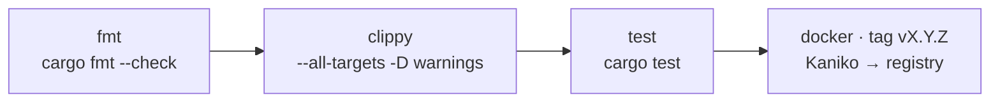

<h1 align="center">kraken-messaging-rs</h1>

<p align="center">
  The Rust counterpart of kraken-messaging: hub client, Kafka outbox and idempotent consumer, JWT identity, one builder.
</p>

<p align="center">
  <a href="https://gitlab.damoreira.ml/kraken-org/kraken-messaging-rs/-/pipelines"></a>
  <a href="https://gitlab.damoreira.ml/kraken-org/kraken-messaging-rs/-/releases"></a>
  
  
  
  <a href="https://gitlab.damoreira.ml/kraken-org/kraken/-/tree/main/docs"></a>
  <a href="LICENSE"></a>
</p>

---

The Rust counterpart of the Kotlin `kraken-messaging` starter. A service built on it is
indistinguishable from a Kotlin one in front of the hub and Kafka: same protocol
(`proto/hub.proto`), same `kraken.events` record format, same JSON shapes, same error codes, same
`outbox` and `processed_events` collections in MongoDB.

| Capability | Where |
|---|---|
| Register with the hub, handle commands and queries, reconnect with backoff | `hub::HubConnection`, `hub::Dispatcher` |
| Send commands and queries, typed replies, timeouts, error mapping | `hub::Sender` (`app.commands()`, `app.queries()`) |
| Publish events through the Mongo outbox, relay to Kafka | `kafka::EventBus`, `kafka::OutboxPublisher` |
| Consume events idempotently (marker + handler in one transaction) | `kafka::EventConsumer` |
| Identity from the forwarded JWT: JWKS verification or unverified parsing; handler guards | `identity::{IdentityResolver, JwksVerifier, Guard}` |
| One builder wiring all of it from `KRAKEN_*` variables | `KrakenMessaging`, `Config` |

## Table of contents

- [Usage](#usage)
- [Configuration (`Config::from_env`)](#configuration-configfromenv)
- [Semantics worth knowing](#semantics-worth-knowing)
- [Build and test](#build-and-test)
- [Example](#example)
- [CI/CD pipeline](#cicd-pipeline)
- [Contributing](#contributing)
- [License](#license)

## Usage

```rust
use kraken_messaging::{Command, Config, Event, KrakenMessaging, MessagingError, Query, SendOptions, message_type};
use kraken_messaging::identity::Guard;

#[derive(serde::Serialize, serde::Deserialize)]
struct Shout { text: String }
#[derive(serde::Serialize, serde::Deserialize)]
struct Shouted { text: String }
message_type!(Shout, "examples.Shout");            // wire names are always explicit
impl Command for Shout { type Reply = Shouted; }

#[derive(serde::Serialize, serde::Deserialize)]
struct TextShouted { text: String, at: chrono::DateTime<chrono::Utc> }
message_type!(TextShouted, "examples.TextShouted");
impl Event for TextShouted {}

#[tokio::main]
async fn main() -> Result<(), MessagingError> {
    let builder = KrakenMessaging::builder(Config::from_env()?).await?;
    let events = builder.events();                                   // capture what handlers need
    let app = builder
        .command::<Shout, _, _>(move |cmd, ctx| {
            let events = events.clone();
            async move {
                let text = cmd.text.to_uppercase();
                events.publish(&TextShouted { text: text.clone(), at: chrono::Utc::now() }, Some(&cmd.text)).await?;
                tracing::info!(correlation = %ctx.correlation_id, "handled Shout");
                Ok(Shouted { text })
            }
        })
        .requires::<Shout>(Guard::role("kraken-user"))              // optional, like @RequiresAuthentication
        .start()                                                      // registers in the background
        .await?;
    app.await_hub(std::time::Duration::from_secs(30)).await;
    tokio::signal::ctrl_c().await.ok();
    app.shutdown().await;
    Ok(())
}
```

Handlers are async closures `Fn(Message, MessageContext) -> Future<Result<Reply, MessagingError>>`.
Event handlers receive an `EventContext { message, session }`: `session` is the Mongo session of the
consumer's transaction (`Arc<Mutex<ClientSession>>`), so writes done through it, including
`events.publish_in(&event, key, &mut session)`, commit together with the dedupe marker.

Sending: `app.commands().send_command(&cmd, SendOptions::default()).await?` and
`app.queries().send_query(&q, SendOptions { routing_key, timeout, authorization })`. Inside a handler
the caller's `correlationId` and bearer token are forwarded automatically (task-local
`MessageContext::current()`).

## Configuration (`Config::from_env`)

| Variable | Default | Meaning |
|---|---|---|
| `KRAKEN_SERVICE_NAME` | required | hub `service_name`, Kafka consumer group, event `source` |
| `KRAKEN_MONGODB_URI` | required | must name a database, e.g. `mongodb://mongodb:27017/service-c?replicaSet=rs0` |
| `KRAKEN_HUB_ADDRESS` | `static://kraken-hub:7000` | gRPC target (`static://` optional) |
| `KRAKEN_KAFKA_BOOTSTRAP` | `kafka:19092` | |
| `KRAKEN_KAFKA_TOPIC` | `kraken.events` | |
| `KRAKEN_JWKS_URL`, `KRAKEN_ISSUER` | unset | set both to verify forwarded tokens (RS256, `exp`, `iss`); unset = read signed tokens unverified, warned once |
| `KRAKEN_HUB_REQUEST_TIMEOUT_MS` | unset | default request timeout, sent as `timeout_ms` (`SendOptions.timeout` wins per call). Unset: a v2 hub gets `timeout_ms = 0` and applies its per-type override or its default (5 s); a legacy hub gets 5000 as before. `0` counts as unset (here and for `SendOptions.timeout`) |
| `KRAKEN_HEARTBEAT_INTERVAL_MS` | 10000 | fallback only: a v2 hub announces its interval (3 s by default) in `RegisterAck`; this value applies to legacy hubs |
| `KRAKEN_RECONNECT_BACKOFF_MIN_MS` / `_MAX_MS` | 500 / 5000 | exponential, each wait ±20 % jitter and never above the max (at the max: 80-100 % of it); back to the min once a connect reached the handshake |
| `KRAKEN_MAX_CONCURRENT_HANDLERS` | 256 | handlers run at once; also the permits offered to a hub with flow control (`Register.initial_permits`), which queues further requests for this instance |
| `KRAKEN_HUB_LOAD_FACTOR` | 100 | `Register.load_factor`: relative capacity; weights this instance's share of keyed commands and its load score |
| `KRAKEN_HUB_TAGS` | none | `Register.tags`, `k=v,k=v`: unkeyed requests prefer instances whose tags match more of the sender's tags |
| `KRAKEN_HUB_PRIORITIES` | none | default `Request.priority` per outgoing type, `type=n,type=n` (higher first while the target's queue at the hub is not empty); `SendOptions.priority` wins |
| `KRAKEN_HUB_RETRY_ENABLED` | false | caller-side retry of transient failures (see Retry); `SendOptions.retry` wins per call |
| `KRAKEN_HUB_RETRY_MAX_ATTEMPTS` | 3 | attempts in total, the first included |
| `KRAKEN_HUB_RETRY_INITIAL_BACKOFF_MS`, `_MULTIPLIER`, `_MAX_BACKOFF_MS` | 100, 2, 2000 | wait before the second attempt, growth factor (>= 1), cap of one wait; each wait is jittered by ±20 % and never above the cap (at the cap: 80-100 % of it), like the reconnect backoff |
| `KRAKEN_CONSUMER_ENABLED`, `KRAKEN_CONSUMER_MAX_ATTEMPTS` | true, 5 | consumer starts only when event handlers are registered |
| `KRAKEN_OUTBOX_ENABLED`, `KRAKEN_OUTBOX_POLL_INTERVAL_MS`, `KRAKEN_OUTBOX_BATCH_SIZE`, `KRAKEN_OUTBOX_MAX_ATTEMPTS` | true, 200, 100, 10 | |
| `KRAKEN_FORWARD_JWT` | true | |

## Semantics worth knowing

- **Errors** map exactly as `HubErrors.kt`: `NoHandler`, `Timeout`, `HandlerDisconnected`,
  `RemoteHandler`, `Unauthenticated`, `AccessDenied`, `InvalidMessage`, `HubUnavailable`,
  `HubConnectionLost`, `HandlerBusy`. `HandlerBusy` (hub code `RESOURCE_EXHAUSTED`): the target
  instance's queue at the hub is full; the handler never saw the request. A hub only sends it to
  clients that declared flow control; others get `RemoteHandler` "handler busy" as before. `HubUnavailable`: the request was never written to a live hub stream (no
  stream, or the write failed), so a retry is safe. `HubConnectionLost`: the request was accepted by
  a stream's outbound queue and that stream broke before the answer, so the outcome is unknown (treat
  it like `Timeout`). An unknown code (including `UNSUPPORTED`, declared but not produced yet) reads
  as `RemoteHandler`. A handler's
  `Err` becomes `HANDLER_ERROR` unless it is `Unauthenticated`/`AccessDenied`/`InvalidMessage`; a panic
  becomes `HANDLER_ERROR "handler panicked"`, never a dropped stream.
- **Guards** run before the payload is decoded: anonymous → `UNAUTHENTICATED`, refused → `PERMISSION_DENIED`.
- **Unit replies** travel as `{}`; an `Option::None` reply stays `null`.
- **Consumer**: one record at a time; marker inserted first (a duplicate id never reaches the handler),
  handlers run, commit, then the offset. A failing or panicking handler is retried `max_attempts`
  times with 1 s backoff, then logged (type, id, topic-partition@offset, never the payload) and skipped.
  Records without `type`, with an unhandled type, or with a non-object payload are skipped.
- **Outbox**: `publish` inserts; the publisher relays in `createdAt, seq` order, stops the batch on a
  retriable failure, marks `failedAt` after 10 attempts, or at once for non-retriable failures (oversized record, invalid or
  unauthorized topic). Delivery budget per attempt is 30 s, as in the Kotlin producer. `userId` header is `""` when anonymous.
- **Mongo documents** use the Kotlin field names and BSON types; no `_class` field is written.
- **Mongo access**: `builder.client()` / `app.client()` and `database()` expose the crate's client; sessions passed to
  `events.publish_in` must come from it (the driver rejects sessions of another client).
- **Verified identity** checks signature, `exp`, `nbf` and `iss`; `aud` is not validated (Keycloak sets it, Spring's
  decoder ignores it too). A JWKS outage is `UNAUTHENTICATED` for the caller, never an internal error with a URL.
- **Shutdown** drains in-flight handlers (10 s bound), closes the hub stream, fails this instance's outgoing requests still in flight with `HubConnectionLost`, stops the publisher and the consumer.
- **Start** does not wait for the hub. `await_hub(timeout)` tells you when the registration was
  confirmed; sends before that fail with `HubUnavailable`.
- **Handshake** (hub protocol v2, ADR 0013): `Register` carries `protocol_version = 2`, the
  capabilities (`flow-control`) and `client_version = kraken-messaging-rs/<version>`. A v2 hub answers with a
  `RegisterAck` before it echoes the first heartbeat; the client then heartbeats at the announced
  interval (3 s; the hub evicts after 10 s) and sends `timeout_ms = 0` unless a timeout was chosen,
  guarding locally with the ack's per-type or maximum timeout plus 1 s. When the echo arrives without
  an ack the hub predates v2 and the client runs in legacy mode: configured heartbeat interval,
  `timeout_ms` = the chosen timeout or 5 s, guard = that plus 1 s. `HubConnection::handshake()`
  tells which (`Handshake::V2(ack)` / `Handshake::Legacy`).
- **Flow control** (capability `flow-control`, ADR 0014): `Register` declares the capability and
  offers `max_concurrent_handlers` permits, `load_factor` and `tags`. A hub whose ack shares the
  capability forwards only while this instance has permits and queues the rest (by priority, then
  age; queued requests keep their own deadline). Every finished request gives its permit back on
  the stream it arrived on. The hub still holds `initial − received + returned` of this stream's
  permits (offered, minus requests that arrived, plus permits written back); once that is at or
  below the low-water mark `min(16, initial / 2)` the pending grants go back at once (with one
  permit, every completion does), otherwise they are batched: one `Permits` message at 16 pending
  grants or 50 ms after the first unsent one. A hub without the capability (P0 or v1) gets no
  `Permits` and forwards without limit, as before.
- **SendOptions**: `routing_key`, `timeout`, `authorization`, `priority` (else
  `KRAKEN_HUB_PRIORITIES` for the type, else 0) and `retry` (else `KRAKEN_HUB_RETRY_*`;
  `RetryPolicy::disabled()` switches it off for one call).
- **Retry** (opt-in): `retry::is_retryable(kind, &error)` is the one classification (shared with
  the saga relay). Commands retry `HubUnavailable`, `NoHandler` and `HandlerBusy` (the handler never
  ran); queries also `HandlerDisconnected`, `Timeout` and `HubConnectionLost`. A command whose
  outcome is unknown is never retried; nothing else is retried. Each attempt has a fresh request id.
  All attempts share one budget: the caller's timeout, else the hub's bound for the type (override,
  else default; 5 s against a legacy hub). A retry starts only if, once its backoff is over, at
  least `max(initial_backoff, 250 ms)` of the budget is left; otherwise the last error is returned
  at once, without waiting. Each attempt sends what is left of the budget as `timeout_ms`, never
  less than 1 ms (a remainder never turns into "unset", which would let the hub apply its default).
- **Liveness**: a stream with no heartbeat echo for three intervals is dropped and reconnected; the
  channel also sends HTTP/2 keepalive pings every 10 s (5 s to answer, also while idle).
- **Replies** go back on the stream the request arrived on; when that stream is gone the reply is
  dropped, never sent on a newer one. The hub has already failed the request with
  `HANDLER_DISCONNECTED`, including when this instance reconnected with the same instance id while
  the old stream was still registered. A hub from before that fix leaves such a request to its
  `TIMEOUT` instead.

## Build and test

```bash
brew install cmake protobuf          # librdkafka is built from source; protoc for the proto
cargo build
cargo test                            # unit tests + integration tests (Docker required for the latter)
```

Integration tests start Kafka (`apache/kafka`), MongoDB (replica set) and `kraken-hub:dev` with
testcontainers. The hub image is built from the sibling repo: `docker build -t kraken-hub:dev .` in
`../kraken-hub` (override with `KRAKEN_HUB_IMAGE`). `tests/hub_compat.rs` also runs against the
previous hub releases: `kraken-hub:p0` (protocol v2 without flow control, override with
`KRAKEN_HUB_P0_IMAGE`) and `kraken-hub:v1-baseline` (override with `KRAKEN_HUB_BASELINE_IMAGE`), to
prove the client behaves as before against both. Without Docker the integration tests print a notice and skip; with Docker but no hub
image they fail with the build command. On Rancher Desktop export
`DOCKER_HOST=unix://$HOME/.rd/docker.sock` first. A unit test and `scripts/check-proto-sync.sh` (CI
job `proto-sync`) check that `proto/hub.proto` is byte-identical to `../kraken/protocol/hub.proto`
whenever the umbrella checkout exists.

## Example

`examples/service-c` is a complete service: it handles `Shout` and `Reverse`, publishes
events, consumes `GreetingDelivered`, and runs in the sandbox compose next to the Kotlin examples.


## CI/CD pipeline

Defined in [`.gitlab-ci.yml`](.gitlab-ci.yml); runs on every push and merge request on a Rust image
with `protobuf-compiler` installed.



| Stage | Job | Runs | Produces |
|---|---|---|---|
| fmt | `fmt` | always | formatting check |
| clippy | `clippy` | always | lint with warnings as errors |
| test | `test` | always | unit and in-process integration tests |
| docker | `docker` | only on tags `vX.Y.Z` | `registry.gitlab.damoreira.ml/kraken-org/kraken-messaging-rs:vX.Y.Z` and `:latest` |

The crate is consumed as a git dependency pinned to a tag, so the image job mainly proves the Dockerfile; the sandbox compose builds `examples/service-c` from source.

## Contributing

Branches `feat/<topic>`, `fix/<topic>`, `chore/<topic>` off `main`, merged by merge request with a
green pipeline; conventional commit messages. Design changes go to the umbrella repo first.
Conventions: [`../kraken/docs/04-repositories.md`](../kraken/docs/04-repositories.md).

## License

[MIT](LICENSE) © 2026 Guilherme D'Amoreira.
